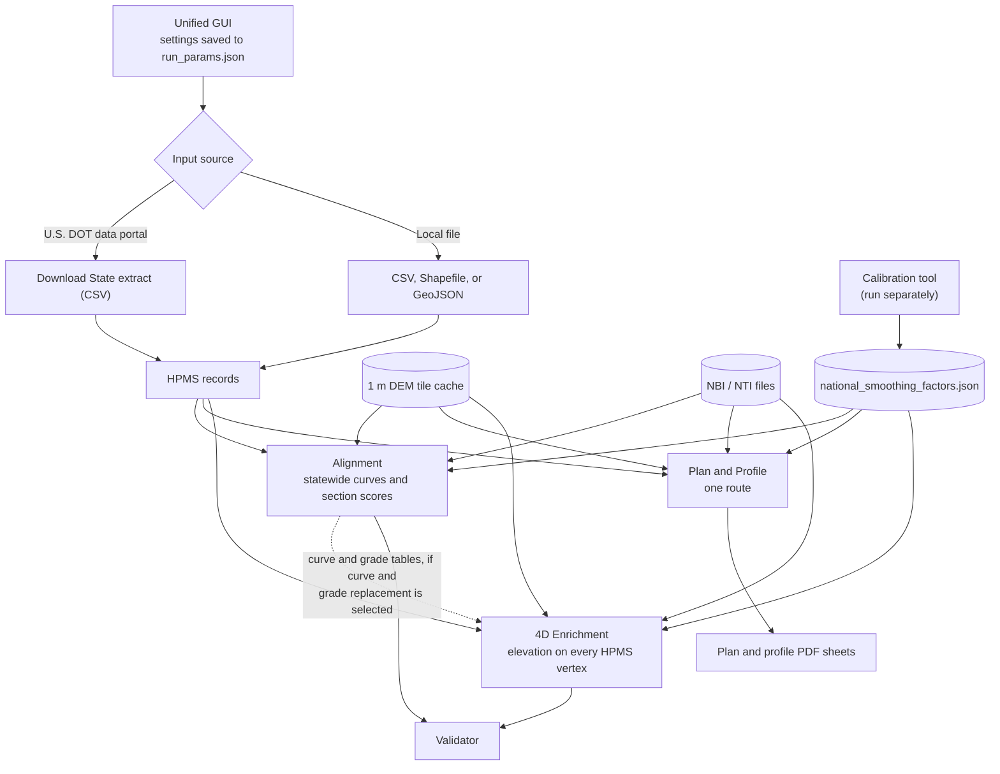

# HPMS Roadway Alignment Tool (RAT) Suite, Version 3.3
## Technical Manual

*Federal Highway Administration, Office of Highway Policy Information*
*October 29, 2026*

---

## Notice

**Notice**

The United States Government does not endorse products or manufacturers. Trade and manufacturers' names appear in this report only because they are considered essential to the object of the document.

**Quality Assurance Statement**

The Federal Highway Administration (FHWA) provides high-quality information to serve Government, industry, and the public in a manner that promotes public understanding. Standards and policies are used to ensure and maximize the quality, objectivity, utility, and integrity of its information. FHWA periodically reviews quality issues and adjusts its programs and processes to ensure continuous quality improvement.

**Non-Binding Contents**

Except for the statutes and regulations cited, the contents of this document do not have the force and effect of law and are not meant to bind the States or the public in any way. This document is intended only to provide information regarding existing requirements under the law or agency policies.

**Software Disclaimer**

This document and the software it describes were developed by the Federal Highway Administration (FHWA), an agency of the U.S. Department of Transportation (U.S. DOT). The software is dedicated to the public domain under the CC0 1.0 Universal license.

The U.S. Government makes no warranty, express or implied, including warranties of merchantability and fitness for a particular purpose, or assumes any legal liability or responsibility for the accuracy, completeness, or usefulness of any information, apparatus, product, or process disclosed.

The use of this tool does not constitute a federal mandate, regulation, or formal engineering directive. Any reliance placed on the software's outputs is at the user's own risk.


---

## Contents

- Chapter 1: Introduction
  - 1.1 Background and Purpose
  - 1.2 What the Suite Produces
  - 1.3 The Documentation Set
  - 1.4 Data Basis
  - 1.5 Units and Reference Points
  - 1.6 How a Route Is Processed
  - 1.7 Guide to the Chapters
- Chapter 2: Model Structure and Data
  - 2.1 Processing Flow
  - 2.2 HPMS Route Geometry
  - 2.3 Route Continuity Chunks
  - 2.4 Coordinate Systems
  - 2.5 Elevation Data
  - 2.6 Bridge and Tunnel Inventories
  - 2.7 Parallel Processing
- Chapter 3: Geometry Preparation and Smoothing
  - 3.1 Why the Geometry Must Be Smoothed
  - 3.2 Densification
  - 3.3 The Smoothing Spline
  - 3.4 Smoothing the Horizontal Line and the Profile
  - 3.5 Smoothing Factors
  - 3.6 Checking the Smoothing
- Chapter 4: Horizontal Alignment
  - 4.1 Heading and Curvature
  - 4.2 Labeling Tangents and Curves
  - 4.3 From Labeled Runs to Curves
  - 4.4 Curve Measurements and Classes
  - 4.5 Compound and Reverse Curves
  - 4.6 Assigning Reference Points
  - 4.7 Curves at the Ends of Split Pieces
- Chapter 5: Vertical Profile
  - 5.1 Elevation Sampling
  - 5.2 Bridges and Tunnels
  - 5.3 Smoothing the Profile
  - 5.4 Grade and Rate of Change of Grade
  - 5.5 Vertical Curves
  - 5.6 Vertical Curve Classes
  - 5.7 Grade Segments
  - 5.8 Available Sight Distance
  - 5.9 Roughness Proxy
- Chapter 6: Cross Sections and Measured Superelevation
  - 6.1 Cutting a Section
  - 6.2 HPMS Attributes Used
  - 6.3 Fitting the Travel Lanes
  - 6.4 Finding the Roadway Centerline
  - 6.5 Pavement Edges
  - 6.6 Opposing Roadway
  - 6.7 Foreslopes
  - 6.8 Measured Superelevation
  - 6.9 Stations
  - 6.10 HPMS Line off the Roadway
- Chapter 7: Crossings
  - 7.1 Network Crossings in the Alignment Tool
  - 7.2 Nearby Lines in the Plan and Profile Tool
- Chapter 8: 4D Enrichment
  - 8.1 Building the Route Profiles
  - 8.2 Placing the HPMS Vertices
  - 8.3 Records That Cannot Be Smoothed
  - 8.4 Replacing the HPMS Curve and Grade Fields
  - 8.5 Outputs
- Chapter 9: Calibration
  - 9.1 What the Calibration Looks For
  - 9.2 Sample Size
  - 9.3 Stability Search
  - 9.4 Fidelity Limit
  - 9.5 Repeats and Final Values
  - 9.6 The National Vertical Factor
  - 9.7 Route Cross-Check in the Plan and Profile Tool
- Chapter 10: Outputs
  - 10.1 File Names
  - 10.2 Curve and Grade Segment Tables
  - 10.3 Vertex Table
  - 10.4 Section Scores
  - 10.5 Route Ordering Audit
  - 10.6 Bridge and Tunnel Spans
  - 10.7 Maps
  - 10.8 Statewide Dashboard
  - 10.9 Plan and Profile Outputs
  - 10.10 Plan and Profile Sheets
  - 10.11 4D Enrichment Outputs
  - 10.12 Logs and Reports
- Chapter 11: Validation and Known Limitations
  - Part A: Validation
  - Part B: Known Limitations
- Appendix A: Derivations
  - A.1 Smoothing Factor and RMS Departure
  - A.2 Degree of Curve
  - A.3 The Parabolic Vertical Curve
  - A.4 Stopping Sight Distance on Vertical Curves
  - A.5 The Viterbi Labeling
  - A.6 Sample Size
- Appendix B: Default Parameters
- Appendix C: National Horizontal Smoothing Factors
- Appendix D: Output Columns
  - D.1 Horizontal Curve Table
  - D.2 Vertical Curve Table
  - D.3 Grade Segment Table
  - D.4 Vertex Table
  - D.5 Section Scores (Alignment)
  - D.6 Bridge and Tunnel Spans
  - D.7 Cross-Section Stations (Plan and Profile)
  - D.8 Nearby Lines (Plan and Profile)
  - D.9 Crossings GeoPackage (Alignment)
  - D.10 Route Ordering Audit (Alignment)
  - D.11 4D Output
  - D.12 Calibration Audit
- Appendix E: File Structure
- Appendix F: Glossary
- Appendix G: References

## List of Tables

- Table 1-1. Classes used by RAT
- Table 1-2. RAT Suite tools
- Table 1-3. Shared modules
- Table 1-4. Helper scripts
- Table 1-5. Outputs by tool
- Table 2-1. HPMS fields used by RAT
- Table 3-1. RMS departure of the smoothed line by smoothing factor
- Table 3-2. National default horizontal smoothing factors
- Table 3-3. Source of the smoothing factors in a run
- Table 5-1. Stopping sight distance on level roadway (AASHTO Green Book, Table 3-1)
- Table 5-2. Vertical curve classes
- Table 9-1. Smoothing factors tested (`VITERBI_S_GRID`)
- Table 9-2. Vertical curves per mile by vertical smoothing factor
- Table 11-1. Validator checks
- Table B-1. Processing parameters
- Table B-2. Fixed values
- Table B-3. Cross-section values (`core/rat_cross_section.py`)
- Table B-4. Calibration settings (`tools/rat_national_calibration.py`)
- Table C-1. Horizontal smoothing factors by State and functional class

## List of Figures

- Figure 2-1. Processing flow

---

## Acronyms and Abbreviations

| Abbreviation | Meaning |
| :--- | :--- |
| 3DEP | 3D Elevation Program (USGS) |
| AASHTO | American Association of State Highway and Transportation Officials |
| ARNOLD | All Road Network of Linear Referenced Data |
| CC0 | Creative Commons Zero (public domain dedication) |
| CS | Curve-to-spiral point |
| DEM | Digital elevation model |
| DOT | Department of Transportation |
| EPSG | European Petroleum Survey Group (coordinate system codes) |
| FHWA | Federal Highway Administration |
| FIPS | Federal Information Processing Standards (State codes) |
| FS | Functional system |
| GIS | Geographic information system |
| GUI | Graphical user interface |
| HMM | Hidden Markov model |
| HPMS | Highway Performance Monitoring System |
| IRI | International Roughness Index |
| MP | Milepost |
| NBI | National Bridge Inventory |
| NC | Normal crown |
| NTI | National Tunnel Inventory |
| PVC | Point of vertical curvature |
| PVT | Point of vertical tangency |
| RAT | Roadway Alignment Tool |
| RMS | Root mean square |
| RMSE | Root mean square error |
| RP | Reference point |
| SC | Spiral-to-curve point |
| SSD | Stopping sight distance |
| USGS | U.S. Geological Survey |
| UTM | Universal Transverse Mercator |
| VPI | Vertical point of intersection |
| WGS 84 | World Geodetic System 1984 |
| WKT | Well-known text |

---

## Chapter 1: Introduction

### 1.1 Background and Purpose

The Highway Performance Monitoring System (HPMS) is a national database, maintained by the Federal Highway Administration (FHWA), of the extent, condition, performance, use, and operating characteristics of the Nation's highways. States submit their HPMS data to FHWA each year.

Some HPMS data items, including length, lane-miles, and travel, are required for every public road eligible for Federal-aid highway funds. These are the Full Extent data items, and these three are used in the apportionment of Federal-aid highway funds.

Other items are reported only for the Sample Panel, a randomly selected sample of roadway sections in each State's public road system, which provides more detailed statistical data. A third set, the Summary data items, is reported in aggregate for rural minor collectors and for local roads in any area.

Horizontal curves and grades affect crash risk, operating speeds, truck performance, and the design of improvements. The design policy of the American Association of State Highway and Transportation Officials (AASHTO) sets limits on curve radius, grade, and vertical curve length, and safety analyses under the Highway Safety Manual use curve and grade data for individual road segments. For most public roads, however, this information is not held in any inventory. It is usually collected for a single project during design.

HPMS asks States to report the horizontal curves and vertical grades on their Sample Panel sections: Curve Classification (Item 43, `CURVES_A` through `CURVES_F`) and Grade Classification (Item 45, `GRADES_A` through `GRADES_F`). These items apply to paved samples on urban functional classes 1 through 3 and rural functional classes 1 through 4, in the inventory direction. The State divides each sample into its curves and tangents, or into its grades between vertical points of intersection, and reports the total length in each of six classes, A through F. Curve classes are set by degree of curvature and grade classes by percent grade. The class lengths must add up to the length of the sample (HPMS Field Manual, 2021 draft). Not every State keeps this information in a form that is easy to report. Getting it from design plans or field surveys takes a lot of time and money, so these fields are often under reported or estimated.

The Roadway Alignment Tool (RAT) Suite was developed to help States report their curve and grade data to FHWA. It derives them from two national sources that FHWA already has: the HPMS route geometry, which States submit through their All Road Network of Linear Referenced Data (ARNOLD), and the bare-earth digital elevation models (DEMs) of the U.S. Geological Survey (USGS) 3D Elevation Program (3DEP). The main model in the suite is the alignment model. It finds every horizontal and vertical curve on the roads it processes, measures each one, and classes it. It also divides the vertical profile into grade segments and gives each segment its percent grade.

RAT reports results curve by curve and segment by segment rather than as class totals for each section, because the individual curves are more useful to most analysts. The class totals in the HPMS format are available as an option in the 4D enrichment output (Section 1.2).

RAT uses three A-to-F scales. On every scale, A is the mildest class and F the most severe (Table 1-1).

**Table 1-1. Classes used by RAT**

| Class | Horizontal curves: degree of curve (HPMS Item 43) | Grade segments: percent grade (HPMS Item 45) | Vertical curves: design speed supported (AASHTO) |
| :---: | :--- | :--- | :--- |
| A | under 3.5 | under 0.5 | 70 mph or more |
| B | 3.5 to 5.4 | 0.5 to 2.4 | 60 or 65 mph |
| C | 5.5 to 8.4 | 2.5 to 4.4 | 50 or 55 mph |
| D | 8.5 to 13.9 | 4.5 to 6.4 | 40 or 45 mph |
| E | 14.0 to 27.9 | 6.5 to 8.4 | 30 or 35 mph |
| F | 28.0 or more | 8.5 or more | 25 mph or less |

Horizontal curve and grade classes follow the HPMS definitions, so RAT values can be compared with the values States report. Vertical curves have no HPMS class. RAT classes them by the highest design speed whose stopping sight distance the curve provides (Chapter 5). Design speeds are taken from the AASHTO stopping sight distance table in 5 mph steps, so every vertical curve falls in one class. Table 5-2 gives the sight distance range of each class.

The other tools in the suite use the same processing for different purposes. The plan and profile tool produces engineering-style sheets and detailed tables for a single route. The 4D enrichment tool returns a State's HPMS line work with an elevation assigned to each vertex, so the State can use the data in geographic information system (GIS) and 3D software.

RAT results are estimates derived from mapped geometry and a bare-earth elevation model. They are not design data, survey data, or a substitute for engineering judgment. The disclaimer that comes with the suite (`DISCLAIMER.md`) describes the limits on their use.

### 1.2 What the Suite Produces

The suite has four processing tools, a calibration tool, and a validator. A graphical user interface (GUI), the Unified GUI, sets up and runs the processing tools. Table 1-2 lists them.

**Table 1-2. RAT Suite tools**

| Tool | Script | Scope | Main purpose |
| :--- | :--- | :--- | :--- |
| Unified GUI | `apps/rat_unified_gui.py` | Any | Collects settings and runs the other tools in order |
| Alignment | `apps/rat_alignment_cli.py` | One State or all States | Finds and classifies every horizontal and vertical curve and every grade segment |
| Plan and Profile | `apps/rat_plan_profile_cli.py`, `apps/rat_plan_profile_report_pdf.py` | One route, optionally between two reference points | Detailed tables, cross sections, and engineering-style sheets |
| 4D Enrichment | `apps/hpms_4d_enricher_cli.py` | One State or all States | HPMS line work with elevation (Z) and reference point (M) on every vertex |
| Calibration | `tools/rat_national_calibration.py` | One State or All States | Sets the horizontal smoothing factor for each State and functional class |
| Validator | `tools/rat_results_validator.py` | Output files | Checks the output files for missing fields and impossible values |

The tools in Table 1-2 rely on the shared modules in Table 1-3. These hold the processing that two or more tools use, so each method is written once. Most of the methods described in this manual are in `core/rat_core.py`.

**Table 1-3. Shared modules**

| Module | Used by | Purpose | Section |
| :--- | :--- | :--- | :--- |
| `core/rat_core.py` | All tools | Data loading, continuity chunks, DEM tiles, smoothing, bridge and tunnel repair, curve and grade detection, sight distance, smoothing factors | Chapters 2 to 5 |
| `core/rat_cross_section.py` | Plan and Profile, 4D Enrichment | Cross sections, measured superelevation, nearby lines, over/under labels; DEM sampling for the 4D fallback | Chapters 6, 7, 8 |
| `core/rat_structure_report.py` | Alignment, Plan and Profile | Bridge and tunnel span list and span report PDF | 10.6 |
| `core/rat_dem_relief.py` | Plan and Profile PDF, span report | Shaded relief from the cached DEM tiles | 10.6, 10.10 |
| `core/rat_param_summary.py` | Alignment, Plan and Profile | Run-parameter panels on the maps and dashboards and the PDF cover page | 10.7, 10.10 |
| `core/national_smoothing_factors.json` | All tools | Horizontal smoothing factors by State and functional class | 3.5, Appendix C |

Table 1-4 lists the helper scripts. The scripts in `tools/` are run by hand, from the suite folder, after editing the CONFIGURATION block at the top of each. The two batch files are for Windows.

**Table 1-4. Helper scripts**

| Script | Used with | Purpose | Section |
| :--- | :--- | :--- | :--- |
| `tools/pull_national_curve_distribution.py` | Calibration | HPMS curve class shares used to size the calibration samples; run once per HPMS release | 9.2 |
| `tools/rat_calibration_diagnostics.py` | Calibration | Charts and checks of the calibration audit table | 9.5 |
| `tools/rat_structure_span_check.py` | Plan and Profile | Runs the bridge and tunnel detection again on existing plan and profile vertex tables, to try other settings without downloading data | 5.2 |
| `Run_RAT_Suite.bat` | Unified GUI | Starts the Unified GUI | |
| `NBI/download_nbi.bat` | All tools | Downloads the NBI and NTI files into the `NBI` folder | 2.6 |

The alignment and plan and profile tools share most of their processing, so they have several outputs in common. Other outputs come from only one tool. Table 1-5 shows which tool writes which output. Chapter 10 describes each output, and Appendix D lists every column.

**Table 1-5. Outputs by tool**

| Output | Alignment | Plan and Profile | 4D Enrichment |
| :--- | :---: | :---: | :---: |
| Horizontal curve table (CSV) | Yes | Yes | |
| Vertical curve table (CSV) | Yes | Yes | |
| Grade segment table (CSV) | Yes | Yes | |
| Vertex table: smoothed position, elevation, grade, classes, structure labels, sight distance, roughness proxy (CSV) | Yes | Yes | |
| Bridge and tunnel span list (CSV, optional) | Yes | Yes | |
| Section scores: the curve class and grade class covering most of each HPMS section (CSV) | Yes | | |
| Route ordering audit (CSV) | Yes | | |
| Curves and grade segments as lines (GeoJSON or GeoPackage, optional) | Yes | | |
| Vertices as points (GeoPackage, optional) | Yes | | |
| Crossings between routes (GeoPackage, optional) | Yes | | |
| Curve map, grade map, and crossing map (HTML) | Yes | | |
| Statewide summary dashboard (HTML) | Yes | | |
| Run parameters (JSON) | | Yes | |
| Corridor analytics dashboard (HTML) | | Yes | |
| Calibration cross-check for the route (HTML) | | Yes | |
| Cross-section station table and ground profiles (CSV) | | Yes | |
| Nearby HPMS lines (CSV) | | Yes | |
| Bridge and tunnel span report (PDF, optional) | | Yes | |
| Plan and profile sheets (PDF, optional) | | Yes | |
| HPMS records with 3D/4D line geometry (CSV with `WKT_ZM`) | | | Yes |
| HPMS records with 3D line geometry (GeoPackage, optional) | | | Yes |
| HPMS records projected to UTM (Shapefile, optional, for 3D software such as Blender) | | | Yes |

The UTM Shapefile is written only by the 4D enrichment tool. Its coordinates are in meters in the local Universal Transverse Mercator (UTM) zone rather than in longitude and latitude. That lets 3D software such as Blender show the road network with true horizontal and vertical scale, which is a simple way to show people what the elevation data looks like.

The 4D enrichment tool can also replace the HPMS curve and grade fields (`CURVES_A` through `CURVES_F`, `GRADES_A` through `GRADES_F`) with values from an alignment run. It splits each section's length among the classes using the alignment run's horizontal curve table and grade segment table, so the class lengths add up to the section length, as HPMS requires. The validator writes a text report (`qa_validation_report_<state>_<date>_v<n>.txt`) beside the files it checked. The GUI saves everything shown in its Run Log to `Run_Log_<state>_<date>_v<n>.txt`. The calibration tool writes the national smoothing factor file (`core/national_smoothing_factors.json`), an audit table of every sample it ran, and a run log.

### 1.3 The Documentation Set

The suite comes with the following documents:

- **README.** Installation, a quick start, and a summary of what changed in version 3.3.
- **Technical Manual** (this document). How each model works and the equations it uses.
- **User Manual** (`docs/RAT_Suite_v3_3_User_Manual.md`). How to run the suite and read its outputs.
- **Roadmap.** Planned work.
- **DISCLAIMER and LICENSE.** The limits on use of the results, and the public domain dedication (CC0 1.0) that covers the software.

### 1.4 Data Basis

RAT uses three sources of data. Chapter 2 describes each one.

1. **HPMS route geometry.** The State's HPMS records with their line geometry, downloaded from the U.S. Department of Transportation (U.S. DOT) data portal or read from a local file. Each record carries all HPMS data items including a route identifier, begin and end reference points, functional system, facility type, and structure type.
2. **USGS 3DEP elevation.** Bare-earth elevation from the 3DEP elevation service, requested at a grid spacing of about 1 meter.
3. **National Bridge Inventory (NBI) and National Tunnel Inventory (NTI).** Point locations of bridges and tunnels. These are optional. RAT finds bridges and tunnels in the elevation data on its own and uses these inventories only to label them.

### 1.5 Units and Reference Points

All geometry is computed in meters on a UTM projection. Results are reported in U.S. customary units: feet, miles, percent grade, and degrees of curve per 100 feet. The conversion used throughout is

$$
1\ \text{m} = 3.28084\ \text{ft} \qquad \text{(1.1)}
$$

$$
1\ \text{mi} = 1{,}609.344\ \text{m} \qquad \text{(1.2)}
$$

Both conversions come from the international foot, which is defined as exactly 0.3048 meter. A mile of 5,280 feet is therefore exactly 1,609.344 meters. One meter is 1/0.3048 = 3.2808399 feet, which RAT rounds to 3.28084; the rounding changes a length by less than 0.0002 foot per mile.

Unless an equation says otherwise, lengths in this manual are in meters.

HPMS locates each record along its route by a begin point and an end point. These are reference points (RPs): measured positions along the route in miles from the route's origin. They are not necessarily the mileposts posted along the road. The scripts and their output columns use the terms "milepost" and "MP" (for example `Milepost`, `Start_MP`, `Calibrated_Start_MP`). The column names are kept as they are in the code, but this manual calls these values reference points.

A value marked "default", such as `H_MIN_CURVE_LENGTH_FT` (default 100 feet), is a setting the user can change. Those marked "GUI" in Table B-1 are changed in the Unified GUI (main window or Advanced Settings), and the others in the DEFAULTS or CONFIGURATION block of the script named in Tables B-1 and B-4. Values given without "default" are set in the code and are not meant to be changed (Tables B-2 and B-3).

### 1.6 How a Route Is Processed

The alignment tool processes a State one route at a time. For each route it:

1. Loads the route's HPMS records and joins them into continuous pieces, called continuity chunks (Chapter 2).
2. Projects each chunk to UTM and adds points along it at an even spacing (default 5 feet; Chapter 3).
3. Fits a smoothing spline to the horizontal line (Chapter 3).
4. Reads the ground elevation under each point from the 1-meter DEM (Chapter 2).
5. Finds bridge and tunnel spans in the elevation profile and replaces each one with a straight line between its ends (Chapter 5).
6. Fits a smoothing spline to the repaired profile (Chapters 3 and 5).
7. Finds horizontal curves from the curvature of the smoothed line and vertical curves from the rate of change of grade on the smoothed profile, then measures and classifies each curve (Chapters 4 and 5).
8. Divides the profile into grade segments at the vertical points of intersection (VPIs) of the vertical curves, and classes each segment by its grade (Chapter 5).
9. Converts each curve's and segment's position from distance along the chunk to HPMS reference points (Chapter 4).
10. Writes the curve tables, the grade segment table, the vertex table, and the section scores (Chapter 10).

After all routes are done, the tool looks for places where two routes cross and labels each crossing as 'at grade' or 'grade separated' (Chapter 7).

The plan and profile tool follows the same steps for a single route and then adds cross sections, measured superelevation, and over/under labels for other HPMS lines near the route (Chapters 6 and 7). The 4D enrichment tool follows steps 1 through 6 and then assigns the smoothed elevation to each vertex of the original HPMS records (Chapter 8).

### 1.7 Guide to the Chapters

- **Chapter 2, Model Structure and Data**, describes the overall flow, the input data, how HPMS records are joined into continuous pieces, and how elevation data is obtained.
- **Chapter 3, Geometry Preparation and Smoothing**, covers point spacing, the smoothing spline, and the smoothing factors.
- **Chapter 4, Horizontal Alignment**, covers curvature, curve detection and classification, curve measurements, and the assignment of reference points.
- **Chapter 5, Vertical Profile**, covers elevation sampling, bridge and tunnel repair, vertical curves and their design speed classes, grade segments, sight distance, and the roughness proxy.
- **Chapter 6, Cross Sections and Measured Superelevation**, covers the plan and profile tool's cross sections.
- **Chapter 7, Crossings**, covers the network crossing map and the over/under labels.
- **Chapter 8, 4D Enrichment**, covers how elevation is assigned to the original HPMS vertices.
- **Chapter 9, Calibration**, covers how the horizontal smoothing factors were set and how the national vertical factor was chosen.
- **Chapter 10, Outputs**, describes each output file.
- **Chapter 11, Validation and Known Limitations**, describes the validator's checks and, separately, the known limits of the methods.
- **Appendices** give derivations, default parameters, the national horizontal smoothing factors, the column dictionary, the file structure, a glossary, and references.

---

## Chapter 2: Model Structure and Data

### 2.1 Processing Flow

The Unified GUI does no geometric processing itself. It collects the user's settings, saves them to a file named `run_params.json` in the output folder, and runs each selected tool as a separate process. Running each tool as its own process keeps the memory used by a statewide run apart from the GUI. Closing the GUI while a tool is running asks whether to stop the run. Stopping ends the tool and its worker processes, and no further steps start.

When the input is the U.S. DOT data portal and a single State is selected, the GUI first downloads that State's records and saves them as a CSV file. Each tool then reads that file. When all States are selected, each tool downloads the records for one State at a time.

The tools run in a fixed order: alignment, then plan and profile (followed by the PDF sheets), then 4D enrichment. When automatic validation is selected and the run included alignment, the validator runs last and checks the files the run wrote in each State's output folder. The order matters in one case. When the user asks the 4D enrichment tool to replace the HPMS curve and grade fields, it reads the most recent alignment horizontal curve table and grade segment table in the output folder, so the alignment run has to come first. Figure 2-1 shows the flow.

**Figure 2-1. Processing flow**



The calibration tool is not run from the GUI. It is run on its own when the HPMS data changes, and it writes the national smoothing factor file that the other tools read (Chapter 9).

### 2.2 HPMS Route Geometry

#### 2.2.1 Source

HPMS records are read from one of two places:

- **The U.S. DOT data portal.** The default source during development is the 2024 HPMS dataset at `https://datahub.transportation.gov/resource/42um-tgh5.json`, which is served through the Socrata Open Data API. RAT requests one State at a time. The facility type and functional system filters are applied by the server, so records that are not wanted are never downloaded. Records are requested 100,000 at a time and ordered by `shapeid`, the field that keeps the order in which the State submitted its geometry. A free Socrata app token is optional and reduces throttling on large downloads. Scripts run outside the GUI read the token from the `RAT_SOCRATA_TOKEN` environment variable. A request that fails for a temporary reason is tried up to six times in all, with increasing waits between tries.
- **A local file.** A CSV file with the geometry as well-known text (WKT), a Shapefile, or a GeoJSON file. Shapefiles and GeoJSON files in another coordinate system are reprojected to longitude and latitude (EPSG:4326) when they are read. The State, facility type, and functional system filters are applied after the file is read, so each tool processes the same records as it would from the portal.

The scripts rename the source fields to a common set of names, listed in Table 2-1. Records with no geometry are dropped. Route identifiers are read as text, so leading zeros are kept.

**Table 2-1. HPMS fields used by RAT**

| HPMS field | Name in RAT | Use |
| :--- | :--- | :--- |
| `route_id` | `RouteId` | Groups records into routes |
| `begin_point` | `Start_MP` | Begin reference point of the record (miles) |
| `end_point` | `End_MP` | End reference point of the record (miles) |
| `f_system` | `FSystem` | Functional system (functional classes 1 = Interstate through 7 = Local); selects the horizontal smoothing factor. Records with no value are processed only when selected, as class 7 (Section 2.2.1) |
| `facility_type` | `Facility_Type` | Selects which records are processed. Records with no value are processed only when selected, as type 2 (Section 2.2.1) |
| `structure_type` | `Structure_Type` | Labels bridge (1) and tunnel (2) records |
| `shapeid` | `ShapeId` | Order in which the State submitted the geometry |
| `county_id` | `County_ID` | Federal Information Processing Standards (FIPS) county code; reported in the route ordering audit |
| `line` | `WKT` | Line geometry in longitude and latitude |

Some States leave the functional system blank on their local roads instead of coding them 7, and some also leave the facility type blank. Records with a blank functional system or facility type are processed only when the user selects them with the **Missing** box in the functional system or facility type filters (`FSYSTEM_INCLUDE_MISSING` and `FACILITY_TYPE_INCLUDE_MISSING`, both off by default). They are then processed as functional class 7 and facility type 2 (two-way roadway). Missouri also submits railroad lines with a blank functional system, so in Missouri (State code 29) records with a blank functional system are always dropped. The 4D output keeps both fields blank, as submitted (Section 8.5).

#### 2.2.2 Facility Types

HPMS uses the facility type to separate the inventory direction of a road from its other parts. RAT processes facility types 1 (one-way roadway) and 2 (two-way roadway) by default. Ramps (4), non-mainline roadways (5), the non-inventory direction of a divided road (6), and planned roads (7) are left out unless the user selects them. The plan and profile tool also reads every nearby HPMS record of any facility type to place the opposing roadway and find crossings (Chapters 6 and 7).

### 2.3 Route Continuity Chunks

A route in HPMS is made up of many records, often hundreds. Each record has its own piece of line geometry. To measure curves, RAT needs each physically continuous stretch of the route as one line. These lines are called continuity chunks. A route that is broken by a gap, such as a stretch shared with another route or a break at a county line, produces more than one chunk. Each chunk is identified by its lowest reference point, which appears in the output as `Part`.

Chunks are built once for each route from all of that route's records in the State. 

#### 2.3.1 Joining Records in Submission Order

States submit their geometry in route order, and the `ShapeId` field keeps that order. RAT first sorts a route's records by `ShapeId` and walks through them. If the end of one record lies within the join tolerance of the start of the next, the two are joined, and the shared point is moved to the midpoint of the two ends. If not, the current chunk ends and a new one begins. The join tolerance is `CHUNK_JOIN_TOLERANCE_FT` (default 100 feet). This is large enough to bridge the small gaps that are common in digitized line work at intersections and interchanges.

The distance between two points given in longitude and latitude is computed with the haversine formula:

$$
\chi = \sin^2\!\left(\frac{\phi_2-\phi_1}{2}\right) + \cos\phi_1\cos\phi_2\,\sin^2\!\left(\frac{\lambda_2-\lambda_1}{2}\right) \qquad \text{(2.1)}
$$

$$
d_{12} = 2R_E\,\arcsin\!\sqrt{\chi} \qquad \text{(2.2)}
$$

where:

| Symbol | Meaning |
| :--- | :--- |
| $\phi_1, \phi_2$ | latitudes of the two points (radians) |
| $\lambda_1, \lambda_2$ | longitudes of the two points (radians) |
| $\chi$ | haversine of the central angle between the points |
| $R_E$ | radius of the Earth, taken as 3,958.8 miles (20,902,464 feet) |
| $d_{12}$ | distance between the points (feet) |

#### 2.3.2 Joining Records by Location

If any record on a route has no `ShapeId`, or a record's geometry cannot be read, the submission order cannot be trusted and RAT joins that route's records by location instead. It starts a chain with the first record and adds the record whose end lies closest to either end of the chain, within the join tolerance. All four ways of meeting are tested (end to start, end to end, start to end, start to start), and a record is reversed when needed. When more than one record qualifies, RAT prefers the one whose reference points continue the chain's range most closely, which keeps short records on dense urban streets in order. Once a chain closes on itself, such as around a traffic circle, only records whose reference points continue the chain's range are added to it.

In this method the join tolerance is converted from feet to degrees by dividing by 330,000, an approximate number of feet per degree.

#### 2.3.3 Closing Small Gaps

After the chunks are built, any two chunks of the same route whose nearest ends are within 500 feet are joined. This mainly closes loops whose digitized start and end points do not quite meet. Chunks farther apart than that are left as separate pieces.

#### 2.3.4 Direction and Order

Each chunk keeps the direction in which its records were joined. When records are joined in submission order (Section 2.3.1), that is the State's own order. RAT assumes that this order runs in the direction of increasing reference point, which held on every route tested. Reference points are later assigned along each chunk from its lowest to its highest reference point (Chapter 4). Chunks are processed in order of their lowest reference point.

Assigning reference points this way requires that a chunk's records follow one another. Sometimes a record joins the chunk out of sequence: for example, a short record at the far end of a route that touches the route's start, or a record attached head to head when small gaps are closed (Section 2.3.3). The chunk's reference points then jump over a range that other records of the route carry, and straight-line interpolation would give the chunk that range as well, so that two chunks claim the same reference points and the rest of the chunk is stretched. RAT therefore places each record along its chunk (its midpoint projected onto the chunk, with its two ends half its length to either side, and its direction from where its quarter points fall). Where two records that meet along the chunk do not continue each other's reference points (by more than 0.001 mile), and the reference points between them belong to some other record of the route, the chunk is cut midway between the two records. Each piece becomes a chunk of its own. A small reference point break that no other record covers is left joined. In a Rhode Island extract of 24,433 routes, 19 routes had chunks cut this way.

Each chunk is also given a starting distance along the route, so that distances continue from one chunk to the next:

$$
d_{0,k} = 1{,}609.344\,P_{\min} + \sum_{j<k} L_j \qquad \text{(2.3)}
$$

where:

| Symbol | Meaning |
| :--- | :--- |
| $d_{0,k}$ | starting distance of chunk $k$ along the route (m) |
| $P_{\min}$ | lowest begin reference point on the route (mi) |
| $L_j$ | length of chunk $j$ measured in UTM (m) |
| 1,609.344 | meters per mile (Eq. 1.2) |

This distance is used to place curves and vertices along the route in the output. It is not the HPMS reference point. Reference points are assigned separately (Chapter 4).

#### 2.3.5 Route Ordering Audit

The alignment tool writes a route ordering audit for each State. For each route it walks the records in `ShapeId` order and counts four things: breaks in reference point continuity, record ends more than 5 feet apart, joins where the records do not meet end to start, and county changes. County changes are reported for information only. A route flagged in the audit is still processed. It is joined in `ShapeId` order as in Section 2.3.1, and each gap larger than the join tolerance starts a new chunk; a record that does not meet the previous one end to start is not reversed. Only a route with a missing `ShapeId` or unreadable geometry is joined by location (Section 2.3.2). The audit shows where the State's submitted order does not hold, and the Run Log gives the number of routes flagged.

### 2.4 Coordinate Systems

HPMS geometry is stored in longitude and latitude (WGS 84, EPSG:4326). Distances, curvature, and grades need a flat coordinate system in meters, so each chunk is projected to a UTM zone before it is processed. The zone is chosen from the chunk's first point:

$$
\zeta = \left\lfloor \frac{\lambda + 180}{6} \right\rfloor + 1 \qquad \text{(2.4)}
$$

$$
\text{EPSG code} = \begin{cases} 32600 + \zeta & \phi \ge 0 \\ 32700 + \zeta & \phi < 0 \end{cases} \qquad \text{(2.5)}
$$

where $\zeta$ is the UTM zone number and $\lambda$ and $\phi$ are the longitude and latitude of the chunk's first point in degrees.

The whole chunk is processed in that one zone, even if part of it lies in the next zone. A long chunk that is split into pieces for parallel processing (Section 2.7) is reprojected piece by piece, each in the zone of the piece's first point. Smoothed coordinates are converted back to longitude and latitude for output.

### 2.5 Elevation Data

#### 2.5.1 The 1-Meter DEM

Elevation comes from the USGS 3DEP elevation service (`3DEPElevation/ImageServer`). RAT asks the service for square tiles that are 0.025 degrees on a side and 2,400 by 2,400 pixels, as 32-bit floating point GeoTIFF files. Each tile is named from its grid position:

$$
i_\lambda = \left\lfloor \frac{\lambda}{0.025} \right\rfloor, \qquad i_\phi = \left\lfloor \frac{\phi}{0.025} \right\rfloor \qquad \text{(2.6)}
$$

where $i_\lambda$ and $i_\phi$ are the tile's column and row in the 0.025-degree grid. The tile covering a point is saved as `tile_1m_hr{i_φ}_{i_λ}.tif`. The pixel size on the ground is

$$
\Delta_{NS} = \frac{0.025 \times 111{,}320}{2400} \approx 1.16\ \text{m}, \qquad \Delta_{EW} = \Delta_{NS}\cos\phi \qquad \text{(2.7)}
$$

where:

| Symbol	| Meaning |
| :--- | :--- |
| $\Delta_{NS}$	| north-south size of a DEM pixel (m) |
|$\Delta_{EW}$	| east-west size of a DEM pixel (m) |
| 0.025 |	size of a tile in degrees |
| 111,320	| approximate meters per degree of latitude |
|2,400	| pixels along each side of a tile |
| $\phi$	|latitude (degrees) |

so the north-south spacing is about 1.16 meters everywhere and the east-west spacing is smaller at higher latitudes. The service builds each tile from the best 3DEP data available at that location. Where 1-meter lidar data does not exist, the tile is filled from coarser data at the same pixel size, and the profile will be less detailed there.

Tiles are kept in a cache folder (`align_1m_cache` in the user's DEM folder) and reused in later runs. All three processing tools use the same cache. Before a statewide alignment or 4D enrichment run starts, RAT works out every tile the State's roads touch and downloads any that are missing; a plan and profile run does the same for its route. Downloading tiles is the slowest part of a first run in a State.

A downloaded tile is accepted only if it opens as a raster and its pixel values are not all the same. A tile whose pixels all have the same value means the service has no elevation data there (open water, or outside 3DEP coverage). If that answer comes back twice in a row, or on the last of the four attempts made for the tile, the tile is marked as having no data and is not requested again, and points that fall on it are filled from their neighbors along the route. If the service cannot be reached (a timeout, a failed connection or name lookup, or a server error), the tile is simply tried again in the next run. Any other failure, such as a damaged file, counts against the tile, and after five such failures the tile is marked as unavailable. A tile marked either way has a marker file (`.missing`) beside it in the cache; deleting the marker makes RAT request the tile again. When the service refuses requests because of heavy load (HTTP 403 or 429), every download in the process pauses together. The pause is 30 seconds after the first refusal of a tile and doubles after each further refusal (60 and 120 seconds; at most four attempts are made, and no pause is longer than 300 seconds), and each wait is varied at random between 50 and 150 percent so that many requests do not resume at once. A refusal of this kind does not count against the tile, since it says nothing about whether the tile exists.

The cache folder itself must stay reachable for the whole run, which matters when it is on a network drive. It is checked before tiles are downloaded and again whenever a task fails. If it cannot be reached, RAT tries again after waits of 3, 6, 12, 24, and 48 seconds, so a drive that drops for a minute or so does not end a long run. If the folder is still out of reach, the run stops with a single error in the Run Log and the tasks not yet started are cancelled. The alignment and 4D enrichment tools then write nothing for the State being processed, so a lost folder cannot leave a partial set of files that looks complete.

#### 2.5.2 Reading Elevations

Elevation is read at each densified point on the HPMS line, before horizontal smoothing. Each value is the value of the pixel that contains the point. Values below −1,000 meters are treated as missing. Missing values are filled by straight-line interpolation along the route; points before the first value or after the last take that value. The share of filled points is recorded. A chunk that still has missing values after filling (for example, one with no elevation data at all) is skipped. The 4D enrichment tool reads the same tiles directly at the original HPMS vertices of records on routes it cannot smooth (Chapter 8).

### 2.6 Bridge and Tunnel Inventories

The NBI and NTI files are not downloaded during a run. The user places them in the `NBI` folder of the suite, as delimited text, CSV, or XML files, either by running `NBI/download_nbi.bat` (Windows) or by downloading them from FHWA. RAT reads the location, kind, and length of each structure:

- **Bridges (NBI).** Item 49 (structure length, in meters) and Items 16 (latitude) and 17 (longitude), stored as degrees, minutes, and seconds with no separators (`DDMMSSss` and `DDDMMSSss`). These are converted to decimal degrees:

$$
\phi = DD + \frac{MM}{60} + \frac{SS.ss}{3600}, \qquad \lambda = -\left(DDD + \frac{MM}{60} + \frac{SS.ss}{3600}\right) \qquad \text{(2.8)}
$$

where:

| Symbol	| Meaning |
| :--- | :--- |
| $\phi$	| latitude (decimal degrees, north positive) |
| $\lambda$	| longitude (decimal degrees, east positive; negative in the United States) |
| $DD$, $DDD$	| whole degrees of latitude (2 digits) and longitude (3 digits) |
| $MM$	| minutes |
| $SS.ss$	| seconds, to hundredths |

Only the main record of each structure (Item 5A = 1) is read. The other records of a structure repeat its location and give no length.

- **Tunnels (NTI).** Items G.1 (tunnel length, in feet), I.13 (latitude), and I.14 (longitude), already in decimal degrees.

Only structures within the bounding box of the roads being processed, widened by 0.1 degree on each side, are kept. The extra margin keeps structures just across a State line.

RAT finds bridge and tunnel spans in the elevation profile (Chapter 5). The HPMS structure records (`Structure_Type` 1 for a bridge, 2 for a tunnel) and the inventories decide which of the spans found are accepted and label them: a span is accepted where a record of the same kind describes a structure about as long as the span (Section 5.2.3). An NBI or NTI point is matched to the route where the route passes within about 55 feet (0.00015 degree) of it. An NBI or NTI point at the end of a route's data also allows a bridge that runs off that end to be spanned (Section 5.2.6). The plan and profile tool also uses the NBI and NTI points when deciding whether another road passes over or under the route (Chapter 7).

### 2.7 Parallel Processing

Statewide runs split the work across processor cores. The number of worker processes defaults to the number of cores minus two. Work is handed out in a rolling window of four tasks per worker rather than all at once, which keeps memory use steady on large States. Each worker loads the State's bridge and tunnel points once when it starts.

- **Alignment.** One task is one continuity chunk. A chunk longer than `MAX_CHUNK_SPLIT_MILES` (default 25 miles) is cut into equal pieces so that one worker is not handed an entire route:

$$
n_p = \left\lceil \frac{L}{L_{\max}} \right\rceil, \qquad L_p = \frac{L}{n_p} \qquad \text{(2.9)}
$$

  where $L$ is the chunk length, $L_{\max}$ is the 25-mile limit, $n_p$ is the number of pieces, and $L_p$ is the length of each piece. Each piece is processed with an extra `CHUNK_SPLIT_PADDING_FT` (default 20,000 feet) of the chunk on each side so that smoothing near the cut has enough line on both sides. A piece reports only the vertices inside its own range and only the curves whose midpoint falls inside its own range, so no curve or vertex is reported twice. The 20,000-foot margin is more than twice the longest curve found in testing (about 8,400 feet).
- **4D enrichment.** The work is split the same way as in the alignment tool, one task per continuity chunk or piece, so each route is smoothed once. A second set of tasks, one per route, then assigns elevations to the route's HPMS records from the route's whole profile (Chapter 8).
- **Plan and profile.** One route is processed in a single process.

---

## Chapter 3: Geometry Preparation and Smoothing

Each continuity chunk is resampled at evenly spaced points, and then smoothing splines are fitted to it: one through the horizontal line and one through the elevation profile. Curves, grades, and everything else measured later come from these smoothed lines. This chapter covers the point spacing, the spline, the smoothing factors that control how closely the spline follows the data, and where the suite gets those factors for a run.

### 3.1 Why the Geometry Must Be Smoothed

An HPMS route is stored as a polyline: a series of points joined by straight segments. A digitized polyline has no curvature between its points and a sharp change of direction at each point. If curvature were measured directly from the polyline, every point would show up as a spike and every segment as a tangent. Curves would not be found in a useful way. Curvature is a second derivative, the rate at which the direction changes along the line. It is computed from differences between neighboring points divided by the square of their spacing, so small errors in the points become large errors in the curvature. With points 10 feet apart, a single point half a foot off the road gives the curvature of a 100-foot radius. The line is therefore smoothed before curvature is measured.

The elevation profile has the same problem for a different reason. Elevations read from a 1-meter DEM contain short undulations from the surface model, from pavement texture, and from small objects on the road. Grades and vertical curves come from the first and second derivatives of the profile, and these undulations would show up as many short false vertical curves.

A smoothing spline solves both problems. It is a smooth curve that passes close to the data but not through every point. How close it stays is set by one number, the smoothing factor. With too little smoothing, the line keeps the corners of the polyline (or the bumps in the DEM), and one curve can come out as several short ones. With too much, the line cuts across curves: short curves disappear and reverse curves are flattened. The smoothing factors are chosen to sit between these two outcomes (Section 3.5 and Chapter 9).

### 3.2 Densification

Before the spline is fitted, each chunk is projected to UTM (Section 2.4) and resampled at evenly spaced points along the polyline. This is called densification. HPMS polylines have points spaced unevenly: close together on curves and far apart on tangents. Evenly spaced points give each foot of road the same weight in the fit, and they set the spacing at which elevation is read from the DEM.

The target spacing is `DENSIFY_SPACING_FT` (default 5 feet). The number of points on a chunk and the actual spacing are

$$
N = \left\lceil \frac{L}{\Delta_0} \right\rceil + 1 \qquad \text{(3.1)}
$$

$$
\Delta = \frac{L_d}{N - 1} \qquad \text{(3.2)}
$$

where:

| Symbol | Meaning |
| :--- | :--- |
| $L$ | length of the chunk's polyline (m) |
| $L_d$ | length of the line through the densified points (m); slightly less than $L$ where the polyline bends between densified points |
| $\Delta_0$ | target spacing, `DENSIFY_SPACING_FT` converted to meters (5 ft = 1.524 m) |
| $N$ | number of densified points |
| $\Delta$ | actual spacing (m), never more than $\Delta_0$ |

The points are placed along the original polyline, so densification adds points but does not change the shape of the line. The first and last points are the ends of the chunk. Each point is given its distance from the start of the chunk:

$$
d_i = i\,\Delta, \qquad i = 0, 1, \ldots, N-1 \qquad \text{(3.3)}
$$

This distance $d$ is the variable that both splines are fitted against. The same distances are used for curve endpoints, curve lengths, and grade segments in later chapters.

A chunk with fewer than `H_MIN_CHUNK_POINTS` (default 23, and never less than 8) densified points, about 110 feet at 5-foot spacing, is too short to smooth and is skipped.

### 3.3 The Smoothing Spline

RAT uses the cubic smoothing spline of Dierckx (1993), as implemented in the SciPy function `UnivariateSpline`. Given data values $f_i$ at distances $d_i$, the fitted spline $g(d)$ is a series of cubic polynomials joined end to end at points called knots. The polynomials meet with matching value, slope, and second derivative at each knot, so the spline and its first two derivatives are continuous.

The spline is fitted to meet a limit on how far it may depart from the data:

$$
\sum_{i=0}^{N-1} \bigl( w_i \,( f_i - g(d_i) ) \bigr)^2 \le s \qquad \text{(3.4)}
$$

where:

| Symbol | Meaning |
| :--- | :--- |
| $f_i$ | data value at point $i$ (an easting, a northing, or an elevation, in meters) |
| $g(d_i)$ | spline value at point $i$ (m) |
| $w_i$ | weight of point $i$; 1 except on bridge and tunnel spans in the profile (Section 3.4.2) |
| $s$ | smoothing condition, the allowed sum of squared departures (m²) |

The number of knots and their locations are not set by the user. The fitting routine adds knots until the condition in Eq. 3.4 can be met, and then, among the splines that meet it, it chooses the smoothest. Smoothness is measured by the size of the jumps in the third derivative at the knots. In practice the sum of squared departures comes out equal to $s$, within 0.1 percent. The exception is a short chunk on which a single cubic polynomial already departs less than $s$, in which case the spline is that polynomial.

A larger $s$ lets the spline depart further from the data, so it uses fewer knots and is smoother. A smaller $s$ makes it follow the data more closely. With $s = 0$ the spline passes through every point.

#### 3.3.1 Smoothing Factor and Number of Points

The condition $s$ is a sum over all the points, so the same $s$ smooths less as the number of points grows. A 20-mile chunk at 5-foot spacing has about 21,000 points. If $s$ were held fixed, the spline on that chunk would be allowed only about one-fortieth of the squared departure per point (about one-sixth of the departure) that it would have on a one-mile chunk at 10-foot spacing, and it would follow the polyline's corners.

To make the result the same for any chunk length and point spacing, the user does not set $s$ directly. The user sets a smoothing factor $F$, and RAT scales it to the number of points fitted:

$$
s = F \cdot \frac{N}{N_{\text{ref}}} \qquad \text{(3.5)}
$$

$$
N_{\text{ref}} = \frac{1{,}609.344}{10 / 3.28084} = 528 \qquad \text{(3.6)}
$$

where:

| Symbol	| Meaning |
| :--- | :--- |
| $s$	| smoothing condition (m²), Eq. 3.4 |
| $F$	| smoothing factor (m²): H_SMOOTH_FACTOR and its functional class variants, or V_SMOOTH_FACTOR |
| $N$	| number of densified points in the chunk, Eq. 3.1 |
| $N_{\text{ref}}$	| number of 10-foot intervals in one mile, 528 (SMOOTH_REF_POINTS) |
| 1,609.344	| meters per mile (Eq. 1.2) |
| 3.28084	| feet per meter (Eq. 1.1) |

Because $s$ is a sum of squared departures in meters and $N/N_{\text{ref}}$ is a ratio of point counts, the factor $F$ is in square meters. Its square root divided by $\sqrt{528}$ is therefore a distance in meters (Eqs. 3.7 and 3.8). The factors were calibrated on one-mile chunks densified at 10 feet (Chapter 9). On those chunks $N \approx N_{\text{ref}}$, so $s = F$. Eq. 3.5 carries the calibrated factors over to chunks of any length and spacing.

#### 3.3.2 What the Factor Means on the Ground

When all weights are 1 and the sum of squared departures equals $s$, Eqs. 3.4 and 3.5 give the root mean square (RMS) departure of the spline from the data:

$$
\text{RMS} = \sqrt{\frac{1}{N}\sum_{i=0}^{N-1} \bigl( f_i - g(d_i) \bigr)^2} = \sqrt{\frac{s}{N}} = \sqrt{\frac{F}{528}}\ \text{m} \qquad \text{(3.7)}
$$

The RMS departure depends only on the factor. It does not depend on chunk length or point spacing. This gives each factor a plain meaning: the typical distance between the smoothed line and the data, in meters. Appendix A gives the derivation.

The horizontal line is fitted as two splines, one for eastings and one for northings (Section 3.4.1). Each of them meets Eq. 3.7, so the RMS distance between the smoothed line and the densified polyline, measured in plan, is

$$
\text{RMS}_{\text{plan}} = \sqrt{\frac{2F}{528}}\ \text{m} \qquad \text{(3.8)}
$$

where:

| Symbol	| Meaning |
| :--- | :--- |
| $\text{RMS}$	| root mean square departure of one spline (easting, northing, or elevation) from its data (m) |
| $\text{RMS}_{\text{plan}}$	| root mean square distance in plan between the smoothed line and the densified line (m) |
| $f_i$, $g(d_i)$	| data value and spline value at point $i$ (m), Eq. 3.4 |

Table 3-1 gives the RMS departure for factors that are common in the national factor file.

**Table 3-1. RMS departure of the smoothed line by smoothing factor**

| Factor $F$ | Each coordinate (ft), Eq. 3.7 | In plan (ft), Eq. 3.8 |
| ---: | ---: | ---: |
| 10 | 0.45 | 0.64 |
| 15 | 0.55 | 0.78 |
| 30 | 0.78 | 1.11 |
| 75 | 1.24 | 1.75 |
| 100 | 1.43 | 2.02 |
| 150 | 1.75 | 2.47 |

For the vertical profile, only the "each coordinate" column applies. The national vertical factor of 10 holds the smoothed profile to about 0.45 feet RMS from the DEM.

These are averages over the chunk. Departures are larger where the spline cuts inside a sharp curve or across a short bump, and smaller on long tangents and uniform grades. Calibration limits the larger departures as well: the horizontal factor is held to the value at which the 99th percentile departure at curve points is no more than 6 feet, which is half of a 12-foot lane (Chapter 9).

### 3.4 Smoothing the Horizontal Line and the Profile

#### 3.4.1 Horizontal Line

The horizontal line is smoothed as two separate splines fitted against the same distance $d$: one for the easting, $x(d)$, and one for the northing, $y(d)$. Both use the same condition $s$, from the horizontal factor for the chunk's functional class (Section 3.5.1). All weights are 1. The smoothed position of point $i$ is $\bigl(x(d_i),\, y(d_i)\bigr)$.

Fitting $x$ and $y$ against distance, rather than fitting $y$ as a function of $x$, lets the line run in any direction, double back, or close on itself. The smoothed coordinates are converted back to longitude and latitude for output, and they are used to find horizontal curves (Chapter 4).

#### 3.4.2 Vertical Profile

Elevations are read from the DEM at the densified points on the original polyline, before horizontal smoothing (Section 2.5.2). Bridge and tunnel spans are found and repaired next, because the bare-earth DEM shows the ground under a bridge and the hill over a tunnel, not the road (Chapter 5). The profile spline $z(d)$ is then fitted to the repaired elevations against the same distance $d$, with the condition $s$ from the national vertical factor.

Weights are 1 everywhere except on bridge and tunnel spans. On a span, the weight rises from 1 at each end to 100 over the first 200 feet, so the spline follows the repaired span line closely, and points at the full weight are then set exactly to the repaired line. Chapter 5 explains why the weight tapers in from the span ends. Because of these weights, Eq. 3.7 holds exactly only on chunks with no spans; on other chunks the departure off the spans differs slightly from Eq. 3.7.

Grades, vertical curves, and sight distance come from the smoothed profile (Chapter 5).

### 3.5 Smoothing Factors

#### 3.5.1 Horizontal Factors by State and Functional Class

Each State digitizes its own HPMS line work, with its own methods, sources, and spacing of points. The right amount of horizontal smoothing therefore differs from State to State. It also differs by functional class, because roads in different functional classes are built to different design standards. For these reasons RAT uses a separate horizontal factor for each State and functional class. The factors were set by the calibration tool (Chapter 9) and are stored in `core/national_smoothing_factors.json`. Appendix C lists them.

The parameter names are `H_SMOOTH_FACTOR` for functional class 1 and `H_SMOOTH_FACTOR_FS2` through `H_SMOOTH_FACTOR_FS7` for classes 2 through 7. Calibrated values range from 5 to 150.

Where no State value is available, RAT uses the national default for the functional class (`NATIONAL_DEFAULTS`). Each national default is the lower median of the calibrated State values (the middle value, or the lower of the two middle values; Section 9.5, Table 3-2).

**Table 3-2. National default horizontal smoothing factors**

| Functional class | 1 | 2 | 3 | 4 | 5 | 6 | 7 |
| :--- | ---: | ---: | ---: | ---: | ---: | ---: | ---: |
| Factor $F_H$ | 75 | 100 | 30 | 30 | 30 | 30 | 75 |

Each continuity chunk is smoothed with one factor. It is the factor for the functional class that covers the most miles of the chunk, where the miles for each functional class are the sum of the record lengths (end reference point minus begin reference point) of the chunk's records in that class. If two functional classes are tied, the lower class number is used. When two chunks are joined because their ends are close (Section 2.3.3), the miles are added together and the choice is made again. The pieces of a long chunk that is split for parallel processing (Section 2.7) all use the chunk's factor. If none of a chunk's records has usable reference points, the route's most common functional class by number of records is used.

A route that changes functional class therefore takes the right factor on each of its chunks. Within a chunk, a short stretch of a different functional class, such as an urban section of a mostly rural route, is smoothed with the chunk's factor. In a statewide run the Run Log gives the number of routes that span more than one functional class. Setting `LOG_FSYSTEM_DETAIL` (default False) to True lists the functional class chosen for each chunk of those routes; the plan and profile tool always lists them.

#### 3.5.2 National Vertical Factor

All elevations come from the same source, the USGS 3DEP 1-meter DEM, so one vertical factor is used for every State and functional class: $F_V = 10$ (`V_SMOOTH_FACTOR`, default 10). By Eq. 3.7 this holds the profile to about 0.45 feet RMS from the DEM.

The value was chosen by counting vertical curves on test routes as the factor was raised. At small factors, short undulations in the DEM are found as many short vertical curves. As the factor rises, the count falls quickly and then levels off over a range of factors before real curves begin to merge. A factor of 10 is at the start of that range on Interstate 70 in Colorado and US 20 in Nebraska, and vertical curves shorter than 500 feet caused by DEM undulations are gone by that point. Chapter 9 gives the details.

#### 3.5.3 Where a Run Gets Its Factors

Table 3-3 shows where each tool gets its factors. In every case the vertical factor comes from the GUI field (default 10), because the factor file holds horizontal factors only.

**Table 3-3. Source of the smoothing factors in a run**

| Run | Horizontal factors | Vertical factor |
| :--- | :--- | :--- |
| All States | Each State's values from `national_smoothing_factors.json`. Where the file has no value for a State or functional class, the GUI value is used. For an All States run the GUI fills these fields with the national defaults (Table 3-2). | GUI field (default 10) |
| One State (any tool) | The GUI fields. Entering a State FIPS code fills them with that State's values from the file, and with the national default (Table 3-2) for any functional class the State has no value for. The **Reload State Factors** button fills them again after they have been edited. | GUI field (default 10) |

A user can change any factor in the GUI for a one-State run, for example to test the effect of more or less smoothing on a route. When the GUI opens with saved settings whose factors differ from the State's values in the file, it lists the differences and asks which to use. At the start of each run, the Run Log gives the horizontal factor used for each functional class, marked "state" (the State's calibrated value), "national" (the national default, used where the State has none) or "custom" (any other value), and the vertical factor. The values are also recorded in the run's `run_params.json` file and on the cover of the plan and profile report.

### 3.6 Checking the Smoothing

For each chunk, the alignment tool records the RMS departure of the smoothed line and profile from the data, and its dashboard charts these values by functional class. The vertical value is

$$
\text{RMSE}_V = 3.28084\,\sqrt{\frac{1}{N}\sum_{i=0}^{N-1} \bigl( z^{raw}_i - z(d_i) \bigr)^2} \qquad \text{(3.9)}
$$

in feet (3.28084 feet per meter, Eq. 1.1), where $z^{raw}_i$ is the elevation read from the DEM (after filling missing values, but before bridge and tunnel repair) and $z(d_i)$ is the smoothed elevation. Because $z^{raw}_i$ is taken before repair, chunks with bridges or tunnels show a larger value.

The horizontal value is computed from the longitude and latitude of each densified point before and after smoothing:

$$
\delta_{y,i} = 364{,}000\,(\phi_i - \phi'_i), \qquad \delta_{x,i} = 364{,}000\,\cos\phi'_i\,(\lambda_i - \lambda'_i) \qquad \text{(3.10)}
$$

$$
\text{RMSE}_H = \sqrt{\frac{1}{N}\sum_{i=0}^{N-1} \left( \delta_{x,i}^2 + \delta_{y,i}^2 \right)} \qquad \text{(3.11)}
$$

where:

| Symbol | Meaning |
| :--- | :--- |
| $\phi_i, \lambda_i$ | latitude and longitude of densified point $i$ before smoothing (degrees) |
| $\phi'_i, \lambda'_i$ | latitude and longitude of point $i$ after smoothing (degrees) |
| 364,000 | approximate feet per degree of latitude |
| $\delta_{x,i}, \delta_{y,i}$ | east-west and north-south departure of point $i$ (ft) |
| $\text{RMSE}_H$ | RMS plan departure of the chunk (ft) |

These values should be close to Eqs. 3.7 and 3.8 for the factors used. A chunk well above them points to a problem with the data, such as a bad DEM tile or an error in the line work.

---

## Chapter 4: Horizontal Alignment

The horizontal alignment model finds the curves on the smoothed line of each continuity chunk, measures each one, and classes it by degree of curve. It works from the curvature of the line: on a tangent the curvature is near zero, and on a curve it rises to the value set by the curve's radius. This chapter describes how curvature is computed, how each point is labeled as tangent or curve, how the labeled runs are turned into curves and measured, and how curve positions are converted to HPMS reference points.

### 4.1 Heading and Curvature

The smoothed line from Chapter 3 is a set of points $\bigl(x(d_i),\, y(d_i)\bigr)$ in UTM meters at an even step $\Delta$ in the distance $d$. The first and second derivatives of $x$ and $y$ with respect to $d$ are estimated by central differences (one-sided differences at the two ends of the chunk):

$$
x'_i = \frac{x_{i+1} - x_{i-1}}{2\Delta}, \qquad x''_i = \frac{x'_{i+1} - x'_{i-1}}{2\Delta} \qquad \text{(4.1)}
$$

and the same for $y$. The signed curvature at point $i$ is

$$
\kappa_i = \frac{x'_i\, y''_i - y'_i\, x''_i}{\left( {x'_i}^2 + {y'_i}^2 \right)^{3/2}} \qquad \text{(4.2)}
$$

where:

| Symbol | Meaning |
| :--- | :--- |
| $x_i, y_i$ | easting and northing of smoothed point $i$ (m) |
| $\Delta$ | spacing of the points in $d$ (m), Eq. 3.2 |
| $x'_i, y'_i$ | first derivatives of $x$ and $y$ with respect to $d$ |
| $x''_i, y''_i$ | second derivatives of $x$ and $y$ with respect to $d$ (1/m) |
| $\kappa_i$ | signed curvature at point $i$ (1/m) |

Eq. 4.2 gives the curvature of a plane curve for any parameter, so it does not matter that the smoothed points are not exactly $\Delta$ apart along the smoothed line. Because $x$ is the easting and $y$ the northing, a positive $\kappa$ means the line turns counterclockwise, which is a left turn for a driver traveling in the direction of increasing $d$. A negative $\kappa$ is a right turn. Chunks run in the direction of increasing reference point (Section 2.3.4), so Left and Right in the output are as seen by a driver traveling in that direction. The radius of curvature at a point is $1/|\kappa_i|$.

The heading of the line at point $i$ is the direction to the next point, measured counterclockwise from east:

$$
\theta_i = \operatorname{atan2}\!\left( y_{i+1} - y_i,\; x_{i+1} - x_i \right) \qquad \text{(4.3)}
$$

The last point takes the heading of the one before it. Headings are converted to degrees and unwrapped, so that a heading changes smoothly as the line turns, instead of jumping by 360 degrees where the angle passes from +180 to −180 degrees (a line pointing west). The total change in heading along a curve is its deflection angle (Section 4.3).

### 4.2 Labeling Tangents and Curves

#### 4.2.1 The Curvature Threshold

A point is a candidate curve point when its curvature is larger than the curvature of the flattest curve RAT will report. That flattest curve is set by `H_MAX_RADIUS_FT` (default 165,000 feet):

$$
\tau_H = \frac{1}{R_{\max}} \qquad \text{(4.4)}
$$

where $R_{\max}$ is `H_MAX_RADIUS_FT` converted to meters (50,292 m), so $\tau_H \approx 1.99 \times 10^{-5}$ per meter. This threshold is low on purpose. On a well-smoothed tangent the curvature stays below it, and any flat curve that is long enough and turns far enough is kept. Short or weak runs are removed later by the length and deflection tests in Section 4.3.

#### 4.2.2 Viterbi Labeling

The Viterbi algorithm is a dynamic programming algorithm that finds the most likely sequence of hidden events that would explain a sequence of observed events. The result of the algorithm is often called the Viterbi path. It is most commonly used with hidden Markov models (HMMs). RAT uses it in an equivalent form, finding the sequence of labels with the lowest total cost rather than the highest probability.

Testing each point against the threshold on its own leaves a ragged result where the curvature is close to the threshold: a single curve can flicker between curve and tangent and come out as several short pieces. RAT instead labels the whole chunk at once, choosing the sequence of labels that best fits the curvature while charging a cost for each change of label. This is a three-state hidden Markov model decoded with the Viterbi algorithm, the method used in map matching. It is turned on by `H_USE_HMM_CLASSIFICATION` (default True).

Each point $i$ takes one of three states: tangent ($q=0$), right curve ($q=1$), or left curve ($q=2$). For a signal $u_i$ (here the signed curvature $\kappa_i$) and threshold $\tau$ (here $\tau_H$), the cost of each state at point $i$ is

$$
\omega_0(u_i) = \frac{\max\left(0,\; |u_i| - \tau\right)}{\tau}, \qquad
\omega_1(u_i) = \frac{\max\left(0,\; u_i + \tau\right)}{\tau}, \qquad
\omega_2(u_i) = \frac{\max\left(0,\; \tau - u_i\right)}{\tau} \qquad \text{(4.5)}
$$

Each cost is zero where a simple threshold test would choose that state and grows in proportion to how far the signal is on the wrong side of the threshold. The decoder chooses the labels $q_0, \ldots, q_{N-1}$ that minimize

$$
\Omega = \sum_{i=0}^{N-1} \omega_{q_i}(u_i) \;+\; c_{sw} \sum_{i=1}^{N-1} \mathbf{1}\left[ q_i \ne q_{i-1} \right] \qquad \text{(4.6)}
$$

The minimum is found by working forward along the chunk, keeping for each state the lowest cost of any label sequence that ends in that state:

$$
\Phi_i(j) = \omega_j(u_i) + \min_{k \in \{0,1,2\}} \left( \Phi_{i-1}(k) + c_{sw}\,\mathbf{1}[k \ne j] \right), \qquad \Phi_0(j) = \omega_j(u_0) \qquad \text{(4.7)}
$$

where:

| Symbol | Meaning |
| :--- | :--- |
| $q_i$ | state of point $i$: 0 tangent, 1 right curve, 2 left curve |
| $u_i$ | signal at point $i$; for horizontal curves, the signed curvature $\kappa_i$ (1/m) |
| $\tau$ | threshold; for horizontal curves, $\tau_H$ of Eq. 4.4 (1/m) |
| $\omega_j(u_i)$ | cost of state $j$ at point $i$ |
| $c_{sw}$ | cost of a change of state (`H_HMM_STICKINESS`, default 1.0) |
| $\mathbf{1}[\cdot]$ | 1 when the condition is true, 0 otherwise |
| $\Omega$ | total cost of a sequence of labels |
| $\Phi_i(j)$ | lowest cost of any labels for points 0 to $i$ that end in state $j$ |

The best final state is the one with the lowest $\Phi_{N-1}$, and the labels are read back from the end of the chunk to the start. Where two choices cost the same, a curve state is preferred over the tangent state. The work grows in proportion to the number of points.

With $c_{sw} = 0$, Eq. 4.6 gives the same labels as testing each point against the threshold. With $c_{sw} > 0$, a change of state is made only where the evidence for it, summed over neighboring points, is larger than $c_{sw}$. A brief dip of curvature below the threshold in the middle of a curve no longer splits the curve, and a brief spike on a tangent no longer starts one.

The simple threshold method can still be selected by setting `H_USE_HMM_CLASSIFICATION` to False. It marks a point as a curve point when $|\kappa_i| \ge \tau_H$ and joins consecutive curve points that turn the same way. On the test routes, at the production smoothing factors, the two methods found the same curves. The calibration tool always uses the Viterbi labeling (Chapter 9), so leaving it on keeps the processing consistent with the calibration.

The same decoder, with a different signal and threshold, labels vertical curves (Section 5.5).

### 4.3 From Labeled Runs to Curves

Each run of consecutive points with the same curve state is a candidate curve. Each candidate is tested and measured as follows.

1. **End trimming.** When `TRIM_CURVE_ENDPOINTS` (default True) is True, points at each end of the run whose curvature is below $1.05\,\tau_H$ are dropped, so the curve begins and ends where the curvature is clearly above the threshold.
2. **Length.** The curve length is measured along the route:

   $$
   L_c = (i_e - i_s)\,\Delta \qquad \text{(4.8)}
   $$

   where $i_s$ and $i_e$ are the indexes of the first and last points of the trimmed run. A curve shorter than `H_MIN_CURVE_LENGTH_FT` (default 100 feet) is dropped.
3. **Deflection angle.** The deflection angle is the change in heading from the start of the curve to its end:

   $$
   I_c = \left| \theta_{i_e} - \theta_{i_s} \right| \qquad \text{(4.9)}
   $$

   in degrees, from the unwrapped headings of Eq. 4.3. A curve that turns less than `H_MIN_DELTA` (default 3.5 degrees) is dropped.
4. **Radius.** The reported radius is the smallest radius in the curve, at the point of greatest curvature:

   $$
   R = \frac{1}{\max_{i_s \le i \le i_e} |\kappa_i|} \qquad \text{(4.10)}
   $$

   A curve whose radius is larger than `H_MAX_RADIUS_FT` is dropped.

The smallest radius is used because it is the radius that governs the curve: on a curve with spirals, the circular arc in the middle is sharper than the spirals that lead into it. On a sharp corner, such as a right-angle turn at a street intersection, the curvature of the smoothed line peaks at the corner and the reported radius can be very small (Chapter 11).

### 4.4 Curve Measurements and Classes

#### 4.4.1 Degree of Curve and Curve Class

The degree of curve measures how sharply a circular curve bends. It is the angle subtended by a 100-foot arc (the arc definition used by HPMS):

$$
D = \frac{100 \times 180}{\pi\, R_{ft}} = \frac{5{,}729.58}{R_{ft}} = \frac{1{,}746.38}{R} \qquad \text{(4.11)}
$$

where:

| Symbol | Meaning |
| :--- | :--- |
| $D$ | degree of curve (degrees per 100 ft) |
| $R_{ft}$ | radius (ft) |
| $R$ | radius (m), Eq. 4.10 |

The curve class (`Bin`) is set from $D$ with the HPMS Item 43 thresholds in Table 1-1: A under 3.5, B from 3.5 to under 5.5, C from 5.5 to under 8.5, D from 8.5 to under 14.0, E from 14.0 to under 28.0, and F at 28.0 or more.

#### 4.4.2 Simple Curves and Spirals

RAT also reports whether a curve appears to have spiral transitions. The central circular part of the curve is taken as the stretch where the curvature is at least 85 percent of its peak value. Its first and last points are reported as the SC (spiral to curve) and CS (curve to spiral) points (`SC_Dist`, `CS_Dist`). If the curve begins more than 150 feet before the SC point, or ends more than 150 feet after the CS point, `Transition_Type` is "Spiral". Otherwise it is "Simple". This is a description of the shape of the smoothed curve, not a measurement of a designed spiral.

### 4.5 Compound and Reverse Curves

Two curves that turn in opposite directions with little or no tangent between them form a reverse curve. RAT reports them as two curves, one Left and one Right.

Two curves that turn the same way with a short gap between them can be the two parts of one compound curve. When `ENABLE_MERGE` (default False) is True, RAT joins such pairs. Curves are taken in order along the chunk, and a curve is joined to the one before it when both turn the same way and the gap between them is less than

$$
L_{gap} = \max\left( L_{floor},\; f_{gap} \cdot \min\left( L_{c,1}, L_{c,2} \right) \right) \qquad \text{(4.12)}
$$

where:

| Symbol | Meaning |
| :--- | :--- |
| $L_{gap}$ | largest gap across which two curves are joined (ft) |
| $L_{floor}$ | `MERGE_GAP_FLOOR_FT` (default 50 ft) |
| $f_{gap}$ | `MERGE_GAP_PCT` (default 0.25, a fraction of the curve length) |
| $L_{c,1}, L_{c,2}$ | lengths of the two curves (Eq. 4.8, converted to ft) |

Using the shorter curve keeps a long curve from reaching across a large gap to a short neighbor.

The joined curve runs from the start of the first curve to the end of the second, its deflection angle is the sum of the two, and its `Merge_Status` is "Compound". Its radius is the length-weighted average of the two radii:

$$
R_{12} = \frac{R_1 L_{c,1} + R_2 L_{c,2}}{L_{c,1} + L_{c,2}} \qquad \text{(4.13)}
$$

where $R_1$ and $R_2$ are the radii of the two curves (m) and $R_{12}$ is the radius of the joined curve. Its smallest radius (`Min_Radius_m`) is the smaller of the two, and its class is set from that smallest radius. It is a spiral curve if either part was; its central circular part begins at the first curve's SC point and ends at the second curve's CS point. A chain of several same-direction curves is joined one pair at a time: for the third and later curves, curve 1 in Eqs. 4.12 and 4.13 is the curve already joined, with its length measured from its start to its end (gaps included) and its radius from Eq. 4.13.

### 4.6 Assigning Reference Points

Curves are found in terms of distance along the chunk. HPMS works in reference points, so each distance is converted to a reference point by straight-line interpolation between the lowest and highest reference points of the chunk's records:

$$
P(d) = P_s + \frac{d}{L_d}\left( P_e - P_s \right) \qquad \text{(4.14)}
$$

where:

| Symbol | Meaning |
| :--- | :--- |
| $P(d)$ | reference point at distance $d$ along the chunk (mi); `Calibrated_Start_MP`, `Calibrated_End_MP`, `Milepost` |
| $P_s, P_e$ | lowest and highest reference points of the chunk's records (mi) |
| $d$ | distance along the chunk from its first point (m) |
| $L_d$ | length of the chunk's densified line (m), Eq. 3.2 |

The same equation places the vertices, vertical curves, and grade segments. For a piece of a long chunk that was split for parallel processing (Section 2.7), $P_s$ and $P_e$ are the reference points at the ends of the padded piece, found from Eq. 4.14 applied to the whole chunk (with the length of the chunk's polyline in UTM in place of $L_d$, which differs from it by a negligible amount), so that every piece uses the same straight-line relation.

Eq. 4.14 assumes that reference points advance evenly along the chunk. Where a State's reference points do not, the reported reference points are shifted. On a 20-mile test of Interstate 80 in Nebraska, the HPMS bridge limits fell a consistent 0.04 to 0.05 mile past the bridges seen in the DEM, which may be an effect of this kind (Chapter 11).

The output also gives each curve's distance along the route (`Start_Dist`, `End_Dist`, `SC_Dist`, `CS_Dist`, in meters), on the basis of Eq. 2.3: zero at reference point 0 of the route, continuing from chunk to chunk.

### 4.7 Curves at the Ends of Split Pieces

When a long chunk is split for parallel processing, each piece is smoothed and searched with 20,000 feet of extra line on each side (Section 2.7). A curve found near a cut is found in both pieces. Each piece keeps only the curves whose midpoint, in reference points, lies within its own unpadded range, so each curve is reported once and is measured from a piece that contains all of it. If a curve found in a split piece is at least 90 percent as long as the padding, the Run Log warns that the padding should be increased.

---

## Chapter 5: Vertical Profile

The vertical profile model builds the elevation profile of each continuity chunk, repairs it where the elevation model does not show the road (bridges and tunnels), smooths it, and then measures it: the grade at every point, the vertical curves and the design speed each one supports, the grade segments between vertical points of intersection, the sight distance available to a driver, and a roughness measure. This chapter takes these steps in order.

### 5.1 Elevation Sampling

Elevations are read from the cached 1-meter DEM tiles at each densified point of the original HPMS line, before horizontal smoothing (Section 2.5.2). Each elevation is the value of the tile pixel that contains the point. Points with no value are filled by straight-line interpolation along the chunk, and points before the first value or after the last take that value. The result is the raw profile $z^{raw}_i$ at the distances $d_i$ of Eq. 3.3. It appears in the vertex table as `Elev_Raw_Ft`.

The DEM is a bare-earth model. It shows the ground, with buildings, trees, and bridge decks removed. On most of the road network the pavement is the ground, and the raw profile follows the road. At bridges and tunnels it does not, which is the subject of Section 5.2.

### 5.2 Bridges and Tunnels

#### 5.2.1 Why a Repair Is Needed

Because bridge decks are removed from the DEM, the raw profile drops into the valley, river, or roadway under a bridge and climbs out again on the far side. Over a tunnel it does the reverse, following the hillside above the bore. Left alone, these drops and humps would appear as steep grades and sharp vertical curves that are not on the road. RAT finds each bridge gap and tunnel hump in the raw profile itself and replaces it with a straight line between its two ends, where the DEM does show the road.

The search is driven by the elevation data. HPMS structure records and the NBI and NTI are used to decide which of the spans found are accepted (Section 5.2.3), to label them, and to find bridges that run off the end of the data (Section 5.2.6). HPMS records are also used to span long bridges whose ends the DEM does not show as edges (Section 5.2.7). This was done because HPMS bridge limits and NBI points do not always line up with the bridges in the DEM, and because many short structures, such as culverts, have no record at all.

#### 5.2.2 Edges

A bridge begins with a sharp drop in the raw profile and ends with a sharp rise. A tunnel begins with a sharp rise and ends with a sharp drop. These drops and rises are called edges. The grade of the raw profile at each point is

$$
\gamma_i = \frac{z^{raw}_{i+1} - z^{raw}_{i-1}}{2\Delta} \qquad \text{(5.1)}
$$

(one-sided at the ends of the chunk)

where:

| Symbol | Meaning |
| :--- | :--- |
| $\gamma_i$ | grade of the raw profile at point $i$ (fraction) |
| $z^{raw}_i$ | raw profile elevation at point $i$ (m), Section 5.1 |
| $\Delta$ | point spacing (m), Eq. 3.2 |

A point is steep when $|\gamma_i|$ is greater than `STRUCTURE_EDGE_GRADE_PCT` (default 10 percent), since few roads are that steep. Some mountain roads have pitches steeper than 10 percent, and noise in a coarse DEM can make single points that steep; test 7 of Section 5.2.3 keeps these from being taken for structures. Steep points that slope the same way and lie within 25 feet of each other are grouped into one edge, so a stair-stepped embankment counts as a single edge. An edge is kept only if the elevation change across it is at least `DIP_THRESHOLD_FT` (default 3 feet). Each edge is a drop or a rise.

#### 5.2.3 Testing a Span

A possible span runs from an opening edge to a closing edge: a drop then a rise for a bridge, a rise then a drop for a tunnel. The span starts one point before the opening edge and ends one point after the closing edge. It is accepted only if all of the following hold:

1. **Length.** The span is no longer than `BRIDGE_MAX_LEN_FT` (default 8,200 feet) for a bridge or `TUNNEL_MAX_LEN_FT` (default 10,000 feet) for a tunnel.
2. **Room at the ends.** There are at least 50 feet of profile beyond each end, so the road elevation there can be read.
3. **Not on a bench (bridges only).** If another edge stepping the same way lies within 200 feet beyond either end (a second drop before the start, or a second rise after the end), the end is on a bench partway down the embankment, not at the abutment, and the span is rejected. The rule does not apply where the next edge beyond the end steps the other way and at least 100 feet of ground lies before it: the ground has come back to road level and run on, and the farther edge belongs to another structure. This keeps the first of two bridges close together from being rejected. The rule is not applied to tunnels, whose portal cuts often step more than once.
4. **Road beyond the ends.** The average grade of the ground over the 150 feet beyond each end is no steeper than 15 percent. Steeper ground there is hillside, not road.
5. **Ground on the gap or hump side.** The elevation at each end, $z_s$ and $z_e$, is read from a straight line fitted to the 50 feet of profile just outside that end. For each point $i$ between the ends, the depth below (bridge) or above (tunnel) the line joining the two ends is

   $$
   \eta_i = \begin{cases} z^{span}_i - z^{raw}_i & \text{bridge} \\ z^{raw}_i - z^{span}_i & \text{tunnel} \end{cases}, \qquad z^{span}_i = z_s + (z_e - z_s)\frac{i - i_s}{i_e - i_s} \qquad \text{(5.2)}
   $$

   where:

   | Symbol | Meaning |
   | :--- | :--- |
   | $i_s, i_e$ | indexes of the points at the two ends of the span |
   | $z_s, z_e$ | road elevations at the two ends, from the 50-foot fits (m) |
   | $z^{span}_i$ | elevation of the line joining the two ends at point $i$ (m) |
   | $\eta_i$ | depth of the ground below that line (bridge) or height above it (tunnel) at point $i$ (m) |

   At least 90 percent of the points between the ends must have $\eta_i > 0$, and the largest $\eta_i$ must be at least `DIP_THRESHOLD_FT` (default 3 feet).
6. **Plausible deck grade.** The grade of the span line, $(z_e - z_s)/\bigl((i_e - i_s)\Delta\bigr)$, is no steeper than 15 percent, since no bridge deck or tunnel is that steep.
7. **A record or two faces.** Either a structure record supports the span, or the span is a bridge that shows a face at both ends:
   - Each record covers a stretch of the profile. An HPMS record covers the points between its begin and end reference points; HPMS records of the same kind less than 100 feet apart are joined, since one structure is often split into several records. An NBI or NTI point may lie anywhere on its structure, so it covers the structure's length (NBI Item 49, NTI G.1) on either side of the point of the line nearest to it. A point with no length covers only the point itself, so the span must lie within `STRUCTURE_MATCH_TOL_FT` of it and be no longer than twice that tolerance (600 feet by default). A tunnel longer than that whose NTI record gives no length is therefore not repaired, since tunnels always need a record.
   - A record supports the span if it is of the same kind (bridge or tunnel), the span lies within the record's stretch widened by `STRUCTURE_MATCH_TOL_FT` (default 300 feet) at each end, and the span is no longer than the structure plus `STRUCTURE_MATCH_TOL_FT` at each end. The margin allows for HPMS limits and inventory locations a few hundred feet off.
   - A bridge with no supporting record must be no longer than twice `STRUCTURE_MATCH_TOL_FT` (600 feet), since the NBI lists every public bridge longer than 20 feet and a longer bridge would have an NBI point near it. Near each of its ends, from 60 feet outside to 150 feet inside (but no farther in than its middle), the ground must rise or fall by at least 3.5 feet between two points 15 feet apart: the two sides of the gap under the deck.
   - A tunnel is never accepted without a tunnel record. Every highway tunnel is in the NTI, and a hump with no tunnel record is a crest, a hillside, or the ground beside the road.

Because this test is part of accepting a span, the pairing of Section 5.2.4 considers only spans that pass it, and the right short span is chosen where a wider pairing would run far past the structure.

On the Pikes Peak Highway in Colorado, pitches of 10.6 and 13 percent in the DEM were once paired as the portals of an 8,000-foot tunnel. On the Seward Highway in Alaska, where the DEM is coarse and rough along the road, short bridge and culvert records once vouched for "bridges" and "tunnels" up to 6,955 feet long over ordinary crests and sags. The Cottonwood Creek bridge on the Parks Highway in Alaska, which has no NBI point near the line, is accepted from its two faces (3.9 to 5.0 feet in the two directions). The false spans on the Seward Highway and on the old alignment of the Parks Highway showed faces of at most 3.4 feet at one end or the other.

#### 5.2.4 Pairing Edges

Bridges are paired first. Each rise is paired with the nearest earlier drop that has not been used and that forms an accepted span. Tunnels are then paired from the edges no bridge used. Pairing bridges first keeps the real road between two nearby bridges (a rise followed by a drop) from being read as a tunnel.

A bench partway down an embankment, or partway up a portal cut, splits one side of a structure into two edges, and the nearest pairing then ends the span on the bench. To catch this, once a span is accepted, RAT also tries the next 40 opening edges farther out and the next 40 closing edges farther out, in every combination. For each span the mismatch between the grade of the span line and the average grade of the road just outside its ends is computed:

$$
m = \left| \frac{z_e - z_s}{(i_e - i_s)\Delta} - \frac{\gamma^{fit}_s + \gamma^{fit}_e}{2} \right| \qquad \text{(5.3)}
$$

where:

| Symbol | Meaning |
| :--- | :--- |
| $m$ | mismatch between the span grade and the road grade (fraction) |
| $i_s, i_e$, $z_s, z_e$ | as in Eq. 5.2 |
| $\gamma^{fit}_s, \gamma^{fit}_e$ | slopes of the 50-foot road fits beyond the two ends (fraction) |

A wider pairing replaces the current one if it is accepted and its mismatch is smaller by more than 2 percentage points. Where an HPMS record of the same kind gives the structure’s limits, a pairing that covers the record to within 100 feet of both its ends is preferred to one that does not, whatever their mismatch; between two pairings that both cover it, or both do not, the mismatch decides. A pier or island in a river can split each side of a gap into two edges, and the nearest pairing then ends partway across, as at the Snow River bridge on the Seward Highway in Alaska. The edges inside the chosen span are then marked as used.

Among bridges, and then among tunnels, the longer of two overlapping spans is kept, for example where a bump on a valley floor under a long bridge would otherwise form a short span of its own. A tunnel that overlaps a bridge is kept only if it wholly contains every bridge it overlaps, which it then replaces, since gullies on a mountainside above a long tunnel read as bridges in the DEM. Otherwise the bridge is kept.

#### 5.2.5 Placing the Ends

A tunnel portal face or a bridge embankment can begin to rise or fall before it is steep enough to count as an edge. Each span end is therefore moved outward to the point where the ground stops departing from the road. A straight line is fitted to the ground from 50 to 200 feet beyond the end, clear of that transition. The end is moved outward one point at a time while the ground there lies more than 0.5 foot from that line on the gap side (below it, for a bridge) or the hump side (above it, for a tunnel), up to a limit of 100 feet. The elevation of the end is read from the fitted line.

Where two structures are close together, the line fitted beyond the end of one can reach over the other, and the end can be moved into the other span. Where the ends of two spans overlap after they are moved, both ends are placed again, with the fit and the move kept short of the other span's edge.

#### 5.2.6 Bridges at the End of the Data

A bridge that runs off the start or end of a route's data, for example where a route begins in the middle of a river at a State line, has only one abutment in the profile. Such a bridge is spanned only where an HPMS bridge record or an NBI point lies within `STRUCTURE_MATCH_TOL_FT` (default 300 feet) of that end of the profile. The abutment is the farthest qualifying edge within the reach of that record: a rise after the start of the profile, or a drop before its end. The bench, hillside, length, and depth tests of Section 5.2.3 apply, with three differences: the bench test has no exception for road before an edge stepping back; the hillside test rejects the abutment if 150 feet of profile is not available beyond it; and the depth test includes the two end points. The deck is held level at the abutment elevation, since the elevation at the other abutment is not known. An open span replaces any bridges it contains (relief on the ground under a long deck), and is dropped if it would cut into another span or contains a tunnel. The span list marks these with `Open_End`.

A line can also stop at a bridge abutment, or at the face of a cut, and keep a point or two beyond it on the ground below the deck or on the slope above the road. Where the edge nearest an end of the profile reaches within 50 feet of that end, so the ground does not come back to road level before the data ends, and the stretch from the edge to that end is no longer than 150 feet, that stretch is held level at the elevation of the road on the other side of the edge (read from the 50-foot road fit of Section 5.2.3). No structure record is needed, since a road cannot rise or fall that much in its last few feet. The stretch is labeled a bridge where the ground lies below the road and a tunnel where it lies above, and is marked `Open_End` like the spans above. It is kept if a structure record supports it as in test 7 of Section 5.2.3 (and labeled for that record), or, for a bridge with no record, if it shows a face at its inner end (labeled 3_DIP). A tunnel stretch needs a tunnel record. At the Glenn Highway interchange at the east end of the Parks Highway in Alaska, both directions' lines end where the ground drops about 23 feet. Without this step, the smoothed profile fell 15 to 25 feet over the last 60 to 100 feet of each line.

#### 5.2.7 Long Bridges Along HPMS Records

Some long bridges have no steep edge at either end in the DEM. Where the approach spans of a long bridge run out over a sloping shore, the ground falls away gradually beneath them, and the water surface, which is flat in the DEM, reads like road. The edge pairing then finds no span, or finds pieces of one that end on the water. The Newport and Mount Hope bridges in Rhode Island are examples.

RAT therefore also places spans from the HPMS bridge records on the route (`Structure_Type` 1). NBI and NTI points are not used for this, since neither provides the begin and end of the structure. The points covered by these records are grouped into runs, allowing gaps of up to 100 feet within a run. A run that a single span already covers, to within 100 feet of both of its ends, is left as it is. For any other run, a bridge span is placed at the limits of the records, widened to take in any bridge span that overlaps them, and each end is moved out to road level as in Section 5.2.5. An end that would move into a neighboring span is stopped just short of it.

HPMS bridge limits are often a few hundred feet off the bridge. At each end where the record runs on past the spans it takes in, the ground it adds there must lie at least `DIP_THRESHOLD_FT` below the new span line somewhere. Otherwise the record only runs on over the approach road at that end, and the span ends where the span it takes in ends. Where the record span would only lengthen a single span and both of its ends are approach road, the existing span is left as it is. On the Indian River Inlet Bridge (DE-1, Delaware), the DEM finds the bridge in two pieces, and the HPMS bridge record begins about 165 feet before the south abutment, on the approach fill as it rises to the bridge; held to the record limit, the span started 6 feet below the abutment. The record span is then kept if it passes the same tests as other bridges:

1. at least 90 percent of the points between the ends lie below the span line, and the largest depth (Eq. 5.2) is at least `DIP_THRESHOLD_FT`;
2. the deck grade is no steeper than 15 percent;
3. there are at least 50 feet of profile beyond each end, checked before the ends are moved out to road level;
4. the span is no longer than `BRIDGE_RECORD_MAX_LEN_FT` (default 30,000 feet, set in the DEFAULTS block of `core/rat_core.py` rather than the GUI).

A kept span replaces the spans it takes in. A run that overlaps a tunnel span or an open span (Section 5.2.6) is skipped. A record on a bridge whose deck the DEM kept fails the first test and leaves the profile unchanged.

On Rhode Island Route 138, this gives one span for the Newport Bridge, from reference point 30.02 to 32.17, where the edge pairing had produced short pieces ending on the water. As with every span, the deck is a straight line between the abutments, so the rise of a high bridge toward its main span is not shown (Chapter 11).

#### 5.2.8 Repairing the Profile

Each accepted span is replaced by the straight line between its end elevations:

$$
z^{fix}_i = z_s + \left( z_e - z_s \right) \frac{i - i_s}{i_e - i_s}, \qquad i_s \le i \le i_e \qquad \text{(5.4)}
$$

where $i_s$ and $i_e$ are the span's ends after they are placed (Section 5.2.5) and $z_s$ and $z_e$ their elevations: from the road line fitted beyond each end, from the raw profile where an end is stopped short of a neighboring span, and the abutment elevation at both ends of a span held level at the end of the data (Section 5.2.6). Outside the spans, $z^{fix}_i = z^{raw}_i$. Each span is labeled with its kind (`Structure_Kind`: Bridge or Tunnel) and with the source that supports it (`Structure_Tier`):

- **1_HPMS**: an HPMS record supports the span (test 7 of Section 5.2.3), or the span was placed from HPMS bridge records (Section 5.2.7).
- **2_NBI**: an NBI or NTI record, and no HPMS record, supports the span. An NBI or NTI point is matched to the route where it lies within about 55 feet (0.00015 degree, taken as 16.7 m) of the smoothed line.
- **3_DIP**: no record supports the span; it is a short bridge with no record, found from its two faces.

A bridge held level at the end of the data on the strength of a nearby record (Section 5.2.6) is labeled 1_HPMS if an HPMS bridge record lies within 300 feet of it, otherwise 2_NBI.

A record or inventory point that has no span near it leaves the profile unchanged. This is the case for a bridge that carries another road over the route, and where the DEM happens to keep a bridge deck. The vertex table records each point's match to a record in `Structure_Record` (HPMS, NBI, or None), whether or not a span was found there.

#### 5.2.9 Holding the Profile to the Span Line

The profile spline (Section 5.3) gives each span point a higher weight so that the smoothed profile follows the span line. The weight rises from about 1 at each end of a span to 100 at 200 feet inside it:

$$
w_i = 1 + 99 \min\left( 1,\; \frac{\xi_i}{200} \right) \qquad \text{(5.5)}
$$

where:

| Symbol | Meaning |
| :--- | :--- |
| $w_i$ | spline weight of point $i$ (Eq. 3.4) |
| $\xi_i$ | distance from point $i$ to the nearest point outside the span (ft) |

After the spline is fitted, points at the full weight of 100 are set exactly to the span line. On a span shorter than about 400 feet (390 feet at 5-foot spacing, since $\xi_i$ is measured to the nearest point outside the span) no point reaches the full weight, so the smoothed profile follows the span line closely but is not set to it. A span that runs to the end of the data (Section 5.2.6) has no point outside it at that end, so the weight rises only from its inner end: every point more than 200 feet from the inner end, out to the end of the data, reaches the full weight and is set to the span line.

The weight tapers in from the ends because the road usually has a vertical curve at a bridge end or tunnel portal. If the full weight began at the end, the profile would be forced into a sharp break there.

#### 5.2.10 Bridge Ends on Steep Approaches

The straight span line and the taper of Eq. 5.5 work well where the approach grade is close to the deck grade. Where they differ sharply, for example a 5 percent approach meeting a nearly flat deck, the spline rounds the corner on the approach side, and the smoothed profile can run 1 to 2 feet below the DEM just before the abutment. This can produce a short grade segment one class steeper than the road and a sharp sag or crest at the bridge end with a low supported design speed. Examples were found on Interstate 5 in Washington (2.3 feet at the East Fork Lewis River bridge), Interstate 70 in Colorado, and Interstate 80 in Iowa. Lowering the vertical smoothing factor does not remove the effect. It is listed as a known limitation (Chapter 11).

A sag curve that lies partly on a bridge span is flagged `False_Valley_Warning`. The flag marks a sag that may be real (a bridge in a valley) or may come from the repair or from the effect described above. Crests at bridge ends are not flagged.

### 5.3 Smoothing the Profile

The repaired profile $z^{fix}$ is smoothed with the cubic smoothing spline of Section 3.3, with the vertical factor (`V_SMOOTH_FACTOR`, default 10, the national value of Section 3.5.2) and the weights of Eq. 5.5. The result is the smoothed profile $z_i = z(d_i)$, which appears in the vertex table as `Elev_Ft`. Everything in Sections 5.4 through 5.8 is measured on the smoothed profile.

### 5.4 Grade and Rate of Change of Grade

The grade at each point, in percent, and its rate of change along the chunk, in percent per meter, are

$$
G_i = 100\, \frac{z_{i+1} - z_{i-1}}{2\Delta} \qquad \text{(5.6)}
$$

$$
r_i = \frac{G_{i+1} - G_{i-1}}{2\Delta} \qquad \text{(5.7)}
$$

(one-sided at the ends of the chunk). On a straight grade $r_i$ is near zero. On a vertical curve, which in design is a parabola, $r$ is nearly constant: negative on a crest and positive on a sag. The rate of change of grade is the inverse of the AASHTO K value. $K = 1/|r|$ in meters per percent, or $K = 3.28084/|r|$ in feet per percent.

The vertex table also gives a grade at each point that is easier to read than Eq. 5.6 (`Grade_Pct`): the slope of a least-squares line through the smoothed profile over the points within `REGRESSION_WINDOW_FT` (default 500 feet) on each side,

$$
G^{reg}_i = 100\, \frac{\sum_j (d_j - \bar{d})(z_j - \bar{z})}{\sum_j (d_j - \bar{d})^2} \qquad \text{(5.8)}
$$

where:

| Symbol | Meaning |
| :--- | :--- |
| $z_i$ | smoothed profile elevation at point $i$ (m) |
| $G_i$ | grade at point $i$ (percent) |
| $r_i$ | rate of change of grade at point $i$ (percent per meter) |
| $G^{reg}_i$ | regression grade at point $i$ (percent), `Grade_Pct` |
| $d_j, z_j$ | distance $j\Delta$ (m) and elevation (m) of a point $j$ within the window |
| $\bar{d}, \bar{z}$ | means of $d_j$ and $z_j$ over the window |

Near the ends of a chunk the window is cut short. This value is for display; the grade classes come from the grade segments (Section 5.7).

### 5.5 Vertical Curves

#### 5.5.1 Finding Candidate Curves

Vertical curves are found the same way as horizontal curves (Section 4.2.2), with the rate of change of grade $r_i$ as the signal and `V_VC_THRESHOLD` (default 0.002) as the threshold:

$$
\tau_V = 0.002\ \text{percent per meter} \qquad \text{(5.9)}
$$

which corresponds to a K value of about 1,640 feet per percent. A point where the profile curves more sharply than that is a candidate curve point. The Viterbi labeling (`V_USE_HMM_CLASSIFICATION`, default True, with `V_HMM_STICKINESS`, default 1.0) labels each point as straight grade, crest ($r < 0$), or sag ($r > 0$). Each run of points with the same curve state is a candidate curve. With the simple threshold method, gaps of up to `V_GAP_TOLERANCE` (default 5) points below the threshold are bridged, and a change in the sign of $r$ ends a run.

When `TRIM_CURVE_ENDPOINTS` is True, points at each end of a run with $|r_i| < 1.10\,\tau_V$ are dropped. A run shorter than `V_MIN_CURVE_LENGTH_FT` (default 200 feet), or with fewer than 5 points, is dropped.

#### 5.5.2 Fitting the Parabola

A parabola is fitted to the smoothed profile over the run by least squares:

$$
\hat{z}(d) = a d^2 + b d + c \qquad \text{(5.10)}
$$

The grades entering and leaving the curve, its algebraic difference in grade, and its K value are

$$
G_1 = 100\,(2 a d_s + b), \qquad G_2 = 100\,(2 a d_e + b) \qquad \text{(5.11)}
$$

$$
A = G_2 - G_1 \qquad \text{(5.12)}
$$

$$
K = \frac{L_v}{|A|} \qquad \text{(5.13)}
$$

where:

| Symbol | Meaning |
| :--- | :--- |
| $d$ | distance along the chunk (m) |
| $d_s, d_e$ | distances at the start and end of the curve (m) |
| $a, b, c$ | coefficients of the fitted parabola |
| $L_v$ | length of the vertical curve, $d_e - d_s$ (m; in feet in Eq. 5.13) |
| $G_1, G_2$ | grades entering and leaving the curve (percent), `Grade_In`, `Grade_Out` |
| $A$ | algebraic difference in grade (percent), `Alg_Diff`; negative on a crest, positive on a sag |
| $K$ | length of curve per percent of grade change (ft per percent), `K_Value` |

The middle ordinate, the vertical distance from the vertical point of intersection to the curve, is

$$
E = \frac{|A|\, L_v}{800} \qquad \text{(5.14)}
$$

in the units of $L_v$ (column `E`, in meters).

A candidate is dropped if $|A|$ is less than `V_MIN_GRADE_CHANGE` (default 0.5 percent) or $E$ is less than `V_MIN_OFFSET_FT` (default 0.10 foot). The 0.5 percent threshold matches the boundary between grade classes A and B in HPMS Item 45. A grade change smaller than that makes no vertical point of intersection, so the two grades on either side of it become one grade segment with their average grade (Section 5.7). A larger threshold would merge grades that differ by more than the width of class A, which could move a segment into a different class.

The curve is a crest if the smoothed profile at the middle point of the run lies above the straight line joining the profile at the two ends of the run, and a sag otherwise (`Type`).

The vertical point of intersection (VPI) of a symmetric parabola lies midway between the ends of the curve, at the elevation reached by extending the incoming grade:

$$
d_{VPI} = \frac{d_s + d_e}{2}, \qquad z_{VPI} = \hat{z}(d_s) + \frac{G_1}{100} \cdot \frac{L_v}{2} \qquad \text{(5.15)}
$$

where:

| Symbol	| Meaning |
| :--- | :--- |
| $d_{VPI}$	| distance of the vertical point of intersection along the chunk (m), `VPI_Dist` |
| $z_{VPI}$	| elevation of the vertical point of intersection (m; reported in feet as `VPI_Elev_Ft`) |
| $\hat{z}(d_s)$	| elevation of the fitted parabola (Eq. 5.10) at the start of the curve (m) |
| $d_s$, $d_e$, $G_1$, $L_v$	| as in Eqs. 5.10 to 5.13 |

### 5.6 Vertical Curve Classes

#### 5.6.1 Sight Distance Provided

A vertical curve limits how far a driver can see the road ahead: over a crest, the road itself blocks the view, and on a sag at night, the headlights light only part of the curve. RAT computes the stopping sight distance each curve provides from the AASHTO formulas (*A Policy on Geometric Design of Highways and Streets*, 7th Edition, 2018).

**Crest curves** use a driver's eye height of 3.5 feet and an object height of 2.0 feet. RAT first assumes the sight distance is less than the curve length:

$$
S = \sqrt{\frac{2158\,L_v}{|A|}} \qquad \text{for } S < L_v \qquad \text{(5.16)}
$$

If that $S$ is greater than $L_v$, the case for sight distance longer than the curve applies instead:

$$
S = \frac{1}{2}\left( L_v + \frac{2158}{|A|} \right) \qquad \text{for } S > L_v \qquad \text{(5.17)}
$$

**Sag curves** use a headlight height of 2.0 feet and a 1-degree upward spread of the light beam. For $S < L_v$, the sight distance is the positive root of $|A| S^2 - 3.5 L_v S - 400 L_v = 0$:

$$
S = \frac{3.5 L_v + \sqrt{(3.5 L_v)^2 + 1600\,|A|\,L_v}}{2|A|} \qquad \text{for } S < L_v \qquad \text{(5.18)}
$$

If that $S$ is greater than $L_v$:

$$
S = \frac{|A| L_v + 400}{2|A| - 3.5} \qquad \text{for } S > L_v \qquad \text{(5.19)}
$$

where:

| Symbol | Meaning |
| :--- | :--- |
| $S$ | stopping sight distance provided (ft), `SSD_Provided_Ft` |
| $L_v$ | length of the vertical curve (ft) |
| $A$ | algebraic difference in grade (percent), Eq. 5.12 |

When $|A| \le 1.75$ percent, the denominator of Eq. 5.19 is zero or negative, which means the curve does not limit headlight sight distance. $S$ is then unlimited and `SSD_Provided_Ft` is left blank.

Using the sight distance rather than the K value alone matters for short curves. For a crest with $L_v$ = 200 feet and $|A|$ = 4 percent, Eq. 5.16 gives 328 feet, which is longer than the curve, so Eq. 5.17 applies and gives 370 feet. The K value of 50 alone would suggest less.

#### 5.6.2 Design Speed Supported and Class

The design speed the curve supports (`Design_Speed_Supported_Mph`) is the highest speed in Table 5-1 whose stopping sight distance is no more than $S$. If $S$ is less than 80 feet, the value is 0, meaning below 15 mph. If $S$ is 910 feet or more, the value is 80, meaning 80 mph or more.

**Table 5-1. Stopping sight distance on level roadway (AASHTO Green Book, Table 3-1)**

| Design speed (mph) | 15 | 20 | 25 | 30 | 35 | 40 | 45 | 50 | 55 | 60 | 65 | 70 | 75 | 80 |
| :--- | --- | --- | --- | --- | --- | --- | --- | --- | --- | --- | --- | --- | --- | --- |
| SSD (ft) | 80 | 115 | 155 | 200 | 250 | 305 | 360 | 425 | 495 | 570 | 645 | 730 | 820 | 910 |

The vertical curve class (`VC_Class`) is set by the design speed supported:

**Table 5-2. Vertical curve classes**

| Class | Design speed supported | Sight distance provided (ft) |
| :---: | :--- | :--- |
| A | 70 mph or more | 730 or more |
| B | 60 to 65 mph | 570 to 729 |
| C | 50 to 55 mph | 425 to 569 |
| D | 40 to 45 mph | 305 to 424 |
| E | 30 to 35 mph | 200 to 304 |
| F | 25 mph or less | under 200 |

The table of stopping sight distances (`SSD_TABLE_FT`) and the class limits (`VC_CLASS_MIN_SPEED_MPH`) are in the CONFIGURATION block of `core/rat_core.py`.

#### 5.6.3 Comparison with the Road's Speed

The class does not depend on any assumption about the road's speed. For analysts who want that comparison, each vertical curve also carries a reference speed:

- `Speed_Ref_Mph` is the HPMS speed limit (`SPEED_LIMIT`, Item 14) of the record that contains the curve's midpoint reference point, when it is reported and is greater than 0 and less than 999. Otherwise it is a default for the functional class of that record (or of the chunk, where no record matches): 75 mph for functional class 1, 65 for class 2, 55 for class 3, 45 for class 4, 35 for class 5, 30 for class 6, and 25 for class 7 (`DEFAULT_SPEED_BY_FS_MPH`).
- `Speed_Ref_Source` is "HPMS SPEED_LIMIT" or "Default by FS".
- `Meets_Speed_Ref` is True when the design speed supported is at least the reference speed.

### 5.7 Grade Segments

HPMS Item 45 classes the length of a section by percent grade, measured between vertical points of intersection. RAT divides each chunk into grade segments the same way. The break points are the start of the chunk, the VPI of every vertical curve in order, and the end of the chunk, with the smoothed profile elevation at the chunk ends and $z_{VPI}$ (Eq. 5.15) at each VPI. Each pair of consecutive break points is one grade segment, with grade

$$
G_{seg} = 100\, \frac{z^{b}_{j+1} - z^{b}_j}{d^{b}_{j+1} - d^{b}_j} \qquad \text{(5.20)}
$$

where:

| Symbol | Meaning |
| :--- | :--- |
| $G_{seg}$ | grade of the segment (percent), `Grade_Pct`; positive where the road rises in the direction of increasing reference point |
| $d^{b}_j, d^{b}_{j+1}$ | distances of the segment's two break points along the chunk (m) |
| $z^{b}_j, z^{b}_{j+1}$ | elevations at the two break points (m): the smoothed profile at a chunk end, $z_{VPI}$ at a VPI |

The grade class (`Grade_Bin`) is set from $|G_{seg}|$ with the Item 45 thresholds in Table 1-1: A under 0.5, B from 0.5 to under 2.5, C from 2.5 to under 4.5, D from 4.5 to under 6.5, E from 6.5 to under 8.5, and F at 8.5 or more.

The segments cover the chunk from end to end with no gaps or overlaps, so their lengths add up to the chunk length. Where a long chunk is split for parallel processing, each piece's segments are cut at the ends of the piece's own range, so the segments of neighboring pieces meet exactly. A segment that crosses a cut is reported as two segments, each with the grade found in its own piece.

Each vertex is given the grade (`Seg_Grade_Pct`) and grade class (`V_Grade_Bin`) of the segment that contains it.

The segment grade is the tangent grade between VPIs, as on a design plan, not the steepest grade the profile reaches. Where two VPIs are only a few hundred feet apart, the vertical curves on either side cover most of the segment, and the tangent grade can be steeper than any grade on the profile itself. On the Pikes Peak Highway, segments of 230 to 270 feet between closely spaced VPIs have tangent grades of 11.5 to 13.4 percent, while the grade of the smoothed profile (`Grade_Pct` in the vertex table) does not exceed 10.4 percent anywhere on the route.

### 5.8 Available Sight Distance

The available sight distance at each point (`Available_Sight_Dist_Ft`) is how far ahead, in the direction of increasing reference point, a driver can see a 2.0-foot object over the smoothed profile, with the eye 3.5 feet above the road. It looks ahead up to 1,500 feet (to the last whole point spacing within 1,500 feet). For a driver at point $i$, with the eye at $z_i + 3.5$ feet, the slope of the sight line to the road at a point $k$ ahead and to an object at point $j$ ahead are

$$
\sigma^{r}_k = \frac{z_k - (z_i + h_1)}{(k - i)\Delta}, \qquad \sigma^{o}_j = \frac{z_j + h_2 - (z_i + h_1)}{(j - i)\Delta} \qquad \text{(5.21)}
$$

The object at $j$ is visible when the sight line to it clears the road at every point up to $j$:

$$
\sigma^{o}_j \ge \max_{i < k \le j} \sigma^{r}_k \qquad \text{(5.22)}
$$

where:

| Symbol | Meaning |
| :--- | :--- |
| $i$ | point where the driver is |
| $k, j$ | points ahead of the driver |
| $z_i, z_j, z_k$ | smoothed profile elevations (m) |
| $h_1$ | eye height, 3.5 ft (1.067 m) |
| $h_2$ | object height, 2.0 ft (0.610 m) |
| $\sigma^{r}_k$ | slope of the sight line from the eye to the road at point $k$ |
| $\sigma^{o}_j$ | slope of the sight line from the eye to an object at point $j$ |
| $\Delta$ | point spacing (m) |

Points ahead are checked in order, and the available sight distance is the distance to the last visible point before the first point that is out of view, since stopping sight distance is the length of road ahead that stays continuously visible. If no point within 1,500 feet is out of view, the available sight distance is 1,500 feet. If the view is clear to the end of the chunk and the chunk ends less than 1,500 feet ahead, the sight distance is not known and is left blank.

This measure uses the vertical profile only. It does not account for horizontal curves, roadside objects, or cut slopes that block the view on the inside of a curve. Where the road passes out of view over a crest and comes back into view farther on, the sight distance ends where it first passes out of view, so a dip hidden beyond a crest limits it. The plan and profile sheets and dashboards mark points with less than 400 feet of available sight distance.

### 5.9 Roughness Proxy

The vertex table gives a short-wavelength roughness measure at each point (`Micro_Jitter_Inches`). It is computed from the part of the repaired profile that the smoothing removed:

$$
\epsilon_i = z^{fix}_i - z_i \qquad \text{(5.23)}
$$

The residual is passed through a second-order Butterworth high-pass filter with a cutoff wavelength of 30 meters, run forward and backward so that it does not shift the signal. This removes longer-wavelength differences between the DEM and the smoothed profile. The filtered residual $\epsilon^{hp}$ is summarized as its root mean square over a moving window centered on each point, of as many points as fit in 30 meters (19 points, about 27 meters, at 5-foot spacing; shorter at the ends of the chunk):

$$
J_i = 12 \times 3.28084\, \sqrt{\frac{1}{|W_i|}\sum_{k \in W_i} \left( \epsilon^{hp}_k \right)^2} \qquad \text{(5.24)}
$$

where:

| Symbol | Meaning |
| :--- | :--- |
| $\epsilon_i$ | residual at point $i$: repaired minus smoothed elevation (m) |
| $\epsilon^{hp}_k$ | residual at point $k$ after the high-pass filter (m) |
| $W_i$ | points in the 30-meter window centered on point $i$ |
| $|W_i|$ | number of points in $W_i$ |
| $J_i$ | roughness proxy at point $i$ (inches), `Micro_Jitter_Inches` |
| $12 \times 3.28084$ | inches per meter (12 inches per foot; feet per meter, Eq. 1.1) |

Chunks with fewer than 15 points get zero. The repaired profile is used so that the clearance under a bridge is not read as roughness.

$J$ is a height in inches, not an International Roughness Index (IRI) value in inches per mile. It reflects short undulations in the bare-earth surface model, which include pavement condition but also the DEM's own noise. It can be compared along a route, but not with IRI values. Where the HPMS records carry IRI, the alignment vertex table also gives it as `IRI_Reported` for comparison.

---

## Chapter 6: Cross Sections and Measured Superelevation

The plan and profile tool cuts cross sections across the route from the 1-meter DEM and measures what the bare-earth surface shows: the cross slope of each roadway's travel lanes, the superelevation through each horizontal curve, the location of the roadway centerline, and the foreslopes. Cross sections are made only by the plan and profile tool, because they need the route's own DEM tiles at full resolution and take time to compute. Offsets in this chapter are in feet, measured perpendicular to the route, and positive to the right of the inventory direction (the direction of increasing reference point).

### 6.1 Cutting a Section

A section at distance $d$ along the route is a line through the route's smoothed centerline at $d$, perpendicular to the route's direction. The direction is taken from the chord between the points 25 feet behind and 25 feet ahead of $d$. Ground elevations are read every foot along the line, out to 410 feet on each side, by bilinear interpolation in the DEM tiles. Each section is reported over 250 feet on each side of the roadway centerline it finds (Section 6.4), so every section has the same width.

### 6.2 HPMS Attributes Used

At each section, RAT reads these items from the HPMS record that contains the section's reference point, where the input has them: median type, median width, through lanes, through lanes in the inventory direction (`Dir_Through_Lanes`), lane width, functional system, and facility type. A facility is treated as follows:

- **Single roadway** (one road with the HPMS line down its middle): a two-way facility (facility type 2) with two or fewer through lanes, whatever its functional class; or the functional class is not 1 or 2, and HPMS shows no median (median type 1) or a median narrower than 20 feet.
- **Divided** (two roadways): not a single roadway, and HPMS shows a median (type 2 or higher) or the functional class is 1 or 2. On Interstates and other freeways the HPMS line is taken to follow the inventory roadway, even beside a narrow barrier median.
- **Directions with separate lines**: where HPMS has a non-inventory direction line (facility type 6) of the same functional class running alongside the route (within 30 degrees, crossing the section 16 to 320 feet away), the HPMS line is taken to follow the inventory direction's own lanes, whatever the median, and the facility is never treated as a single roadway. The two lines are the two directions of one road. On DE-1 at Fenwick Island, Delaware, HPMS reports four through lanes and a 19-foot median, and the southbound line runs about 40 feet from the northbound line; centered on the northbound line as one 48-foot street, the fit ran onto the shoulder and median. The functional class check keeps a frontage road from pairing with a freeway's other direction.

On a two-way facility, through lanes count both directions, so a divided road has at least four. A road with two through lanes has one lane each way and no median to find. Without this rule, the median search ran wherever HPMS reports no median type, which is common below functional class 3, and on two-lane roads of functional class 1 or 2. It then took flat ground beside the road for an opposing roadway: the salt flat and the Badwater parking lot on Badwater Road in Death Valley, and frontage roads and shoulders on the two-lane section of the Parks Highway in Alaska, where only one lane was fitted. The rare divided road with one lane each way, such as a parkway, is centered on the HPMS line like an undivided road.

The half-width of the roadway the HPMS line follows is

$$
H = \frac{n_{lanes}\, w_{lane}}{2} \qquad \text{(6.1)}
$$

where:

| Symbol | Meaning |
| :--- | :--- |
| $H$ | half-width of the roadway the HPMS line follows (ft), `Lane_Half_Width_Ft` |
| $w_{lane}$ | HPMS lane width (ft); 12 ft if not reported |
| $n_{lanes}$ | number of lanes: all through lanes on a single roadway, or the inventory-direction lanes on a divided facility (half the through lanes, rounded up, when `Dir_Through_Lanes` is not reported); where the directions have separate lines and `Dir_Through_Lanes` is not reported, half the through lanes, or the through lanes themselves when there are 2 or fewer (taken as that direction's count); 2 if no lane count is reported |

### 6.3 Fitting the Travel Lanes

The lanes of a roadway centered at offset $o_r$ span $o_r - H$ to $o_r + H$. RAT fits them in two ways. The first is a single plane (in a section, a straight line):

$$
z_{xs}(o) = \beta_0 + \beta_1 o \qquad \text{(6.2)}
$$

The second is a crown, two lines meeting at a high point $o_c$:

$$
z_{xs}(o) = \beta_0 + \beta_1 o + \beta_2 \max(0,\; o - o_c) \qquad \text{(6.3)}
$$

where:

| Symbol | Meaning |
| :--- | :--- |
| $o$ | offset across the section, positive to the right of the inventory direction (ft) |
| $z_{xs}(o)$ | fitted elevation of the lanes at offset $o$ across the section (ft) |
| $o_r$ | offset of the center of the roadway (ft) |
| $\beta_0, \beta_1, \beta_2$ | fitted coefficients; $\beta_1$ is the slope of a plane, or of the left side of a crown, and $\beta_1 + \beta_2$ the slope of the right side |
| $o_c$ | offset of the crown (ft) |

Both are fitted by least squares. The crown point $o_c$ is tried at every foot across the lanes, at least 3 feet in from each side, and the best fit is kept. The crowned form is used when its sum of squared departures is less than half that of the plane and each side slopes away from the crown by at least 0.5 percent. Slopes are reported in percent, rising to the right ($100\beta_1$ for a plane; $100\beta_1$ and $100(\beta_1 + \beta_2)$ for the two sides of a crown). A lane fit is not made if fewer than $\max(8,\, 1.5H)$ points have elevations, or if the ground within the lanes anywhere slopes more steeply than 16 percent.

If the DEM does not support a fit across the full HPMS width, for example where a climbing lane breaks the cross slope, RAT tries again with two lanes (a half-width of 12 feet).

A lane fit is "pavement-like" when its root mean square departure is no more than 0.25 foot and no slope is steeper than 12 percent. This test is used to decide whether a flat strip of ground found in the DEM is a roadway.

### 6.4 Finding the Roadway Centerline

The HPMS line is usually digitized along the inventory roadway of a divided highway, or along the middle of an undivided road, but not always exactly. RAT finds the roadway centerline in each section by trying the methods below in order and using the first that succeeds. On divided facilities the centerline is midway between the two directional roadways. The method used is reported as `Center_Basis`.

1. **DEM median** (any facility that is not a single roadway). Walking left from the inventory lanes, RAT looks for ground that dips at least 1 foot below the lanes and rises back, within 160 feet of the HPMS line. Where the inventory lanes are superelevated, the dip is measured against the extension of their plane instead, and a dip found beyond a pavement-like strip (the opposing lanes, with a ramp ditch past them) is rejected. The centerline is midway between the inside pavement edges of the two roadways, or midway across the median at 70 percent of its depth where those edges cannot be placed.
2. **HPMS opposing line** (any facility that is not a single roadway, where HPMS has a line for the other direction). Where HPMS has a non-inventory direction line (facility type 6) running within 30 degrees of the route and crossing the section 16 to 320 feet away (the nearest on the left, else the nearest on the right), the opposing roadway is centered on the pavement the DEM shows around that line (Section 6.5), and the centerline is midway between the two roadways. Where such a line exists, the DEM median of method 1 is kept only if the opposing roadway it finds is centered within 25 feet of the line, and only where the inventory lanes slope 2.5 percent or less. On more steeply superelevated sections the median can be too shallow to find reliably, and the line is used.
3. **DEM slopes** (any facility that is not a single roadway, where the median is too flat to find). The centerline is midway between the outside pavement edges of the two roadways. Walking left from the inventory lanes, a dip below road level that comes back within 60 feet is crossed as median; the first drop that does not come back is outside the opposing roadway. Both outside edges must drop away into a foreslope, and the distance between them must be at least $4H + 10$ feet and no more than 230 feet.
4. **DEM roadways** (divided facilities on separate alignments). The nearest pavement-like strip left of the inventory lanes, 8 to 100 feet away and within 60 feet of their level, is taken as the opposing roadway. This handles roadways on separate alignments at different levels with no median ditch between them. The centerline is midway between the inside pavement edges.
5. **DEM slopes, cut allowed** (divided facilities). As method 3, but either outside edge may meet a cut slope instead of a foreslope. It is reported as "DEM slopes".
6. **HPMS median and lanes** (HPMS shows a median, type 2 or higher, at least 20 feet wide). The centerline is half the HPMS median width plus $H$ to the left of the HPMS line.
7. **DEM pavement** (any facility on which no other method succeeded). The centerline is midway between the two pavement edges of the road, when that point is 1 to 15 feet from the HPMS line.
8. **HPMS line**. The HPMS line itself.

For methods 1, 3, and 5, the opposing lanes must be pavement-like and at about the level of the inventory lanes (within 4 feet, or within 4 feet of the extension of their plane where both are superelevated together). For method 4, the opposing roadway must be a pavement-like strip within 60 feet of the inventory lanes' level. An opposing roadway that lies on another HPMS line running within 45 degrees of the route, such as a ramp or frontage road, is rejected.

A facility that is neither a single roadway nor divided (Section 6.2: HPMS reports no median type, and the functional class is not 1 or 2) on which no median is found is treated as a single road: all its through lanes are fitted about the HPMS line.

### 6.5 Pavement Edges

A pavement edge is found by fitting a line to the outer lane and walking outward to where the ground falls 0.3 foot below that line and stays below it for three consecutive points, within 45 feet. (When cut slopes are allowed, ground 0.3 foot above the line also ends the pavement.) To center a single roadway on its pavement, both edges are found, the middle between them is taken, and the process is repeated up to three times. The result is used only if the width between the edges is at least $2H - 4$ feet and no more than $2H + 24$ feet (two 12-foot shoulders), and the shift from the HPMS line is no more than 15 feet. Shifts smaller than 1 foot are ignored.

The section's `Left_Edge_Ft` and `Right_Edge_Ft` are the outside pavement edges of whichever roadways lie on each side of the centerline.

### 6.6 Opposing Roadway

The opposing roadway's lanes are reported (`Opp_` columns) only where they are found. A fit is marked "Doubtful" in `Opp_Note` where it may lie on side slope rather than pavement: it is not pavement-like, or it is steeper than 4 percent while the inventory lanes are not superelevated the same way (both planar and sloping the same direction). The inventory lanes are marked the same way in `Inv_Note`: Doubtful where the fit is not pavement-like, or where it is crowned and the side covering more of the fitted width is steeper than 4 percent. A crown near one edge of the fit is usually a shoulder breaking away and is not counted. A steep planar fit of the inventory lanes is not marked, since on a curve it is superelevation. On DE-1 in Delaware, where the DEM shows each roadway as a rounded hump rather than a flat plane, 17 of 134 inventory fits were marked; on the five Interstate test routes, 2 of 688 were. Doubtful slopes are shown in gray with a question mark on the cross-section sheets.

### 6.7 Foreslopes

Beyond each outside pavement edge, the ground is smoothed over 5 feet and searched over 80 feet for slope faces: stretches where it falls outward more steeply than 5 percent (20:1) and drops at least 1 foot in all. The slope of each face is fitted between 10 and 90 percent of its drop. The first face at least as steep as 10 percent (10:1) is reported; this is the face down from the shoulder, past any flat strip beside it. If none is that steep, the steepest face is reported. Foreslopes are reported as horizontal to vertical:

$$
\text{H:V} = \frac{1}{|s_f|} \qquad \text{(6.4)}
$$

where $s_f$ is the fitted slope as a fraction (`Foreslope_Left_HV`, `Foreslope_Right_HV`).

### 6.8 Measured Superelevation

For each horizontal curve, RAT samples the inventory lanes every 50 feet from the start of the curve to its end (at least 3 samples). On single roadways, and on facilities that are neither single nor divided (Section 6.2), each sample is first centered on the pavement (Section 6.5); where the directions have separate lines (Section 6.2), it is not. Samples that fall on a bridge or tunnel span are skipped, since the DEM does not show the deck there. At each sample the lanes are fitted (Section 6.3) and given a superelevation:

$$
e_k = 100\,\beta_{1,k}\, t \qquad \text{(6.5)}
$$

where:

| Symbol | Meaning |
| :--- | :--- |
| $e_k$ | superelevation at sample $k$ (percent); positive where the lanes slope down toward the inside of the curve |
| $\beta_{1,k}$ | slope of the planar lane fit at sample $k$ (Eq. 6.2; fraction, rising to the right) |
| $t$ | +1 for a left curve and −1 for a right curve, from the change in the route's direction between the curve's ends |

A sample is counted as normal crown if the lanes are crowned or slope toward the outside of the curve ($e_k < 0$).

The superelevation of the curve is then set from the samples in the middle half of the curve:

1. If more than half of them are normal crown, the curve is reported as "NC" (`Superelevation_Note`), with no value.
2. Otherwise the plateau value is the median of the middle-half samples. If the plateau is at least 1 percent, full superelevation runs from the first to the last sample that reaches 90 percent of the plateau. If it is less than 1 percent, the middle half is used.
3. The reported value (`Superelevation_Meas_Pct`) is the median of the samples over that full-superelevation run, and its ends are reported as `Super_Full_Start_MP` and `Super_Full_End_MP`.

A curve that lies wholly on a structure is noted "Structure" and has no value. The number of samples used is given in `Super_Samples`.

### 6.9 Stations

Sections are cut at these stations:

- in each superelevated curve, at the start and end of full superelevation and at mid-curve (the quarter points where the full-superelevation run is not known);
- in each NC curve, at its start, middle, and end;
- at the first and last points of the route;
- on tangents, at evenly spaced stations so that no two stations are more than 1,000 feet apart.

A station that falls on a bridge or tunnel span is moved 50 feet past the nearer end of the span, where the DEM shows the roadway. A curve station is moved only if it stays within the curve; otherwise it is left out, since the curve lies on the structure there. Curve stations within 10 feet of each other are merged, and a tangent station, or a station at the first or last point of the route, within 50 feet of another station is dropped.

### 6.10 HPMS Line off the Roadway

Where the HPMS line follows an old alignment, the cross sections find the road somewhere else. Two tests are used to find such stretches: one at each cross section, and one on the ground along the HPMS line.

A station is suspect when no inventory lanes are found at the HPMS line (none were fitted, or their cross slope is more than 8 percent, steeper than normal superelevation) and either of the following holds:

- the centerline offset from the HPMS line is more than 25 feet beyond the route's median offset; or
- the centerline was placed from the other roadway: by the DEM median, the HPMS opposing line, the DEM slopes, or the DEM roadways (methods 1 to 5 of Section 6.4).

On a divided road the offset alone says little. Where both directions' HPMS lines follow an old alignment, the centerline is placed midway between them and lands at the route's usual offset, even though neither line is on its roadway. For lanes fitted as crowned, the slope used is that of the side covering more of the fitted width. A crown near one edge of the lanes is usually the inside shoulder breaking toward the median, and the slope of that narrow strip says nothing about whether lanes are there.

The station test alone can fail on a road that is plainly there, for example in a wide median where the two roadways are at different levels and no lanes are fitted at a few stations. The second test looks at the ground along the HPMS line itself, which does not depend on where the stations fall. Pavement is smooth, while the ground beside a road usually is not. At each vertex the roughness is the departure of the raw DEM elevation from its running median over the 50 feet centered on the vertex:

$$
\rho_i = \left| z^{raw}_i - \operatorname{median}_{\,|d_j - d_i| \le 25\ \text{ft}}\; z^{raw}_j \right| \qquad \text{(6.6)}
$$

where:

| Symbol | Meaning |
| :--- | :--- |
| $\rho_i$ | roughness of the ground at vertex $i$ (ft) |
| $z^{raw}_i$ | raw DEM elevation at vertex $i$ (Section 5.1), here in feet (`Elev_Raw_Ft`) |
| $d_i$ | distance of vertex $i$ along the route (ft) |

Vertices on bridge and tunnel spans backed by an HPMS record or an NBI or NTI point (tiers 1_HPMS and 2_NBI, Section 5.2.8), and within 100 feet of them, are left out, since the DEM there shows the ground below the deck. Spans found from the DEM alone (3_DIP) are kept: where the line has left the road, the uneven ground beside it reads as gaps and humps, and leaving those spans out would hide the very ground that shows the line is off the road. The ground is rough if, over some 300-foot stretch, the median of $\rho_i$ is more than 0.2 foot. On the test routes the roughest 300 feet of pavement measured 0.11 foot (an urban street in the District of Columbia), and pavement was usually under 0.05 foot. Along the HPMS line on the old alignment of Interstate 80 at Council Bluffs, Iowa, the value was 0.27 to 0.38 foot, and on the inventory line of the Parks Highway west of Wasilla, Alaska, 0.66 foot.

Where two or more suspect stations occur in a row, the run is extended halfway to the neighboring stations, and its stations are flagged `Line_Off_Road` if the ground along the HPMS line is rough somewhere in that range. Where less than 100 feet of usable ground lies in the range (the run lies on or next to a structure), or the vertex table has no raw elevations, the station test decides alone. The flagged reference point range is extended halfway to the neighboring stations, and the curves, grade segments, and vertices in that range are flagged as well. Their geometry describes the ground beside the road, and the line work there should be checked against current imagery. The Run Log gives each range, and the sheets mark it "LINE OFF ROAD?".

---

## Chapter 7: Crossings

RAT identifies where other roads cross the route and whether they cross at grade or on a structure. The alignment tool does this for every pair of routes in a State, from the smoothed elevations of the two routes. The plan and profile tool does it in more detail for one route, using the other HPMS lines near it, the route's bridge spans, the NBI and NTI, and the DEM.
**Note:** The crossing results should be treated as experimental and used with caution, although they matched the test routes well. The alignment tool finds crossings only between the routes processed in the same run. A road of a functional class or facility type that was not selected is not processed, so its crossings with the selected routes are not found. To find all crossings in a State, select every functional class and every facility type of interest. The plan and profile tool is less affected, because by default it takes nearby lines of every functional class and facility type from the U.S. DOT data portal (`NEARBY_LINES_FROM_SOCRATA`, Section 7.2.1).

### 7.1 Network Crossings in the Alignment Tool

After all routes in a State are processed, the alignment tool collects every vertex from the vertex tables and builds a spatial index (a k-d tree) on their longitudes and latitudes. Any two vertices on different routes that lie within 0.000045 degree of each other (about 16 feet north-south, and somewhat less east-west) are taken to be at a crossing. With vertices about 5 feet apart, every crossing of two processed routes produces at least one such pair.

For each pair, the elevation difference is

$$
\Delta z = \left| z_A - z_B \right| \qquad \text{(7.1)}
$$

from the two routes' smoothed elevations in feet (`Elev_Diff_Ft`). The crossing is classed as follows (`Topology_Node`):

- **Grade-Separated** if either point is on a bridge or tunnel span or matches an HPMS or NBI/NTI structure record, or if $\Delta z$ is more than 10 feet. A structure decides the class whatever $\Delta z$ is, because at some stacked interchanges the matched points' elevations do not show the deck height.
- **At-Grade** if $\Delta z$ is 5 feet or less.
- **Unknown Clearance** if $\Delta z$ is between 5 and 10 feet. A difference of this size can come from DEM noise, road crown, or a small offset between the two centerlines, so these crossings are reported for review.

Each vertex at a crossing also records the other route (`Intersecting_Route`). The crossings GeoPackage and the crossing map keep one point for each pair of routes, with both routes' reference points and elevations where both routes' points were found. Where two routes cross more than once, only one of the crossings appears in these two outputs; all of them remain in the vertex table.

### 7.2 Nearby Lines in the Plan and Profile Tool

#### 7.2.1 Selecting the Lines

The plan and profile tool collects the other HPMS lines that come within 410 feet of the route section (the reach of a cross section, Section 6.1). They come from the input file and, when `NEARBY_LINES_FROM_SOCRATA` (default True) is True, from a query of the U.S. DOT data portal for every record of the State whose geometry intersects a box around the section, of any facility type or functional class. The run's own extract is usually limited to facility types 1 and 2, so the query is what brings in the non-inventory direction (facility type 6), ramps (4), and other roads. Lines are matched by location only, because States name and measure ramps and directional lines in different ways. The selected lines are written to the nearby lines table, and the non-inventory direction lines guide the cross sections (Section 6.4).

#### 7.2.2 Over or Under

For each nearby line, RAT finds the first point where it crosses the route. A crossing is used only if the line crosses at an angle of at least 30 degrees, and not within 30 feet of the line's own ends (where a ramp merely meets the route at a gore). The route's reference point at the crossing is reported as `Crossing_MP`. The crossing is then labeled "Over" (the other road passes over the route), "Under" (it passes under), or left blank, by the first of these tests that applies:

1. The route is on a bridge span at the crossing: **Under**.
2. The route is in a tunnel at the crossing, or the other line's HPMS record is a bridge (`Structure_Type` 1): **Over**.
3. An NBI or NTI point lies within 150 feet of the crossing: **Over**, unless the ground test below says Under.
4. Otherwise, the ground test.

The ground test looks at the bare-earth ground along the other road just beyond the route's roadways, where the approach fills of an overpass stand. Points are taken every 5 feet along all of the other road's HPMS lines within 600 feet of the crossing (its records often end at the bridge). On each side of the route, the points lying 60 to 150 feet beyond that side's directional HPMS line are kept: beyond the inventory line on one side, and beyond the non-inventory direction line on the other (or beyond the inventory line on both sides, where there is no line for the other direction). On each side the height of the ground above that side's directional line is

$$
h_{side} = Q_{75}\left( z_{ground} \right) - z_{line} \qquad \text{(7.2)}
$$

where:

| Symbol | Meaning |
| :--- | :--- |
| $h_{side}$ | height of the ground beside the route above that side's directional line (ft) |
| $Q_{75}$ | 75th percentile |
| $z_{ground}$ | DEM elevations at the points kept on that side (ft) |
| $z_{line}$ | the route's profile elevation (inventory side) or the DEM elevation at the directional line (other side) (ft) |

The upper quartile is used so that low ground in the bridge opening is passed over. If $h$ is at least 15 feet on both sides, the label is **Over**. If it is at most −15 feet on both sides, the label is **Under**. Otherwise the label is left blank. At least 3 points are needed on each side.

The plan and profile sheets draw the nearby lines on each plan view (the other direction in blue, ramps in orange, other routes in gray) and label each with its Route ID, followed by "(over)" or "(under)" where a label was found.

---

## Chapter 8: 4D Enrichment

The 4D enrichment tool returns a State's HPMS records with an elevation and a reference point on every vertex of their original geometry. The output is "4D" because each vertex carries four values: longitude, latitude, elevation (Z), and reference point (M). States can use it to add elevation to their own line work in GIS and 3D software. The tool can also fill the HPMS curve and grade fields with values from an alignment run.

### 8.1 Building the Route Profiles

The tool builds each route's smoothed profile in the same way as the alignment tool, from the same records: the same State, facility type, and functional system filters are applied, whether the records come from the data portal or a local file (Section 2.2.1). Each route's records are joined into continuity chunks (Section 2.3), long chunks are split into padded pieces (Section 2.7), and each chunk or piece is densified, smoothed, repaired at bridges and tunnels, and smoothed again (Chapters 3 and 5), with the same parameters and the same shared DEM cache. Each piece keeps only the points in its own unpadded reference point range, so the pieces of a route do not overlap. The smoothed points of all of a route's chunks are then pooled into one set of points with their smoothed elevations.

Because the steps and parameters are the same, the elevations in the 4D output agree with the smoothed elevations in an alignment run of the same State.

### 8.2 Placing the HPMS Vertices

Each HPMS record is then placed on its route's pooled profile once. For each original vertex of the record, the nearest smoothed point of the same route is found with a k-d tree in UTM meters, and the vertex takes that point's smoothed elevation:

$$
z_v = z_{k^*}, \qquad k^* = \arg\min_k \left\| \mathbf{p}_v - \mathbf{p}^{s}_k \right\| \qquad \text{(8.1)}
$$

where:

| Symbol | Meaning |
| :--- | :--- |
| $z_v$ | elevation given to vertex $v$ (m) |
| $\mathbf{p}_v$ | position of vertex $v$ (UTM, m) |
| $\mathbf{p}^{s}_k$ | position of smoothed point $k$ of the same route (UTM, m) |
| $k^*$ | the nearest smoothed point |
| $z_{k^*}$ | smoothed elevation at that point (m) |

The elevation is not interpolated between points; with the points 5 feet apart, the nearest point is close enough.

The vertex's reference point is interpolated along the record from its begin and end reference points, by distance along the record's own geometry:

$$
M_v = P_{beg} + \frac{d_v}{L_r}\left( P_{end} - P_{beg} \right) \qquad \text{(8.2)}
$$

where:

| Symbol | Meaning |
| :--- | :--- |
| $M_v$ | reference point of vertex $v$ (mi) |
| $P_{beg}, P_{end}$ | the record's `Start_MP` and `End_MP` (mi) |
| $d_v$ | distance from the record's first vertex to vertex $v$ along the record's line (UTM, m) |
| $L_r$ | total length of the record (UTM, m) |

The original longitude and latitude of each vertex are kept unchanged.

The result is written as well-known text in the `WKT_ZM` column: `LINESTRING ZM (lon lat z m, ...)`, with longitude and latitude to 7 decimal places, Z in meters to 2 decimal places, and M in miles to 4 decimal places. The `Elevation_Source` column is "smoothed" for these records.

### 8.3 Records That Cannot Be Smoothed

Some records lie on a piece of route that cannot be smoothed, usually because the piece is shorter than the 23-point minimum (Section 3.2). A record is treated this way if its route has no smoothed profile, or if any of its vertices lies more than 100 feet (`PROFILE_MAX_DIST_FT`, the chunk join tolerance) from every point of the route's smoothed profile, so that it is not given elevations from another piece of the route. These records take their elevations directly from the 1-meter DEM tiles at each original vertex, by bilinear interpolation, with gaps filled by straight-line interpolation along the record by distance (vertices before the first value or after the last take that value). Their reference points are interpolated as in Eq. 8.2, with the distance along the record measured in UTM meters (for a record in separate parts, the jump between parts is not counted). `Elevation_Source` is "raw_fallback" for these records. Their elevations are not smoothed and bridges on them are not repaired.

A record that gets no elevation either way, because its route could not be smoothed and the DEM has no value at any of its vertices, is left out of the outputs. The Run Log gives the number of records left out, as a warning, or as an error when they are more than 5 percent of the State's records (`MAX_UNENRICHED_PCT`, default 5 percent, in the tool's CONFIGURATION block). The validator also compares the 4D output with the alignment's section scores record by record (Section 11.1).

### 8.4 Replacing the HPMS Curve and Grade Fields

When **Replace HPMS curve/grade classifications** is selected, the tool fills the HPMS fields `CURVES_A` through `CURVES_F` and `GRADES_A` through `GRADES_F` with lengths from an alignment run of the same State: the horizontal curve table for the curves and the grade segment table for the grades. The values are written into the HPMS fields themselves, matched without regard to case, so the output never carries both the State's values and RAT's.

For each HPMS section with begin and end reference points $P_{beg}$ and $P_{end}$, the length in each class $X$ from B to F is the sum of the overlaps with the curves (or grade segments) of that class on the same route:

$$
\ell_X = \sum_{c \,\in\, X} \max\left( 0,\; \min\left(P^c_{end}, P_{end}\right) - \max\left(P^c_{beg}, P_{beg}\right) \right) \qquad \text{(8.3)}
$$

Class A takes the rest of the section:

$$
\ell_A = \max\left( 0,\; \left(P_{end} - P_{beg}\right) - \sum_{X=B}^{F} \ell_X \right) \qquad \text{(8.4)}
$$

where:

| Symbol | Meaning |
| :--- | :--- |
| $\ell_X$ | length of the section in class $X$ (mi) |
| $P_{beg}, P_{end}$ | begin and end reference points of the HPMS section (mi) |
| $P^c_{beg}, P^c_{end}$ | the curve's or grade segment's `Calibrated_Start_MP` and `Calibrated_End_MP` (mi) |

All lengths are in miles, rounded to 6 decimal places. For curves, the rest of the section is tangent, which HPMS counts as class A. For grades, the rest is the class A grade segments plus any part of the section that the grade segments do not reach. In both cases the six class lengths add up to the section length, as HPMS requires. Fields replaced in this way are kept in the output even if they were not among the fields the user selected.

### 8.5 Outputs

The tool writes a CSV file of the records with all HPMS fields (or the fields the user selected) plus `WKT_ZM` and `Elevation_Source`. The functional system and facility type are written as submitted, so records processed with a blank value (Section 2.2.1) are blank in the output. It can also write a GeoPackage with 3D line geometry in longitude and latitude, and a Shapefile with the same records projected to a UTM zone chosen for the whole State, for 3D software such as Blender. Shapefile field names are limited to 10 characters, so longer names are shortened in that file only. In a run of all States, the GUI also merges the State files into one national CSV file.

---

## Chapter 9: Calibration

The horizontal smoothing factor controls how closely the smoothed line follows the HPMS line work (Chapter 3). The right value depends on how the line work was digitized, which differs by State and by functional class. The calibration tool (`tools/rat_national_calibration.py`) sets a horizontal factor for each State and functional class from the HPMS line work alone; it needs no elevation data. The settings named in this chapter are in the tool's CONFIGURATION block, and the values given for them are its defaults (Table B-4). The vertical smoothing factor is a single national value, chosen as described in Section 9.6.

### 9.1 What the Calibration Looks For

As the smoothing factor rises from a small value, the smoothed line first loses the corners of the digitized polyline. During this stage the curves the model finds change a great deal from one factor to the next: curves split by polyline corners join up, and spurious short curves disappear. Then comes a range of factors over which the curves found hardly change. Past that range, real curves start to be flattened and merged. The calibration selects the smallest factor at the start of the stable range, so that the line is smoothed enough to give stable curves but no more. It then checks that the selected factor does not pull the line too far from the HPMS line work.

### 9.2 Sample Size

The calibration uses the records of facility types 1 and 2 in every functional class. Records with a blank functional system or facility type are left out (`INCLUDE_MISSING_FSYSTEM` and `INCLUDE_MISSING_FACILITY`, both False; Section 2.2.1). In Idaho, where no records are coded functional class 7, the records with a blank functional system are forest roads whose line work is often 5 to 20 feet from the road (Section 11.4), and they would otherwise make up the whole class 7 sample. For each State and functional class, the HPMS records are grouped by route, joined in submission order or by location as in production (Sections 2.3.1 and 2.3.2, with the 100-foot join tolerance), and cut into one-mile pieces. A remaining piece of at least half a mile (800 m) at the end of a line is kept as well, and a line between half a mile and a mile long is kept as one piece, so that short routes are represented. Lines shorter than half a mile give no pieces. The pieces form the population from which samples are drawn.

The number of pieces sampled is set by Cochran's formula with a finite population correction:

$$
n_0 = \frac{Z^2\, V}{B^2}, \qquad n = \left\lceil \frac{n_0}{1 + (n_0 - 1)/N_{pop}} \right\rceil \qquad \text{(9.1)}
$$

where:

| Symbol | Meaning |
| :--- | :--- |
| $Z$ | standard normal value for the confidence level, 1.960 for 95 percent |
| $B$ | margin of error, 0.05 |
| $V$ | variance term (see below) |
| $N_{pop}$ | number of pieces in the population |
| $n$ | sample size (no more than $N_{pop}$) |

Cochran's formula is written for a yes-or-no outcome, with $V = p(1-p)$. The calibration is really estimating the curve class mix, so $V$ is taken as the largest variance among the six HPMS curve classes:

$$
V = \max_{k \in \{A,\ldots,F\}} p_k (1 - p_k) \qquad \text{(9.2)}
$$

where $p_k$ is the share of length in curve class $k$. This gives the required precision for every class. The shares come from the curve data States report to HPMS (Item 43), prepared once per HPMS release by `tools/pull_national_curve_distribution.py`. That script groups records by Sample Panel (`SAMPLE_ID`). States place the curve values on a panel's records in different ways: some repeat the panel's values on every record, some put them on one record and leave the others blank, and some split them among the records. Where every record that carries values carries the same values, they are taken once; otherwise they are summed. The panel length is the total length of all the panel's records. Class A is the panel length minus classes B through F. A panel that reports more curve mileage than its length is left out. The shares are length-weighted sums over the panels. Curve data are reported only on HPMS sample panels, and local roads (functional class 7) are not part of the HPMS sample, so almost no class 7 panels exist. A State and functional class with fewer than 10 panels uses the national shares. Local roads (functional class 7) are not in the HPMS sample and have no curve data, so class 7 uses $V = 0.25$ ($p = 0.5$), which gives the largest sample. The same value is used for any other class without the shares file or with no data at either level.

### 9.3 Stability Search

Each sampled piece is projected to UTM and densified at 10 feet, so a one-mile piece has about 528 intervals and the spline condition $s$ equals the smoothing factor. On shorter pieces $s$ is scaled to the number of points by Eq. 3.5, as in production. The sample is smoothed at every value in the grid of Table 9-1.

**Table 9-1. Smoothing factors tested (`VITERBI_S_GRID`)**

| Use | Smoothing factors |
| :--- | :--- |
| Can be selected | 5, 10, 15, 20, 30, 40, 50, 75, 100, 150, 200, 300, 400, 600, 800, 1,200, 1,800 |
| Tested only to check stability | 2,500, 3,500, 5,000, 7,500, 10,000, 15,000, 20,000, 30,000, 50,000 |

Values above 2,000 cannot be selected (`VITERBI_MAX_SELECTABLE_S`). They are tested so that a run of stable transitions that starts at one of the larger selectable values can be followed to its end, and so that a result that becomes stable only above 2,000 is recognized and left blank. At each value, the curvature of each smoothed piece is labeled with the same Viterbi labeling and threshold used in production (Section 4.2.2). Runs of curve points that turn the same way and are less than 150 meters apart are joined, so that the two spirals of one curve count as one curve.

The curves found at each grid value are compared with those found at the previous value by their length-weighted overlap. Only curves at least 100 feet long are compared. For each curve $\mathcal{A}$ at the previous value, the curve $\mathcal{B}$ at the current value that turns the same way, has not already been matched, and shares the most length with $\mathcal{A}$ is found, and the overlap ratio is

$$
\mu_{\mathcal{A}} = \frac{\left| \mathcal{A} \cap \mathcal{B} \right|}{\left| \mathcal{A} \cup \mathcal{B} \right|} \qquad \text{(9.3)}
$$

The overlap for the transition between the two grid values, pooled over all pieces in the sample, is

$$
\bar{\mu} = \frac{\sum_{\mathcal{A}} \mu_{\mathcal{A}}\, |\mathcal{A}|}{\sum_{\mathcal{A}} |\mathcal{A}|} \qquad \text{(9.4)}
$$

where:

| Symbol | Meaning |
| :--- | :--- |
| $\mathcal{A}$ | a curve found at the previous grid value |
| $\mathcal{B}$ | the curve matched to it at the current grid value |
| $|\mathcal{A} \cap \mathcal{B}|$ | length the two curves share |
| $|\mathcal{A} \cup \mathcal{B}|$ | length the two curves cover together |
| $\mu_{\mathcal{A}}$ | overlap ratio of curve $\mathcal{A}$; 0 if it has no match |
| $|\mathcal{A}|$ | length of curve $\mathcal{A}$ |
| $\bar{\mu}$ | length-weighted overlap for the transition between the two grid values |

$\bar{\mu}$ near 1 means the curves did not change between the two values.

A transition is stable when $\bar{\mu}$ is at least the threshold for the functional class: 0.90 for functional classes 1 and 2, and 0.85 for classes 3 through 7 (`VITERBI_STABILITY_THRESHOLD_BY_FS`). The selected factor is the grid value at the start of the first run of 8 consecutive stable transitions (`FIXED_DURABLE_WINDOW`). If that value is above 2,000 (`VITERBI_MAX_SELECTABLE_S`), the result is left blank, since larger values were seen to distort curves visibly on plan views. If no such run exists, the result is also blank.

### 9.4 Fidelity Limit

The stability search of Section 9.3 finds the factor at which the curves stop changing, but it does not check that the smoothed line still follows the road. In dense urban grids, short curves and tight corners keep changing as the factor grows, and the curves become stable only at a factor large enough to smooth those features away. At that factor the smoothed line cuts inside the corners and lies well off the road. To prevent this, the distance between each smoothed point and its densified HPMS point is measured at every grid value, and the 99th percentile over the points labeled as curve is recorded. Smoothing moves the line most on curves and corners. Tangent points barely move, and including them would lower the percentile on samples that are mostly tangent, such as local road grids:

$$
\delta_{99}(F) = Q_{99,\, i \in \mathcal{C}(F)}\left( \sqrt{(x^{raw}_i - x_i)^2 + (y^{raw}_i - y_i)^2} \right) \qquad \text{(9.5)}
$$

where:

| Symbol | Meaning |
| :--- | :--- |
| $\delta_{99}(F)$ | 99th percentile departure at smoothing factor $F$ (ft) |
| $Q_{99,\, i \in \mathcal{C}(F)}$ | 99th percentile over the points $i$ in $\mathcal{C}(F)$ |
| $\mathcal{C}(F)$ | points in the sample labeled as curve at factor $F$ (Section 9.3); all points if none is |
| $x^{raw}_i, y^{raw}_i$ | densified HPMS point $i$ before smoothing (ft) |
| $x_i, y_i$ | smoothed point $i$ at factor $F$ (ft) |

A factor is acceptable only if $\delta_{99}$ is no more than 6 feet (`MAX_DEPARTURE_P99_FT`, half of a 12-foot lane). If the stable factor of Section 9.3 departs more than that, the largest smaller grid value that meets the limit is selected instead. If no smaller grid value meets it, the smallest grid value (5) is selected, the least smoothing the grid allows.

Each repeat also records its fidelity cap: the largest grid value, no more than 2,000, that meets the limit. The cap is recorded even when the curves never become stable, and it is used to fill blanks (Section 9.5).

### 9.5 Repeats and Final Values

Each State and functional class is calibrated 5 times (`N_REPEATS_PER_STATE`), each time with a new random sample. The repeats are combined as follows:

1. At least half of the repeats (`MIN_CONVERGED_FRACTION`), that is 3 of the 5, must give a value. Otherwise the result is blank.
2. When at least 4 repeats gave a value, the 20 percent of them that agree least are set aside (`DROP_FRACTION`), but never so many that fewer than 3 remain. The values are sorted, and of all runs of consecutive sorted values of the remaining size, the run with the smallest spread is kept.
3. The spread of the kept values is

   $$
   \psi = \frac{F_{\max} - F_{\min}}{\tilde{F}} \qquad \text{(9.6)}
   $$

   where $F_{\max}$ and $F_{\min}$ are the largest and smallest kept values and $\tilde{F}$ is their median. If $\psi$ is more than 1.0 (`MAX_SPREAD_RATIO`), the repeats are not consistent and the result is blank.
4. Otherwise the final value is the lower median of the kept values: the middle value, or the lower of the two middle values when their number is even. The final value is therefore always a value that one of the repeats selected, and always a grid value.

Blank results are then filled. For each functional class, the cross-State fill value is the lower median of all the States' final values. A blank cell takes the smaller of that fill value and the State's own fidelity cap for that functional class (the lower median of its repeats' caps). A State's own calibrated value is never replaced. The filled values are written to `national_smoothing_factors_CV_national_filled.json`, which is copied to `core/national_smoothing_factors.json` to put the factors into use. The national defaults of Table 3-2 are the cross-State lower medians.

The calibration also writes an audit table with one row for each repeat (its selected factor, the overlap at selection, its 99th percentile departure, and its fidelity cap) and one row for each State and functional class with the final value and the spread ratio. `tools/rat_calibration_diagnostics.py` charts and checks the audit table.

### 9.6 The National Vertical Factor

All elevations come from one source, the USGS 3DEP DEM, so the vertical smoothing factor is a single national value rather than one per State. It was chosen with the same idea as the horizontal calibration: find the smallest factor at which the vertical curves found stop changing.

The raw 1-meter elevations of test routes (5-foot spacing, with points within 200 feet of bridge and tunnel spans left out) were smoothed at factors from 0.25 to 100 with the production spline and vertical curve detection, and the number of vertical curves per mile was counted at each factor. On pavement, the point-to-point noise in the 1-meter DEM was only 0.02 to 0.06 foot, so the extra curves at small factors come from undulations of medium wavelength in the surface model rather than from noise at single points.

**Table 9-2. Vertical curves per mile by vertical smoothing factor**

| Factor | Interstate 70, Colorado | US 20, Nebraska |
| ---: | ---: | ---: |
| 1 | 3.5 | 3.45 |
| 8.5 | 1.77 | 2.42 |
| 10 to 12 | 1.59 | 2.42 |
| 20 | 1.48 | 2.42 |
| 50 | 1.25 | 2.06 |

On both routes the count fell quickly as the factor rose and then held nearly steady before real curves began to merge: from about 8.5 to 20 on US 20, and from about 10 to 25 on Interstate 70. Short vertical curves (under 500 feet) had disappeared by a factor of 8.5 to 10. The start of the stable range was 8.5 on US 20 and 10 on Interstate 70, and 10 was adopted. By Eq. 3.7, a factor of 10 holds the smoothed profile to about 0.45 foot RMS from the DEM. A 20-mile section of Interstate 80 in Nebraska had too few vertical curves to show a stable range, and an urban arterial in the District of Columbia, with many real short curves, showed none.

### 9.7 Route Cross-Check in the Plan and Profile Tool

The plan and profile tool repeats the stability search of Section 9.3 on its own route, using a random 20 percent (at least 3) of the route's one-mile pieces, and reports the result beside the horizontal factor the run used, in the calibration cross-check dashboard. The check is for information only. It does not change the factors used, and a single route's sample is much less reliable than the State samples the national factors came from.

---

## Chapter 10: Outputs

This chapter describes each output of the processing tools. Appendix D lists the columns of each table. Table 1-5 shows which tool writes which output.

### 10.1 File Names

The alignment and 4D enrichment tools write each State's files to a folder `Output_State_XX` in the output folder, where `XX` is the State FIPS code. File names end in `_XX_YYYYMMDD_vN`, where `YYYYMMDD` is the run date and `vN` a version number that increases when a run is repeated on the same day, so earlier results are not overwritten (for example `alignment_horizontal_08_20261015_v1.csv`). A run on a local file with no State code uses `LOCAL` in place of the code.

The version number is claimed when the run starts. The alignment tool creates its horizontal curve table, and the 4D enrichment tool its CSV file, under the first version number not yet taken, as an empty file that the run later replaces. A second run started on the same day, even while the first is still running, therefore gets the next number and cannot overwrite the first run's files. If a run ends without writing that file, the empty file is removed. If an alignment run writes its other files but finds no horizontal curves, the horizontal curve table is kept with a header line only.

The plan and profile tool writes to the output folder. All of its files share the name `plan_profile_<route>_MP_<begin>_to_<end>`, where `<begin>` and `<end>` are the lowest and highest reference points processed, to three decimals. When the user gives a begin and end reference point, every record that overlaps that range is processed whole, so the range processed can extend a little beyond the one requested. The Run Log gives the range requested, the number of records that overlap it, the range processed, and the full range of the route. A piece of the route that cannot be processed is logged as a warning with its reference points, and is missing from every output of the run.

All tables are CSV files. Reference point columns keep the names used in the code (`Milepost`, `Calibrated_Start_MP`, and so on; see Section 1.5).

### 10.2 Curve and Grade Segment Tables

The **horizontal curve table** has one row per horizontal curve, with its route, distances along the route, reference points, length, radius, smallest radius, degree-of-curve class, direction, deflection angle, simple or spiral shape, and simple or compound status (Chapter 4). The alignment tool adds `Part` (the continuity chunk, Section 2.3) and the functional class. The plan and profile tool adds the curve number used on the sheets, the measured superelevation and its full-superelevation limits (Chapter 6), and `Line_Off_Road`.

The **vertical curve table** has one row per vertical curve, with its route, part, functional class, distances, reference points, length, entering and leaving grades, algebraic difference, K value, type (crest or sag), middle ordinate, VPI, sight distance provided, design speed supported, vertical curve class, the speed comparison, and `False_Valley_Warning` (Chapter 5).

The **grade segment table** has one row per grade segment, with its route, part, functional class, distances, reference points, length, signed percent grade, and Item 45 grade class (Section 5.7). Within each part the segments cover the processed length with no gaps or overlaps.

In the alignment tool, the curve tables include a `geometry` column with each curve's smoothed line as well-known text. The GeoJSON and GeoPackage options write the curve and grade segment tables as spatial line files. No Shapefile is written for these tables, because Shapefile field names are limited to 10 characters (the reference point column names would collide) and Shapefile tables are limited to 2 GB.

### 10.3 Vertex Table

The vertex table has one row for every densified point (about every 5 feet): its route, part, reference point, distance along the route, smoothed position and elevation, raw position and DEM elevation, grade from the regression of Eq. 5.8, unwrapped heading, structure labels, roughness proxy, available sight distance, the curve type and class at the point, and the grade and grade class of its segment. The alignment tool also gives the functional class, the State, the HPMS IRI of the section, and the crossing fields (Chapter 7). Distance along the route is in miles (`Dist_Mi`) in the alignment tool and in feet (`Dist_Ft`) in the plan and profile tool.

The vertex table of a whole State is large. The **Vertices Spatial File** option writes it as a GeoPackage of points, 50,000 rows at a time to limit memory use.

### 10.4 Section Scores

The alignment tool writes the State's HPMS sections with two added columns: `H_Curve_Bin`, the horizontal curve class covering the most length of the section, and `V_Grade_Bin`, the grade class covering the most length. For a section from $P_{beg}$ to $P_{end}$, the length in each class B to F is found from the overlaps of the section with the curves or grade segments of that class on the same route, as in Eq. 8.3. The length in class A is the larger of the remaining length,

$$
\ell_A = \left(P_{end} - P_{beg}\right) - \sum_{X=B}^{F} \ell_X \qquad \text{(10.1)}
$$

and the length of class A items that overlap the section. Tangent length therefore counts as class A. The predominant class is the one with the greatest length. Where two classes have the same length, the more severe class is reported. A section that overlaps no curve is class A.

### 10.5 Route Ordering Audit

The alignment tool writes one row per route with the results of the ordering checks described in Section 2.3.5: the number of records and joins, breaks in reference point continuity, record ends more than 5 feet apart, joins not end to start, county changes, the largest gap between record ends, and whether any check found a problem (`Any_Violation`, Appendix D.10). It is for review only.

### 10.6 Bridge and Tunnel Spans

With the **Structure Span Report** option, both tools write a table with one row for each repaired span (Section 5.2), except that two spans that meet end to end are listed as one row: route, kind, source tier, the HPMS or NBI records found along it, reference points, length, end elevations, grade across the span, the largest difference between the span line and the raw DEM, whether it is an open span at the end of the data, and the coordinates of its ends. The plan and profile tool also writes a PDF with one page per span: the raw DEM profile and the final profile for 300 feet of road on each side of the span, and a shaded-relief map of the DEM around it (at least 500 meters across) with the route and span drawn on it.

### 10.7 Maps

The alignment tool writes three interactive HTML maps on a light gray basemap:

- **Curves** (`alignment_map_*.html`): horizontal curves colored by class, with compound curves dashed, and vertical curves colored by vertical curve class. Hovering over a curve shows its main values.
- **Grades** (`*_grades.html`): grade segments colored by signed grade, in reds for rising grades and blues for falling grades, darker for steeper classes, with class A in gray.
- **Crossings** (`*_intersections.html`): one marker for each pair of crossing routes, in separate layers for at-grade crossings, grade-separated crossings, and crossings of unknown clearance.

Each map has a panel listing the run's parameters. Lines are simplified (to about 5 meters) so that maps of large States open in a browser; the GeoJSON and GeoPackage files keep full detail. A map larger than 500 MB is not written, and the Run Log says so; the same data are in the tables and spatial files.

### 10.8 Statewide Dashboard

The alignment tool writes an HTML dashboard with charts of the State's results: the number of curves in each class, horizontal and vertical; miles in each grade class; each of these by functional class; curve density per 100 route-miles by functional class (route-miles from the grade segments); the cumulative distribution of curve classes; crest and sag counts by functional class; the share of compound curves; the smoothing check of Section 3.6 (median and 80th to 95th percentile RMS departure by functional class); length against radius for horizontal curves; the distribution of K values; the roughness proxy and reported IRI along the route reference points; and the raw and smoothed elevation profile.

### 10.9 Plan and Profile Outputs

Besides the tables above, the plan and profile tool writes:

- **Cross-section tables**: one row per station with its measurements (Chapter 6), and the ground profile of each station every foot from 250 feet left to 250 feet right of the roadway centerline.
- **Nearby lines**: the other HPMS lines near the route, with the crossing reference point and over/under label (Section 7.2).
- **Run parameters** (JSON): the parameters the run used, read by the PDF tool for its cover page.
- **Corridor analytics dashboard** (HTML): interactive charts along the route of the change in heading from point to point, the smoothed and raw elevation with points of available sight distance under 400 feet, and the roughness proxy against the HPMS IRI (on separate axes, since the two are on different scales).
- **Calibration cross-check** (HTML): the route check described in Section 9.7.

### 10.10 Plan and Profile Sheets

The PDF tool (`apps/rat_plan_profile_report_pdf.py`) makes landscape sheets from the plan and profile tables:

- **Cover page**: route, reference point range, run date, number of sheets, all run parameters, and an overview map on a USGS topographic basemap.
- **Terrain pages** (when the DEM tiles are cached): a shaded-relief map of the whole route with reference point labels and bridge and tunnel spans, and, for routes longer than 6 miles, section pages of 5 miles each.
- **Plan and profile sheets**, each covering 1,500 feet of road. The plan view is at true scale, with the route turned to run left to right, on shaded relief from the DEM. It shows the smoothed centerline and the HPMS line, horizontal curves with call-outs (class, smallest radius, deflection, length, measured superelevation, and begin and end reference points), reference point ticks every 100 feet, cross-section stations, the nearby HPMS lines, a north arrow, a scale bar, and a locator map on USGS aerial imagery. The profile view shows the smoothed and raw profiles, vertical curves with call-outs (type, class, K, length, grades, sight distance and supported speed, and begin and end reference points), and a band marking points with less than 400 feet of available sight distance. An optional strip under the profile gives the profile and ground elevations at a set interval.
- **Cross-section sheets**, four sections per sheet, at the same horizontal and vertical scale, each 500 feet wide and 50 feet tall. They show the ground, the lane slopes with arrows pointing downhill, foreslopes, the HPMS lines, and the measured superelevation of the curve each station belongs to.

The options for these pages are in the CONFIGURATION block at the top of the PDF tool.

### 10.11 4D Enrichment Outputs

The 4D enrichment outputs are described in Section 8.5.

### 10.12 Logs and Reports

- **Run Log**: the GUI shows the progress of each run and saves everything it shows to `Run_Log_<state>_<date>_v<n>.txt` in the State's output folder (the output folder itself for a run of all States). The log gives the smoothing factors used, the bridge and tunnel spans found, the number of sag curves on bridges, the share of the network with available sight distance under 400 feet, and any warnings and errors. At the end of a run the GUI reports whether any errors were logged.
- **Validator report**: `qa_validation_report_<state>_<date>_v<n>.txt`, beside the files it checked (Chapter 11).
- **Calibration outputs**: the factors file, the filled factors file, the audit table, and a run log (Section 9.5).

---

## Chapter 11: Validation and Known Limitations

This chapter has two separate parts. Part A describes the checks the suite makes on its own outputs. Part B describes the known limits of the methods, which a user should keep in mind when using the results.

### Part A: Validation

#### 11.1 The Results Validator

The validator (`tools/rat_results_validator.py`) checks output files for missing columns, impossible values, and breaks in continuity. The GUI runs it after each alignment run when **Run validation automatically** is selected. It checks each State's output folder in turn: one folder for a single State, every State for a run of all States. In each folder it checks the newest horizontal curve, vertical curve, grade segment, vertex, and section score tables written by the run, and the 4D output if the 4D enrichment tool ran successfully in the same run. Files left in the folder by an earlier run are not checked, so a State whose run failed is not passed on the strength of older files. The Run Log gives each State's report, and for a run of all States, the number of States that failed. When it checks both the 4D output and the section scores, it compares them record by record, since both have one row for each HPMS record the run processed. It can also be run from the command line on any set of files.

Each check either fails the file or gives a warning. A failure means the file is not usable as it is. A warning points to something to look at. The validator writes its report beside the files it checked, named after them (`qa_validation_report_<state>_<date>_v<n>.txt`), and ends with PASS or FAILED.

**Table 11-1. Validator checks**

| File | Fails the file | Gives a warning |
| :--- | :--- | :--- |
| Horizontal curves | A required column is missing (`RouteId`, `Start_Dist`, `End_Dist`, `Length_m`); a length of zero or less; an end distance not greater than the start distance | A radius of zero or less; a direction other than Left or Right; a class other than A to F |
| Vertical curves | The same as for horizontal curves | A K value of zero or less; a type other than CREST or SAG; a vertical curve class other than A to F; a file from an earlier version with `Grade_Bin` and no `VC_Class` |
| Grade segments | A required column is missing; a grade class other than A to F; an end distance not greater than the start distance; a length that differs from the distance between the ends by more than 0.1 foot; within any part of a route, a gap or overlap of more than 0.1 foot between consecutive segments | None |
| Vertices | `RouteId` or `Milepost` is missing; a reference point that decreases from one vertex to the next within a part of a route | No `Part` column, so reference points are checked over the whole route |
| Section scores | A required column is missing; an end reference point not greater than the begin; a missing or invalid class | None |
| 4D output | No `WKT_ZM` column; no Z and M values can be read | Z values that are not numbers; records whose Z values are all zero; records whose M values are all zero; where RAT replaced the curve and grade fields (Section 8.4), `CURVES_A` to `CURVES_F` or `GRADES_A` to `GRADES_F` (in either case) that do not add up to the section length (within 0.0001 mile), with the first 10 such records listed (`MAX_LISTED_ROWS`, default 10). HPMS-reported values are not checked |
| 4D output against section scores | More than 5 percent of the records in the section scores are missing from the 4D output (records matched by `RouteId`, `Start_MP`, and `End_MP`; `MAX_4D_MISSING_PCT`, default 5 percent) | Some records missing, up to 5 percent; 4D records that are not in the section scores (runs with different filters or input); RouteId, Start_MP, or End_MP missing from either file, so the records are not compared |

The report also gives summary figures: the smallest, mean, and largest radius, length, and K value; miles in each grade class; and the range of Z and M values in the 4D output.

#### 11.2 Checks in the Run Log and Outputs

The processing tools also report conditions that call for review:

- **Smoothing check.** The alignment dashboard charts the RMS departure of the smoothed line and profile from the data by functional class (Section 3.6). Values well above those expected from the factors point to problems with the line work or the DEM.
- **Route ordering audit.** Routes with reference point breaks, gaps between records, or records that do not join end to start are listed in the audit table and counted in the Run Log (Section 2.3.5).
- **Sag curves on bridges.** The Run Log counts the vertical curves flagged `False_Valley_Warning` (Section 5.2.10).
- **HPMS line off the roadway.** The plan and profile tool logs each reference point range flagged `Line_Off_Road` (Section 6.10).
- **Records left out of the 4D output.** The 4D enrichment tool logs the number of records that got no elevations (Section 8.3).
- **Sight distance.** The Run Log gives the share of the network with available sight distance under 400 feet.
- **Elevation tiles.** Tiles that could not be downloaded, or that have no elevation data, are logged (Section 2.5.1).
- **Smoothing factors.** The factors used are logged at the start of each run (Section 3.5.3).

#### 11.3 Test Routes

The methods were checked during development on runs of these routes, comparing the outputs with aerial imagery, Street View, the DEM, and published structure data:

- Interstate 70 in Colorado, reference points 199.9 to 220.1, including the Eisenhower Tunnel (portal elevations within a few feet of published values);
- Interstate 80 in Nebraska, reference points 299.98 to 320.04, and US 20 in the Nebraska panhandle;
- Massachusetts Avenue in the District of Columbia, an urban arterial with an underpass and a bridge;
- Interstate 5 in Washington, reference points 0 to 25.04, with bridges at the State line;
- Interstate 80 in Iowa at Council Bluffs, with a bridge at the State line and a stretch of HPMS line on an old alignment;
- a statewide run of Rhode Island, functional classes 1 to 6, with plan and profile runs of Interstate 95, Route 138 over the Jamestown and Newport bridges, and Route 114 over the Mount Hope Bridge;
- a statewide run of Delaware, all functional classes;
- a statewide run of Maryland, functional classes 1 to 3 (alignment and 4D enrichment), with a plan and profile run of Interstate 595 (U.S. 50);
- the Parks Highway (Alaska Route 3) from the Glenn Highway west through Wasilla, both directions, where the inventory line follows an old alignment for several miles;
- the Pikes Peak Highway in Colorado, functional class 7, the full 18.2 miles from about 7,700 feet to about 14,100 feet elevation, with sustained grades near 10 percent, many switchbacks, and one bridge;
- a local road (functional class 7) in Iowa, 1.9 miles of rural grid with five turns of about 90 degrees, smoothed at factors of 30, 100, and 150 to check the departure limit of the calibration (Section 9.4);
- a statewide run of Alaska, functional classes 1 to 6, with a plan and profile run of the Seward Highway from Seward to beyond Moose Pass, where the DEM is coarse and the structure records decide which spans are kept (Section 5.2.3);
- Badwater Road in Death Valley, California, functional class 5, reference points 10.5 to 48.4, nearly all below sea level (lowest point about 274 feet below), on a valley floor flat enough that the ground beside the road was at first taken for an opposing roadway (Section 6.2).

### Part B: Known Limitations

#### 11.4 Input Geometry and Reference Points

- **Position of the HPMS line.** RAT measures the line work as submitted. Where the line is off the road, for example on an old alignment after new construction, the curves and grades there describe the ground beside the road. The plan and profile tool flags such stretches from its cross sections and the roughness of the ground along the line (Section 6.10). Two real cases were available for testing: Interstate 80 at Council Bluffs, Iowa, and the inventory line of the Parks Highway west of Wasilla, Alaska, which is off its roadway for several miles while the non-inventory line follows the new road. On the Parks Highway about 2 of those miles were not flagged, because the cross sections there found flat ground at the line (probably the old pavement) that the lane fit cannot tell from road. Where the line is off the road, the ground beside it also produces bridge and tunnel spans that are not there. The alignment tool has no cross sections and does not flag such stretches.
- **Line off the road with no road found.** The flags of Section 6.10 depend on finding the road at a cross section or on rough ground along the line. Where the line lies on a smooth hillside beside the road and the cross sections find no road, neither test applies, and the stretch is not flagged. Two forest roads in Idaho with no functional class reported show this. The roads are narrow, so lanes were fitted at only about 5 percent of their stations, and in the DEM the road is a flat strip about 10 feet wide. On one of them, for about 12 miles, that strip was within 5 feet of the line at only 20 to 58 percent of the stations and 5 to 20 feet away at most of the rest, and the ground at the line sloped 20 to 57 percent. No station was flagged, and the 9 bridges found there from the DEM alone were most likely gullies beside the road. The second road showed the same pattern over most of its 10 miles, with 12 bridges found from the DEM alone. A test for a line on steep ground with no flat strip beside it flagged these stretches, but it also flagged about 9 miles of the Seward Highway, where the DEM is coarse and the road bench does not show. It is not used in this version (see the Roadmap).
- **Direction of the records.** RAT assumes that a State's submitted order runs in the direction of increasing reference point (Section 2.3.4). This held on every route tested.
- **Gaps in the line work.** Records whose ends are up to 100 feet apart are joined, and chunks whose ends are up to 500 feet apart are joined (Section 2.3). A real gap of that size becomes a straight piece of line and can cause a step in the profile.
- **Reference points.** Reference points are interpolated in a straight line between the lowest and highest reference points of each chunk (Eq. 4.14). Where a State's reference points do not advance evenly along the line, positions are shifted. On a Nebraska test the HPMS bridge limits fell 0.04 to 0.05 mile past the bridges in the DEM.
- **Repeated reference points.** Section scores (Section 10.4) and the 4D curve and grade replacement (Section 8.4) match curves to HPMS sections by route and reference point. On a route whose reference points start over partway along, such as at a county line, curves from one part can be counted on a section of another part with the same reference points.
- **One smoothing factor per chunk.** Each continuity chunk is smoothed with the factor for the functional class covering most of its length (Section 3.5.1). A short stretch of a different functional class within the chunk is smoothed with that factor.

#### 11.5 Elevation Data

- **Source resolution.** The 3DEP service fills areas without 1-meter lidar from coarser data at the same pixel size (Section 2.5.1), and the tiles do not record which source was used. Results in those areas are less detailed, and the vertical smoothing factor was chosen on 1-meter data.
- **Structures not found.** A bridge or tunnel is repaired only if the DEM shows it as a gap or hump at least 3 feet deep with steep edges and a structure record of the same kind supports it, or, for a short bridge with no record, if both sides of the gap show a face (Section 5.2.3); or, for a bridge, if an HPMS record covers it and the ground under the record lies below the line between its ends (Section 5.2.7). A structure the DEM does not show that way is left in the profile. Where the DEM is coarse, as on much of the Seward Highway in Alaska, many short bridges show no gap and get no span; the profile there follows the DEM over the bridge. Steep sags and crests on short ramp-like routes of functional class 1 were seen in the Delaware run.
- **Bridges with no record and gentle sides.** A bridge that has no HPMS record, and no NBI point within about 55 feet of the line, is found only if both sides of its gap rise or fall at least 3.5 feet within 15 feet. The smallest such bridge face seen in testing was 3.9 feet and the largest false one 3.4 feet, so a real bridge with lower sides is missed.
- **HPMS bridge limits inside the gap.** A span placed along HPMS bridge records (Section 5.2.7) assumes that the record limits lie near the abutments. Where they fall on the slope or at the bottom of the gap, the road line used to move each end out is fitted partly over the slope, the end stops partway up, and the span can fail the ground test. A bridge with gentle sides and record limits inside the gap can then be missed.
- **Bridge ends on steep approaches.** Where the approach grade differs sharply from the straight deck line, the profile can run 1 to 2 feet below the DEM before the abutment, giving a false steep grade and a sharp sag or crest (Section 5.2.10). Sags are flagged `False_Valley_Warning`; crests are not flagged. Class D, E, and F vertical curves and class D or steeper grades that touch a bridge end should be checked against the profile sheet.
- **Bridge decks.** Every span is a straight line between its ends. The deck of a high bridge that rises toward a main span, such as the Newport Bridge in Rhode Island, is drawn lower than it is. Where a steep approach meets the straight deck, the profile can also form a crest that is not on the road: about 50 points at the west end of the Newport Bridge, where a 4.5 percent approach meets the deck, show available sight distance under 400 feet for this reason.
- **Bridges at the end of the data.** A bridge that runs off the end of a route's data, such as at a State line, is held level at the one abutment in the data (Section 5.2.6).

#### 11.6 Horizontal Curves

- **Radius at sharp corners.** The reported radius is the smallest radius in the curve (Eq. 4.10). At a right-angle turn on a street grid, the smoothed line turns the corner over a short distance, and the reported radius can be very small. In the Delaware run, 485 horizontal curves had radii under 25 feet, 456 of them on local roads. These are correct for the smoothed line but are corners, not designed curves.
- **Smoothing and short curves.** Curves shorter than 100 feet, or turning less than 3.5 degrees, are not reported. Heavier smoothing, where the calibrated factor is high, can flatten short curves and reverse curves.
- **Spirals and superelevation.** The spiral label (Section 4.4.2) describes the shape of the smoothed curve, not a designed spiral. Measured superelevation, from the plan and profile tool only, comes from a bare-earth surface model and is not available on bridges.

#### 11.7 Vertical Curves, Grades, and Sight Distance

- **Design speed supported.** The vertical curve class considers the vertical curve only. It does not consider horizontal curves, roadside objects, or cut slopes that limit sight distance, and it assumes a symmetric parabolic curve fitted to the smoothed profile.
- **Available sight distance.** The available sight distance (Section 5.8) is measured only in the direction of increasing reference point, over the vertical profile only, up to 1,500 feet. The 400-foot warning on the sheets and dashboards is a fixed value, not tied to the road's speed. **Note:** The sight distance results should be treated as experimental and used with caution.
- **Grade segments between close VPIs.** A short grade segment between two closely spaced VPIs reports the tangent grade, which can be steeper than the profile itself (Section 5.7). Short class F segments on mountain roads should be read with the vertex grades.
- **Roughness proxy.** `Micro_Jitter_Inches` is a height in inches from the DEM residual, not an IRI value (Section 5.9). **Note:** The roughness proxy results should be treated as experimental and used with caution.

#### 11.8 Crossings

- A network crossing is found only where two processed routes come within about 16 feet of each other. Crossings with roads not processed (other facility types or functional classes not selected) are not found.
- A crossing with an elevation difference of 5 to 10 feet is left as "Unknown Clearance".
- The crossings GeoPackage and map keep one point for each pair of routes (Section 7.1).

#### 11.9 Use of the Results

RAT results are estimates from mapped geometry and a bare-earth elevation model. They are suited to screening, inventory, and review of HPMS data, not to design or to decisions about a specific location without checking. `DISCLAIMER.md` gives the terms of use.

Correcting the horizontal position of the HPMS line work with map matching against OpenStreetMap is listed as future work in the Roadmap.

---

## Appendix A: Derivations

### A.1 Smoothing Factor and RMS Departure

The spline condition is a sum of squared departures over the $N$ fitted points (Eq. 3.4), and the fitting routine finds a spline whose sum equals $s$. With all weights equal to 1,

$$
\sum_{i=0}^{N-1} \left( f_i - g(d_i) \right)^2 = s = F\,\frac{N}{N_{\text{ref}}} \qquad \text{(A.1)}
$$

Dividing by $N$ gives the mean squared departure, $F/N_{\text{ref}}$, which does not depend on $N$. Its square root is Eq. 3.7:

$$
\text{RMS} = \sqrt{\frac{F}{N_{\text{ref}}}} = \sqrt{\frac{F}{528}}\ \text{m} \qquad \text{(A.2)}
$$

where:

| Symbol | Meaning |
| :--- | :--- |
| $f_i$ | data value at point $i$ (an easting, a northing, or an elevation, in meters) |
| $g(d_i)$ | spline value at point $i$ (m) |
| $d_i$ | distance of point $i$ along the chunk (m) |
| $N$ | number of fitted points |
| $s$ | smoothing condition (m²), Eq. 3.4 |
| $F$ | smoothing factor (m²) |
| $N_{\text{ref}}$ | number of 10-foot intervals in one mile, 528 (Eq. 3.6) |
| $\text{RMS}$ | root mean square departure of the spline from the data (m) |

The horizontal line is fitted as two splines with the same $s$. The squared plan distance between a smoothed point and its data point is the sum of the squared easting and northing departures, so its mean is $2F/528$ and the RMS plan departure is $\sqrt{2F/528}$ m (Eq. 3.8).

The departures are not spread evenly. They are larger where the spline cuts across a sharp change in direction or grade and smaller on long tangents and steady grades. This is why the calibration also limits the 99th percentile departure at curve points (Section 9.4).

### A.2 Degree of Curve

By the arc definition, the degree of curve $D$ is the central angle subtended by a 100-foot arc. The ratio of $D$ to a full circle equals the ratio of 100 feet to the circumference:

$$
\frac{D}{360} = \frac{100}{2\pi R_{ft}} \quad\Rightarrow\quad D = \frac{18{,}000}{\pi R_{ft}} = \frac{5{,}729.58}{R_{ft}} \qquad \text{(A.3)}
$$

where:

| Symbol | Meaning |
| :--- | :--- |
| $D$ | degree of curve (degrees per 100 feet of arc) |
| $R_{ft}$ | radius (ft) |
| $R$ | radius (m) |

With $R_{ft} = 3.28084\,R$, $D = 1{,}746.38/R$ for a radius $R$ in meters (Eq. 4.11).

### A.3 The Parabolic Vertical Curve

For the fitted parabola $\hat{z}(d) = a d^2 + b d + c$ (Eq. 5.10), the grade in percent is

$$
G(d) = 100\,\hat{z}'(d) = 100\,(2 a d + b) \qquad \text{(A.4)}
$$

which changes linearly along the curve, at the constant rate $200a$ percent per unit length. Over a curve of length $L_v = d_e - d_s$, the algebraic difference is $A = G(d_e) - G(d_s) = 200\,a\,L_v$, and $K = L_v/|A| = 1/(200|a|)$ in the length unit of $d$ per percent (Eq. 5.13 reports it in feet): the length needed for a 1 percent change in grade.

The offset of the curve below (crest) or above (sag) the incoming tangent at distance $d$ along the curve is

$$
E(d) = \frac{|A|}{200 L_v}\, (d - d_s)^2, \qquad d_s \le d \le d_e \qquad \text{(A.5)}
$$

where:

| Symbol | Meaning |
| :--- | :--- |
| $\hat{z}(d)$ | elevation of the fitted parabola at distance $d$ |
| $d$ | distance along the chunk |
| $a, b, c$ | coefficients of the fitted parabola (Eq. 5.10) |
| $G(d)$ | grade at distance $d$ (percent) |
| $d_s, d_e$ | distances at the start and end of the curve |
| $L_v$ | length of the vertical curve, $d_e - d_s$ |
| $A$ | algebraic difference in grade (percent), Eq. 5.12 |
| $K$ | length of curve per percent of grade change |
| $E(d)$ | offset of the curve from the incoming tangent at distance $d$ |
| $E$ | middle ordinate, $E(d_s + L_v/2)$ |

Lengths and elevations are in any one unit: meters in Eq. 5.10, feet for $K$ in Eq. 5.13.

At the middle of the curve, $d - d_s = L_v/2$, this gives the middle ordinate $E = |A| L_v / 800$ (Eq. 5.14). For a symmetric parabola, the two tangents meet at the middle of the curve, at the elevation of the incoming tangent extended a distance $L_v/2$ from the start (Eq. 5.15).

### A.4 Stopping Sight Distance on Vertical Curves

The AASHTO relations between the length of a vertical curve $L_v$ (ft), the absolute algebraic difference in grade $|A|$ (percent), and sight distance $S$ (ft) are as follows.

**Crest curves**, for eye height $h_1$ and object height $h_2$:

$$
L_v = \frac{|A|\,S^2}{200\left(\sqrt{h_1} + \sqrt{h_2}\right)^2} \quad (S < L_v), \qquad
L_v = 2S - \frac{200\left(\sqrt{h_1} + \sqrt{h_2}\right)^2}{|A|} \quad (S > L_v) \qquad \text{(A.6)}
$$

With $h_1$ = 3.5 feet and $h_2$ = 2.0 feet, $200(\sqrt{3.5} + \sqrt{2.0})^2 = 2{,}158$. Solving each case for $S$ gives Eqs. 5.16 and 5.17.

**Sag curves**, for headlight height $h_3$ and an upward beam angle $\alpha$:

$$
L_v = \frac{|A|\,S^2}{200\left(h_3 + S\tan\alpha\right)} \quad (S < L_v), \qquad
L_v = 2S - \frac{200\left(h_3 + S\tan\alpha\right)}{|A|} \quad (S > L_v) \qquad \text{(A.7)}
$$

where:

| Symbol | Meaning |
| :--- | :--- |
| $L_v$ | length of the vertical curve (ft) |
| $|A|$ | absolute algebraic difference in grade (percent) |
| $S$ | sight distance (ft) |
| $h_1$ | height of the driver's eye, 3.5 ft |
| $h_2$ | height of the object, 2.0 ft |
| $h_3$ | height of the headlights, 2.0 ft |
| $\alpha$ | upward divergence of the headlight beam, 1 degree |

With $h_3$ = 2.0 feet and $\alpha$ = 1 degree, $200(h_3 + S\tan\alpha) = 400 + 3.49S$, taken as $400 + 3.5S$. The first case becomes $|A| S^2 - 3.5 L_v S - 400 L_v = 0$, whose positive root is Eq. 5.18. The second becomes $S(2|A| - 3.5) = |A| L_v + 400$, which is Eq. 5.19 and has no positive solution when $2|A| \le 3.5$.

In each case RAT first solves for $S$ assuming $S < L_v$ and uses the $S > L_v$ form if the result is longer than the curve.

### A.5 The Viterbi Labeling

The labeling of Section 4.2.2 chooses the state sequence $q_0, \ldots, q_{N-1}$ that minimizes the total cost of Eq. 4.6. Because the cost of each label depends only on the label before it, the minimum can be found by dynamic programming (Eq. 4.7). $\Phi_i(j)$ is the lowest cost of any label sequence for points $0$ to $i$ that ends in state $j$. For each $i$ and $j$, the state $k$ that achieved the minimum is stored. After the last point, the state with the lowest $\Phi_{N-1}(j)$ is taken, and the stored states are followed back to the first point. With three states, each step compares nine transitions, so the work grows in proportion to $N$.

When the change cost $c_{sw}$ is zero, Eq. 4.7 becomes $\Phi_i(j) = \omega_j(u_i) + \min_k \Phi_{i-1}(k)$. The second term is the same for every $j$, so each point takes the state with the lowest $\omega_j(u_i)$. By Eq. 4.5 that is the state a simple threshold test would choose. A positive $c_{sw}$ makes a change of state worthwhile only where the summed evidence for the new state exceeds $c_{sw}$. Because each cost in Eq. 4.5 is divided by the threshold, $c_{sw}$ is measured in units of the threshold. On a tangent, a short run of points above the threshold is labeled as a curve only if the amounts by which the signal exceeds the threshold, summed over the run and divided by the threshold, come to more than $2c_{sw}$, the cost of one change into the curve and one change out of it. In the same way, a short dip below the threshold inside a curve splits the curve only if the summed shortfall is more than $2c_{sw}$.

The symbols are those of Eqs. 4.5 to 4.7:

| Symbol | Meaning |
| :--- | :--- |
| $q_i$ | state of point $i$: 0 tangent, 1 right curve, 2 left curve |
| $u_i$ | signal at point $i$ (the signed curvature for horizontal curves) |
| $\omega_j(u_i)$ | cost of state $j$ at point $i$, Eq. 4.5 |
| $c_{sw}$ | cost of a change of state (`H_HMM_STICKINESS`, default 1.0) |
| $\Phi_i(j)$ | lowest cost of any labels for points 0 to $i$ that end in state $j$ |
| $j, k$ | states at point $i$ and at point $i-1$ |
| $N$ | number of points in the chunk |

### A.6 Sample Size

Cochran's sample size for estimating a proportion $p$ within a margin $B$ at a given confidence level is $n_0 = Z^2 p(1-p)/B^2$, where $Z$ is the standard normal value for that confidence level. For a finite population of $N_{pop}$ units, the finite population correction gives $n = n_0/\bigl(1 + (n_0 - 1)/N_{pop}\bigr)$ (Eq. 9.1). For a variable with several classes, replacing $p(1-p)$ by its largest value over the classes (Eq. 9.2) gives a sample large enough to estimate the share of each class within $B$. The largest possible value, 0.25, occurs at $p = 0.5$; with $Z$ = 1.960 and $B$ = 0.05 it gives $n_0 = 384.2$.

| Symbol | Meaning |
| :--- | :--- |
| $n_0$ | sample size for an infinite population |
| $n$ | sample size with the finite population correction |
| $Z$ | standard normal value for the confidence level, 1.960 for 95 percent |
| $p$ | proportion being estimated |
| $B$ | margin of error, 0.05 |
| $N_{pop}$ | number of units in the population |

---

## Appendix B: Default Parameters

Table B-1 lists the parameters a user can change, with their defaults. "GUI" means the parameter appears in the Unified GUI (main window or Advanced Settings); "Core" means it is set in `DEFAULTS` in `core/rat_core.py`; "Plan/profile tool", "4D tool" and "Validator" mean the CONFIGURATION block of `apps/rat_plan_profile_cli.py`, `apps/hpms_4d_enricher_cli.py` and `tools/rat_results_validator.py`. Parameters in feet are converted to meters internally.

**Table B-1. Processing parameters**

| Parameter | Default | Where set | Use | Section |
| :--- | :--- | :--- | :--- | :--- |
| `DENSIFY_SPACING_FT` | 5 ft | GUI | Target point spacing | 3.2 |
| `H_MIN_CHUNK_POINTS` | 23 | Core | Fewest densified points for a chunk to be processed (at least 8) | 3.2 |
| `H_SMOOTH_FACTOR`, `H_SMOOTH_FACTOR_FS2` to `_FS7` | State values, or Table 3-2 | GUI | Horizontal smoothing factor by functional class | 3.5 |
| `V_SMOOTH_FACTOR` | 10 | GUI | Vertical smoothing factor (all States and functional classes) | 3.5.2 |
| `H_USE_HMM_CLASSIFICATION` | True | GUI | Viterbi labeling of horizontal curves | 4.2.2 |
| `H_HMM_STICKINESS` | 1.0 | GUI | Cost of a change of state, horizontal | 4.2.2 |
| `H_MAX_RADIUS_FT` | 165,000 ft | GUI | Flattest curve reported; sets the curvature threshold | 4.2.1 |
| `H_MIN_CURVE_LENGTH_FT` | 100 ft | GUI | Shortest horizontal curve reported | 4.3 |
| `H_MIN_DELTA` | 3.5 degrees | GUI | Smallest deflection angle reported | 4.3 |
| `TRIM_CURVE_ENDPOINTS` | True | GUI | Trim weak points from curve ends | 4.3, 5.5.1 |
| `ENABLE_MERGE` | False | GUI | Join same-direction horizontal curves into compound curves | 4.5 |
| `MERGE_GAP_FLOOR_FT` | 50 ft | GUI | Smallest gap limit for joining | 4.5 |
| `MERGE_GAP_PCT` | 0.25 | GUI | Gap limit as a fraction of the shorter curve's length | 4.5 |
| `V_USE_HMM_CLASSIFICATION` | True | GUI | Viterbi labeling of vertical curves | 5.5.1 |
| `V_HMM_STICKINESS` | 1.0 | GUI | Cost of a change of state, vertical | 5.5.1 |
| `V_VC_THRESHOLD` | 0.002 %/m | GUI | Rate of change of grade that marks a curve point | 5.5.1 |
| `V_GAP_TOLERANCE` | 5 points | GUI | Gap bridged by the simple threshold method only | 5.5.1 |
| `V_MIN_CURVE_LENGTH_FT` | 200 ft | GUI | Shortest vertical curve reported | 5.5.1 |
| `V_MIN_GRADE_CHANGE` | 0.5 % | GUI | Smallest algebraic difference reported | 5.5.2 |
| `V_MIN_OFFSET_FT` | 0.10 ft | GUI | Smallest middle ordinate reported | 5.5.2 |
| `REGRESSION_WINDOW_FT` | 500 ft | GUI | Half-width of the vertex grade regression | 5.4 |
| `DIP_THRESHOLD_FT` | 3 ft | GUI | Smallest edge height and span depth | 5.2.2, 5.2.3 |
| `STRUCTURE_EDGE_GRADE_PCT` | 10 % | GUI | Grade that marks an edge | 5.2.2 |
| `BRIDGE_MAX_LEN_FT` | 8,200 ft | GUI | Longest bridge span | 5.2.3 |
| `BRIDGE_RECORD_MAX_LEN_FT` | 30,000 ft | Core | Longest span placed along HPMS bridge records | 5.2.7 |
| `TUNNEL_MAX_LEN_FT` | 10,000 ft | GUI | Longest tunnel span | 5.2.3 |
| `STRUCTURE_MATCH_TOL_FT` | 300 ft | GUI | Distance within which a record labels a span | 5.2.6 to 5.2.8 |
| `CHUNK_JOIN_TOLERANCE_FT` | 100 ft | GUI | Largest gap joined between records | 2.3.1 |
| `MAX_CHUNK_SPLIT_MILES` | 25 mi | GUI | Longest chunk processed as one task | 2.7 |
| `CHUNK_SPLIT_PADDING_FT` | 20,000 ft | GUI | Extra line on each side of a split piece | 2.7 |
| `LOG_FSYSTEM_DETAIL` | False | Core | List each chunk's functional class in the Run Log | 3.5.1 |
| `NEARBY_LINES_FROM_SOCRATA` | True | Plan/profile tool | Add nearby HPMS lines of every facility type from the data portal | 7.2.1 |
| `MAX_UNENRICHED_PCT` | 5 % | 4D tool | Records left out above which the Run Log shows an error | 8.3 |
| `MAX_4D_MISSING_PCT` | 5 % | Validator | Records missing from the 4D output above which the check fails | 11.1 |
| `MAX_LISTED_ROWS` | 10 | Validator | Records listed under the curve and grade sum warning | 11.1 |

Table B-2 lists fixed values in the code that a user would not normally change.

**Table B-2. Fixed values**

| Name | Value | Use | Section |
| :--- | :--- | :--- | :--- |
| `SMOOTH_REF_POINTS` | 528 | Points per mile at 10-ft spacing; scales the smoothing factor | 3.3.1 |
| `NATIONAL_DEFAULTS` | Table 3-2 | Horizontal factors where no State value exists | 3.5.1 |
| `NATIONAL_V_SMOOTH_FACTOR` | 10 | National vertical factor | 3.5.2 |
| Edge grouping distance | 25 ft | Steep points this close form one edge | 5.2.2 |
| Road fit length | 50 ft | Fit for span end elevations | 5.2.3 |
| Span interior share | 90 % | Share of points on the gap or hump side | 5.2.3 |
| Outside grade check | 150 ft, 15 % | Ground beyond a span end must be road | 5.2.3 |
| Maximum span grade | 15 % | Steepest deck or tunnel | 5.2.3 |
| Bench distance | 200 ft | Second edge this close beyond a bridge end means a bench | 5.2.3 |
| Road before a bench | 100 ft | Ground this long before an edge stepping back means the next edge is another structure | 5.2.3 |
| Further edges tried | 40 each side | Wider pairings tested | 5.2.4 |
| Grade match improvement | 2 percentage points | Needed for a wider pairing to replace a narrower one | 5.2.4 |
| End refinement | 50 to 200 ft fit, 0.5 ft, 100 ft limit | Placing span ends | 5.2.5 |
| Record run gap | 100 ft | HPMS bridge records this close form one run; a span reaching this close to both ends covers the run | 5.2.7 |
| End of the data | 50 ft, 150 ft | An edge reaching this close to an end of the profile, with no more than this beyond it, is held level | 5.2.6 |
| Record support | Same kind; 300 ft (`STRUCTURE_MATCH_TOL_FT`) beyond the record at each end; record runs joined across 100 ft | Span a structure record supports | 5.2.3 |
| Span with no record | Bridges only; 600 ft; 3.5 ft rise or fall between points 15 ft apart at both ends, searched 60 ft outside to 150 ft inside | Short bridge found from its faces | 5.2.3 |
| Span weight | 100, reached 200 ft inside the span | Spline weights on spans | 5.2.9 |
| NBI/NTI match distance | 0.00015 degree (16.7 m) | Structure point near the line | 5.2.8 |
| `SSD_TABLE_FT` | Table 5-1 | Stopping sight distance by design speed | 5.6.2 |
| `VC_CLASS_MIN_SPEED_MPH` | A 70, B 60, C 50, D 40, E 30 mph | Vertical curve class limits | 5.6.2 |
| `DEFAULT_SPEED_BY_FS_MPH` | 75, 65, 55, 45, 35, 30, 25 mph | Reference speed by functional class 1 to 7 | 5.6.3 |
| Sight distance | 3.5 ft eye, 2.0 ft object, 1,500 ft | Available sight distance | 5.8 |
| Roughness filter | 30 m cutoff and window | Roughness proxy | 5.9 |
| Spiral test | 85 % of peak curvature, 150 ft | Spiral label | 4.4.2 |
| Crossing search radius | 0.000045 degree | Network crossings | 7.1 |
| Crossing classes | 5 ft, 10 ft | At-grade and grade-separated limits | 7.1 |
| Over/under | 30 degrees, 30 ft, 150 ft, 60 to 150 ft, 15 ft | Nearby line crossings | 7.2.2 |
| Cross sections | Table B-3 | | 6 |
| DEM folder retries | 3, 6, 12, 24, 48 s | Waits before a run stops for a lost DEM folder | 2.5.1 |

**Table B-3. Cross-section values (`core/rat_cross_section.py`)**

| Name | Value | Use |
| :--- | :--- | :--- |
| `XS_HALF_WIDTH_FT` | 250 ft | Width reported on each side of the centerline |
| `XS_TANGENT_MAX_GAP_FT` | 1,000 ft | Longest distance between stations |
| `XS_SUPER_STEP_FT` | 50 ft | Superelevation sampling interval |
| `XS_FULL_SUPER_FRAC` | 0.9 | Share of the plateau that counts as full superelevation |
| `XS_MIN_SUPER_PCT` | 1.0 % | Smaller plateau: middle half used |
| Default lane width, lanes | 12 ft, 2 | Where HPMS does not report them |
| Wide median | 20 ft | Narrower HPMS medians: single roadway |
| Two-lane road | Facility type 2, 2 or fewer through lanes | Single roadway, any functional class |
| Median search | 160 ft, 1 ft depth, 70 % rim | DEM median |
| Median width | 8 ft or more | Between the two roadways' lanes |
| Level tolerance | 4 ft | Opposing lanes' level |
| Pavement-like fit | 0.25 ft RMS, 12 % | Platform test |
| Lane slope limit | 16 % | No lane fit on steeper ground |
| Edge drop | 0.3 ft within 45 ft | Pavement edge |
| Pavement centering | 1 to 15 ft shift, 12 ft shoulders | DEM pavement |
| Separate roadways | 8 to 100 ft gap, 60 ft level, 100 ft width | DEM roadways |
| Opposing HPMS line | 16 to 320 ft, 30 degrees | HPMS opposing line |
| Line agreement | 25 ft | DEM median kept |
| Superelevated lanes | 2.5 % | Opposing line used instead of DEM median |
| Doubtful lane fit | 4 % | `Inv_Note`, `Opp_Note` |
| Other lines | 45 degrees, 6 ft | Opposing roadway on another road's line rejected |
| Crown | 0.5 % each side, half the planar error | Crowned lanes |
| Foreslope | 80 ft search, 1 ft drop, 5 ft smoothing, 20:1 face, 10:1 first face | Foreslopes |
| Line off road | 25 ft (not used where the centerline comes from methods 1 to 5), 8 %, 2 stations | `Line_Off_Road` station test |
| Ground roughness | 50 ft median window, 0.2 ft over 300 ft, 100 ft from record-backed structures, 100 ft of ground | `Line_Off_Road` ground test |

The calibration tool's settings are in its own CONFIGURATION block (Table B-4).

**Table B-4. Calibration settings (`tools/rat_national_calibration.py`)**

| Setting | Value | Section |
| :--- | :--- | :--- |
| `INCLUDE_MISSING_FSYSTEM` | False | 9.2 |
| `INCLUDE_MISSING_FACILITY` | False | 9.2 |
| `N_REPEATS_PER_STATE` | 5 | 9.5 |
| `MIN_CONVERGED_FRACTION` | 0.5 | 9.5 |
| `MIN_FOR_DROP_ONE` | 4 | 9.5 |
| `DROP_FRACTION` | 0.20 | 9.5 |
| `MAX_SPREAD_RATIO` | 1.0 | 9.5 |
| `VITERBI_S_GRID` | Table 9-1 | 9.3 |
| `VITERBI_GAP_BRIDGE_M` | 150 m | 9.3 |
| `VITERBI_STABILITY_THRESHOLD_BY_FS` | 0.90 (FS 1 to 2), 0.85 (FS 3 to 7) | 9.3 |
| `FIXED_DURABLE_WINDOW` | 8 transitions | 9.3 |
| `VITERBI_MAX_SELECTABLE_S` | 2,000 | 9.3 |
| `MAX_DEPARTURE_P99_FT` | 6.0 ft | 9.4 |
| Densify spacing (`BASE_ENGINE_PARAMS`) | 10 ft | 9.3 |
| Cochran confidence, margin | 95 %, 0.05 | 9.2 |
| `MIN_PANELS_FOR_STATE_ESTIMATE` (curve shares) | 10 | 9.2 |

---

## Appendix C: National Horizontal Smoothing Factors

Table C-1 gives the horizontal smoothing factors in `core/national_smoothing_factors.json`, from the national calibration of October 27, 2026 (Chapter 9). Cells that the calibration left blank have been filled as described in Section 9.5. A dash means the file has no value for that functional class; the national default (Table 3-2) is used there.

**Table C-1. Horizontal smoothing factors by State and functional class**

| FIPS | State | FS 1 | FS 2 | FS 3 | FS 4 | FS 5 | FS 6 | FS 7 |
| :--- | :--- | ---: | ---: | ---: | ---: | ---: | ---: | ---: |
| 01 | Alabama | 15 | 50 | 10 | 10 | 75 | 30 | 100 |
| 02 | Alaska | 10 | – | 10 | 10 | 10 | 10 | 75 |
| 04 | Arizona | 40 | 100 | 10 | 30 | 75 | 75 | 100 |
| 05 | Arkansas | 75 | 150 | 10 | 30 | 30 | 100 | 75 |
| 06 | California | 100 | 100 | 100 | 100 | 75 | 30 | 100 |
| 08 | Colorado | 150 | 100 | 30 | 15 | 30 | 100 | 100 |
| 09 | Connecticut | 75 | 10 | 30 | 10 | 10 | 10 | 10 |
| 10 | Delaware | 75 | 30 | 30 | 100 | 75 | 10 | 75 |
| 11 | District of Columbia | 75 | 100 | 75 | 30 | 30 | – | 50 |
| 12 | Florida | 75 | 150 | 10 | 10 | 30 | 15 | 75 |
| 13 | Georgia | 100 | 100 | 30 | 75 | 100 | 100 | 100 |
| 15 | Hawaii | 150 | 100 | 10 | 5 | 5 | 10 | 10 |
| 16 | Idaho | 150 | 150 | 15 | 30 | 75 | 30 | – |
| 17 | Illinois | 75 | 75 | 75 | 100 | 100 | 75 | 75 |
| 18 | Indiana | 75 | 100 | 100 | 100 | 100 | 75 | 75 |
| 19 | Iowa | 150 | – | 75 | 100 | 100 | 100 | 100 |
| 20 | Kansas | 150 | 150 | 30 | 30 | 75 | 75 | 75 |
| 21 | Kentucky | 30 | 15 | 10 | 10 | 10 | 10 | 10 |
| 22 | Louisiana | 150 | 100 | 15 | 15 | 30 | 10 | 100 |
| 23 | Maine | 150 | 100 | 30 | 100 | 75 | 30 | 100 |
| 24 | Maryland | 30 | 40 | 10 | 15 | 30 | 10 | 10 |
| 25 | Massachusetts | 30 | 30 | 100 | 30 | 30 | 15 | 100 |
| 26 | Michigan | 150 | 150 | 100 | 100 | 100 | 75 | 75 |
| 27 | Minnesota | 100 | 100 | 75 | 100 | 75 | 75 | 75 |
| 28 | Mississippi | 75 | 100 | 30 | 10 | 10 | 10 | 30 |
| 29 | Missouri | 100 | 100 | 100 | 100 | 100 | 75 | 75 |
| 30 | Montana | 15 | – | 15 | 15 | 10 | 15 | 15 |
| 31 | Nebraska | 15 | 150 | 15 | 75 | 75 | 75 | 75 |
| 32 | Nevada | 40 | 100 | 10 | 10 | 10 | 30 | 75 |
| 33 | New Hampshire | 150 | 100 | 10 | 10 | 10 | 10 | 15 |
| 34 | New Jersey | 15 | 15 | 30 | 75 | 100 | 100 | – |
| 35 | New Mexico | 100 | 100 | 75 | 75 | 75 | 75 | 75 |
| 36 | New York | 30 | 30 | 30 | 30 | 30 | 15 | 30 |
| 37 | North Carolina | 75 | 150 | 30 | 75 | 100 | 30 | 15 |
| 38 | North Dakota | 15 | – | 30 | 15 | 15 | – | 75 |
| 39 | Ohio | 15 | 10 | 30 | 100 | 15 | 10 | 75 |
| 40 | Oklahoma | 30 | 30 | 30 | 75 | 75 | 75 | 75 |
| 41 | Oregon | 100 | 100 | 30 | 30 | 30 | 30 | 75 |
| 42 | Pennsylvania | 150 | 100 | 75 | 10 | 15 | 15 | 75 |
| 44 | Rhode Island | 30 | 100 | 100 | 100 | 100 | 30 | 75 |
| 45 | South Carolina | 150 | 100 | 100 | 75 | 75 | 75 | 75 |
| 46 | South Dakota | 75 | 150 | 15 | 15 | 75 | 75 | 75 |
| 47 | Tennessee | 15 | 100 | 10 | 10 | 10 | 10 | 10 |
| 48 | Texas | 75 | 100 | 75 | 75 | 30 | 30 | 75 |
| 49 | Utah | 100 | 75 | 75 | 30 | 30 | 30 | 30 |
| 50 | Vermont | 5 | 100 | 10 | 10 | 10 | 10 | 10 |
| 51 | Virginia | 75 | 75 | 15 | 15 | 10 | 10 | 10 |
| 53 | Washington | 20 | 100 | 10 | 10 | 30 | 30 | 100 |
| 54 | West Virginia | 30 | 100 | 15 | 15 | 10 | 10 | 10 |
| 55 | Wisconsin | 30 | 30 | 15 | 30 | 75 | 50 | 20 |
| 56 | Wyoming | 10 | 100 | 5 | 10 | 10 | 15 | 75 |
| 72 | Puerto Rico | 150 | 150 | 75 | 30 | 30 | 30 | 75 |

---

## Appendix D: Output Columns

Distances (`_Dist`) are in meters along the route, on the basis of Eq. 2.3 (zero at reference point 0 of the route). Reference points (`_MP`, `Milepost`) are in miles. "A" marks columns written by the alignment tool only, "P" by the plan and profile tool only; unmarked columns are written by both.

### D.1 Horizontal Curve Table

| Column | Meaning |
| :--- | :--- |
| `RouteId` | HPMS route identifier |
| `Part` (A) | Continuity chunk: its lowest reference point |
| `FSystem` (A) | Functional class used for the chunk's smoothing factor |
| `Curve_No` (P) | Curve number used on the sheets |
| `Start_Dist`, `End_Dist` | Start and end of the curve along the route (m) |
| `SC_Dist`, `CS_Dist` | Start and end of the central circular part (m) (Section 4.4.2) |
| `Calibrated_Start_MP`, `Calibrated_End_MP` | Start and end reference points (Eq. 4.14) |
| `Length_m`, `Length_ft` | Curve length (Eq. 4.8) |
| `Radius_m`, `Radius_ft` | Radius: the smallest radius in the curve, or for a compound curve the length-weighted average of its parts (Eqs. 4.10, 4.13) |
| `Min_Radius_m` | Smallest radius in the curve (m) |
| `Delta` | Deflection angle (degrees) (Eq. 4.9) |
| `Dir` | Left or Right, for travel in the direction of increasing reference point |
| `Bin` | Curve class A to F from the degree of curve of the smallest radius (Table 1-1) |
| `Transition_Type` | Simple or Spiral (Section 4.4.2) |
| `Merge_Status` | Simple, or Compound for joined curves (Section 4.5) |
| `Superelevation_Meas_Pct` (P) | Measured superelevation (Section 6.8) |
| `Superelevation_Note` (P) | NC (normal crown), Structure, or blank |
| `Super_Full_Start_Dist`, `Super_Full_End_Dist` (P) | Limits of full superelevation (m) |
| `Super_Full_Start_MP`, `Super_Full_End_MP` (P) | Limits of full superelevation (reference points) |
| `Super_Samples` (P) | Number of samples used |
| `Line_Off_Road` (P) | True where the HPMS line appears to be off the roadway (Section 6.10) |
| `geometry` (A) | Smoothed line of the curve (well-known text) |

### D.2 Vertical Curve Table

| Column | Meaning |
| :--- | :--- |
| `RouteId`, `Part`, `FSystem` | As in D.1 (`Part` and `FSystem` in both tools) |
| `Start_Dist`, `End_Dist` | Start and end of the curve (m) |
| `Calibrated_Start_MP`, `Calibrated_End_MP` | Start (PVC) and end (PVT) reference points |
| `Length_m`, `Length_ft` | Curve length |
| `Grade_In`, `Grade_Out` | Grades entering and leaving the curve (%) (Eq. 5.11) |
| `Alg_Diff` | Algebraic difference in grade, $G_2 - G_1$ (%) (Eq. 5.12) |
| `K_Value` | Length per percent of grade change (ft/%) (Eq. 5.13) |
| `Type` | CREST or SAG |
| `E` | Middle ordinate (m) (Eq. 5.14) |
| `VPI_Dist`, `VPI_Elev_Ft` | Vertical point of intersection (Eq. 5.15) |
| `SSD_Provided_Ft` | Stopping sight distance the curve provides (ft); blank where not limited (Section 5.6.1) |
| `Design_Speed_Supported_Mph` | Highest design speed supported (0 = below 15 mph, 80 = 80 mph or more) |
| `VC_Class` | Vertical curve class A to F (Table 5-2) |
| `Speed_Ref_Mph`, `Speed_Ref_Source`, `Meets_Speed_Ref` | Speed comparison (Section 5.6.3) |
| `False_Valley_Warning` | True for a sag that lies partly on a bridge span |
| `Line_Off_Road` (P) | As in D.1 |
| `geometry` (A) | Smoothed line of the curve |

### D.3 Grade Segment Table

| Column | Meaning |
| :--- | :--- |
| `RouteId`, `Part`, `FSystem` | As in D.1 |
| `Start_Dist`, `End_Dist` | Start and end of the segment (m) |
| `Calibrated_Start_MP`, `Calibrated_End_MP` | Start and end reference points |
| `Length_ft` | Segment length (ft) |
| `Grade_Pct` | Signed grade (%), positive rising in the direction of increasing reference point (Eq. 5.20) |
| `Grade_Bin` | Grade class A to F (Table 1-1) |
| `Line_Off_Road` (P) | As in D.1 |

### D.4 Vertex Table

| Column | Meaning |
| :--- | :--- |
| `State_ID` (A) | State FIPS code |
| `RouteId`, `Part` | As in D.1 (`Part` in the alignment tool) |
| `FSystem` (A) | As in D.1 |
| `Milepost` | Reference point of the vertex |
| `Dist_Mi` (A), `Dist_Ft` (P) | Distance along the route |
| `Lon`, `Lat` | Smoothed position (degrees) |
| `Elev_Ft` | Smoothed elevation (ft) |
| `Raw_Lon`, `Raw_Lat` | Densified HPMS position (degrees) |
| `Elev_Raw_Ft` | DEM elevation at the densified HPMS position, gaps filled (ft) |
| `Grade_Pct` | Regression grade over ±500 ft (%) (Eq. 5.8) |
| `Heading_Deg_Unwrapped` | Heading, counterclockwise from east, unwrapped (degrees) (Eq. 4.3) |
| `Structure_Tier` | 1_HPMS, 2_NBI, 3_DIP, or None (Section 5.2.8) |
| `Structure_Kind` | Bridge, Tunnel, or None |
| `Structure_Record` | HPMS, NBI, or None: a structure record matched at the point, span or not |
| `Micro_Jitter_Inches` | Roughness proxy (in) (Eq. 5.24) |
| `Available_Sight_Dist_Ft` | Available sight distance (ft); blank where not known (Section 5.8) |
| `H_Curve_Type` | Left, Right, or Tangent |
| `H_Curve_Bin` (A) | Horizontal curve class at the point (A on tangents) |
| `V_Curve_Type` | CREST, SAG, or Tangent |
| `V_Curve_Class` | Vertical curve class at the point (A outside curves) |
| `Seg_Grade_Pct`, `V_Grade_Bin` | Grade and grade class of the segment containing the point |
| `IRI_Reported` (A) | HPMS IRI of the section containing the point |
| `Topology_Node` (A) | At-Grade, Grade-Separated, Unknown Clearance, or blank (Section 7.1) |
| `Intersecting_Route`, `Elev_Diff_Ft` (A) | Crossing route and elevation difference (ft) |
| `Line_Off_Road` (P) | As in D.1 |

### D.5 Section Scores (Alignment)

| Column | Meaning |
| :--- | :--- |
| `RouteId`, `FSystem`, `Start_MP`, `End_MP` | From the HPMS record |
| `H_Curve_Bin` | Horizontal curve class covering the most length (Section 10.4) |
| `V_Grade_Bin` | Grade class covering the most length |

### D.6 Bridge and Tunnel Spans

| Column | Meaning |
| :--- | :--- |
| `RouteId`, `Kind`, `Source_Tier` | Route, Bridge or Tunnel, and source tier |
| `Records_Nearby` | HPMS or NBI records matched along the span |
| `Start_MP`, `End_MP` | Span limits (reference points) |
| `Span_Ft` | Span length (ft) |
| `Z_Start_Ft`, `Z_End_Ft` | Elevations at the span ends (ft) |
| `Span_Grade_Pct` | Grade of the span line (%) |
| `Max_Raw_Departure_Ft` | Largest difference between the final profile and the raw DEM on the span (ft) |
| `Open_End` | Start or End for a bridge running off the data; blank otherwise |
| `Start_Lon`, `Start_Lat`, `End_Lon`, `End_Lat` | Coordinates of the span ends |

### D.7 Cross-Section Stations (Plan and Profile)

| Column | Meaning |
| :--- | :--- |
| `Station_ID`, `Milepost`, `Dist_Ft`, `Lon`, `Lat` | Station identifier and location |
| `Station_Type` | Why the station was placed (Section 6.9) |
| `Curve_No`, `Curve_Dir`, `Curve_Superelevation_Pct`, `Curve_Super_Note` | The curve the station belongs to and its measured superelevation |
| `Center_Basis` | Method that placed the centerline (Section 6.4) |
| `Center_Offset_Ft` | Centerline offset from the HPMS line (ft, + right) |
| `Centerline_Elev_Ft` | Ground elevation at the centerline (ft) |
| `Lane_Half_Width_Ft` | Lane half-width used (ft) |
| `Inv_Center_Ft`, `Opp_Center_Ft` | Centers of the inventory and opposing lanes, from the centerline (ft) |
| `Opp_Line_Ft` | Opposing HPMS line, from the centerline (ft) |
| `Inv_Elev_Ft`, `Opp_Elev_Ft` | Mean elevation of each roadway's lanes (ft) |
| `Inv_Form`, `Opp_Form` | Planar or Crowned |
| `Inv_Slope_Pct`, `Opp_Slope_Pct` | Planar cross slope (%, rising to the right) |
| `Inv_Left_Slope_Pct`, `Inv_Right_Slope_Pct`, `Opp_Left_Slope_Pct`, `Opp_Right_Slope_Pct` | Slopes on each side of a crown (%) |
| `Inv_Crown_Ft`, `Opp_Crown_Ft` | Crown location, from the centerline (ft) |
| `Inv_Note`, `Opp_Note` | Doubtful, or blank (Section 6.6) |
| `Left_Edge_Ft`, `Right_Edge_Ft` | Outside pavement edges, from the centerline (ft) |
| `Foreslope_Left_HV`, `Foreslope_Right_HV` | Foreslopes (H:V) (Eq. 6.4) |
| `Line_Off_Road` | As in D.1 |

The cross-section profile table has `Station_ID`, `Offset_Ft` (from the centerline), and `Elev_Ft`, every foot from −250 to +250 feet.

### D.8 Nearby Lines (Plan and Profile)

| Column | Meaning |
| :--- | :--- |
| `RouteId`, `Facility_Type`, `FSystem`, `Structure_Type`, `Start_MP`, `End_MP`, `WKT` | From the HPMS record |
| `Crossing_MP` | Route reference point where the line crosses the route |
| `Crossing` | Over, Under, or blank (Section 7.2.2) |

### D.9 Crossings GeoPackage (Alignment)

| Column | Meaning |
| :--- | :--- |
| `Topology_Node` | Crossing class (Section 7.1) |
| `Route_A`, `MP_A`, `Elev_A_Ft` | First route, its reference point and elevation |
| `Route_B`, `MP_B`, `Elev_B_Ft` | Second route, its reference point and elevation |
| `Elev_Diff_Ft` | Elevation difference (ft) |
| `Lon`, `Lat` | Location |

### D.10 Route Ordering Audit (Alignment)

| Column | Meaning |
| :--- | :--- |
| `RouteId`, `State_ID` | Route and State |
| `N_Segments`, `N_Joins` | Number of records and joins |
| `MP_Discontinuities` | Joins where the end reference point of one record differs from the begin of the next |
| `Coord_Mismatches` | Joins where the record ends are more than 5 feet apart |
| `Orientation_Flags` | Joins where the nearest ends are not end to start |
| `County_Changes` | Joins where the county changes (for information) |
| `Max_Coord_Mismatch_Ft` | Largest distance between the nearest ends of consecutive records (ft) |
| `Any_Violation`, `Violation_Reason` | `Any_Violation` is True where a reference point, gap, or end-to-start check found a problem, or where the route has a missing `ShapeId` or unreadable geometry; `Violation_Reason` is given for those last two cases, which are the routes joined by location (Section 2.3.2) |

### D.11 4D Output

All HPMS fields of the record (or those selected), plus:

| Column | Meaning |
| :--- | :--- |
| `WKT_ZM` | `LINESTRING ZM` with longitude, latitude, elevation (m), and reference point (mi) at every vertex (Section 8.2) |
| `Elevation_Source` | smoothed or raw_fallback (Sections 8.2, 8.3) |
| `curves_a` to `curves_f`, `grades_a` to `grades_f` | Replaced with RAT lengths (mi) when that option is selected (Section 8.4) |

### D.12 Calibration Audit

| Column | Meaning |
| :--- | :--- |
| `timestamp`, `state_fips`, `f_sys`, `mode` | Run time, State, functional class, and mode (H) |
| `repeat` | Repeat number, or MEDIAN for the final row |
| `n_chunks_sampled` | Pieces in the sample |
| `selected_factor`, `stabilized` | Selected factor and whether one was found |
| `diagnostic_value`, `diagnostic_units` | Overlap at selection (repeats) or spread ratio (MEDIAN rows) |
| `departure_p99_ft` | 99th percentile departure at curve points at the selected factor (ft; Eq. 9.5) |
| `fidelity_cap` | Largest grid value within the 6-foot limit |

---

## Appendix E: File Structure

```
RAT_Suite_v3.3/
├── apps/
│   ├── rat_unified_gui.py                     Unified GUI
│   ├── rat_alignment_cli.py                   Alignment tool (one State or all States)
│   ├── rat_plan_profile_cli.py                Plan and profile tool (one route)
│   ├── rat_plan_profile_report_pdf.py         Plan and profile PDF sheets
│   └── hpms_4d_enricher_cli.py                4D enrichment tool
├── core/
│   ├── rat_core.py                            Shared processing (Chapters 2 to 5, 7, 8)
│   ├── rat_cross_section.py                   Cross sections and crossings (Chapters 6, 7)
│   ├── rat_param_summary.py                   Run-parameter panels for maps, dashboards, PDFs
│   ├── rat_structure_report.py                Bridge and tunnel span list and PDF
│   ├── rat_dem_relief.py                      Shaded relief from the cached DEM tiles
│   ├── national_smoothing_factors.json        Horizontal smoothing factors (Appendix C)
│   └── national_curve_class_proportions.json  HPMS curve class shares for the calibration (Section 9.2)
├── tools/
│   ├── rat_national_calibration.py            Calibration (Chapter 9)
│   ├── pull_national_curve_distribution.py    HPMS curve class shares for sample sizes
│   ├── rat_calibration_diagnostics.py         Charts and checks of the calibration audit
│   ├── rat_structure_span_check.py            Re-runs span detection on existing vertex tables
│   └── rat_results_validator.py               Validator (Chapter 11)
├── NBI/
│   ├── download_nbi.bat                       Downloads the NBI and NTI files
│   └── README.md
├── docs/
│   ├── RAT_Suite_v3_3_Technical_Manual.md
│   └── RAT_Suite_v3_3_User_Manual.md
├── LICENSE
├── README.md
├── DISCLAIMER.md
├── Roadmap.md
├── Run_RAT_Suite.bat
├── pyproject.toml
└── .gitignore
```

Two of the files in `core` are made by the tools in `tools`: `national_smoothing_factors.json` is the filled output of the calibration (Section 9.5), and `national_curve_class_proportions.json` is written by `pull_national_curve_distribution.py` (Section 9.2). Both are included so that the suite can be used, and the calibration rerun, without running those tools first.

Files made by the tools when the suite is used:

- The DEM tile cache, `align_1m_cache` in the user's DEM folder, with one `tile_1m_hr<lat>_<lon>.tif` file per tile and `.missing` markers for tiles with no data (Section 2.5.1).
- `run_params.json` in the output folder, with the settings of the last run. It holds the user's Socrata token and local paths and should not be shared or committed to a repository.
- The output folders and files described in Chapter 10.

---

## Appendix F: Glossary

| Term | Meaning |
| :--- | :--- |
| 3DEP | The USGS 3D Elevation Program, the source of the elevation data |
| Algebraic difference ($A$) | The change in grade across a vertical curve, leaving grade minus entering grade, in percent |
| ARNOLD | All Road Network of Linear Referenced Data, the road network geometry States submit with HPMS |
| Available sight distance | How far ahead a driver can see a 2-foot object over the profile (Section 5.8) |
| Continuity chunk | A physically continuous piece of a route, made by joining its HPMS records (Section 2.3); reported as `Part` |
| Crest | A vertical curve that is convex upward, at the top of a hill |
| Deflection angle | The total change in direction through a horizontal curve, in degrees |
| Degree of curve | The angle subtended by a 100-foot arc of a curve; larger for sharper curves (Eq. 4.11) |
| DEM | Digital elevation model; here, the bare-earth 3DEP model |
| Densification | Adding evenly spaced points along a line (Section 3.2) |
| Facility type | HPMS item that separates one-way and two-way roadways, ramps, the non-inventory direction, and planned roads |
| FIPS code | Two-digit Federal code for a State |
| Functional class | One of the seven classes of the HPMS functional system: 1 Interstate, 2 Principal Arterial – Other Freeways and Expressways, 3 Principal Arterial – Other, 4 Minor Arterial, 5 Major Collector, 6 Minor Collector, 7 Local |
| Functional system | The HPMS functional classification item (`F_SYSTEM`), made up of the seven functional classes |
| Grade segment | A piece of road between vertical points of intersection, with one grade (Section 5.7) |
| HPMS | Highway Performance Monitoring System |
| Inventory direction | The direction of a divided highway that HPMS records as the route; the other direction is the non-inventory direction (facility type 6) |
| K value | Length of vertical curve per percent of grade change, in feet (Eq. 5.13) |
| NBI, NTI | National Bridge Inventory and National Tunnel Inventory |
| Normal crown (NC) | A cross section that slopes down both ways from the middle, with no superelevation |
| PVC, PVT | Point of vertical curvature (start of a vertical curve) and point of vertical tangency (its end) |
| Reference point (RP) | A position along an HPMS route, in miles from its origin; called "milepost" or "MP" in the code and outputs |
| Sag | A vertical curve that is concave upward, at the bottom of a dip |
| SC, CS | Spiral-to-curve and curve-to-spiral points, the ends of the circular part of a curve with spirals |
| Smoothing factor | The number that sets how closely a smoothing spline follows the data (Section 3.3.1) |
| Smoothing spline | A smooth curve made of cubic pieces that passes close to, but not through, the data (Section 3.3) |
| Span | A bridge or tunnel stretch found in the profile and replaced with a straight line (Section 5.2) |
| Superelevation | The cross slope of a roadway through a curve, sloping down toward the inside |
| UTM | Universal Transverse Mercator, the flat coordinate system in meters used for processing |
| Viterbi labeling | The method that labels each point as tangent or curve by finding the most likely sequence of labels (Section 4.2.2) |
| VPI | Vertical point of intersection, where the grades on either side of a vertical curve meet |

---

## Appendix G: References

American Association of State Highway and Transportation Officials (2010). *Highway Safety Manual*, 1st Edition. Washington, DC.

American Association of State Highway and Transportation Officials (2018). *A Policy on Geometric Design of Highways and Streets*, 7th Edition. Washington, DC.

Butterworth, S. (1930). On the theory of filter amplifiers. *Wireless Engineer*, 7, 536–541.

Cochran, W. G. (1977). *Sampling Techniques*, 3rd edition. New York: John Wiley and Sons.

Dierckx, P. (1993). *Curve and Surface Fitting with Splines*. Oxford: Oxford University Press.

Federal Highway Administration (1995). *Recording and Coding Guide for the Structure Inventory and Appraisal of the Nation's Bridges*. Report FHWA-PD-96-001. Washington, DC.

Federal Highway Administration (2015). *Specifications for the National Tunnel Inventory*. Washington, DC.

Federal Highway Administration (2021). *Highway Performance Monitoring System Field Manual* (draft). Washington, DC: Office of Highway Policy Information.

Newson, P., and Krumm, J. (2009). Hidden Markov map matching through noise and sparseness. *Proceedings of the 17th ACM SIGSPATIAL International Conference on Advances in Geographic Information Systems*, 336–343.

U.S. Geological Survey. *3D Elevation Program (3DEP)*. 3DEPElevation image service, `https://elevation.nationalmap.gov/arcgis/rest/services/3DEPElevation/ImageServer`.

Virtanen, P., et al. (2020). SciPy 1.0: Fundamental algorithms for scientific computing in Python. *Nature Methods*, 17, 261–272.

Viterbi, A. J. (1967). Error bounds for convolutional codes and an asymptotically optimum decoding algorithm. *IEEE Transactions on Information Theory*, 13(2), 260–269.